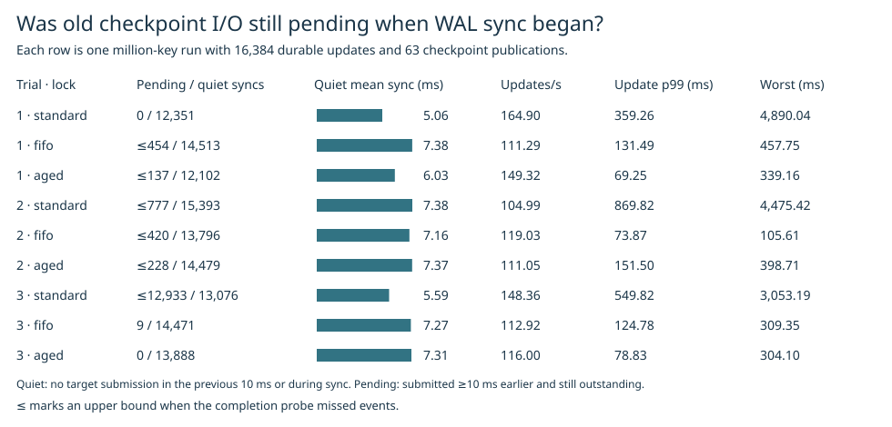

# Outstanding checkpoint data at WAL sync entry

The previous third pair measured mean WAL sync at 5.39 ms with the current lock and 7.36 ms with 16 ms priority on calls with no new checkpoint submission in the preceding 10 ms or during sync. Those recordings contained only submission events. These independent repetitions measure guest ext4 callback lifetimes and cannot retrospectively assign a completion time to an earlier request.

The second 16 ms trial reached a quiet mean of **7.370 ms**. Across the 3 usable 16 ms trials, charging the full duration of every possibly exposed quiet sync contributed at most **0.111 ms** to a run's mean. Counting only the part of each sync when an old BIO could still be outstanding lowered that ceiling to **0.108 ms**. These figures bound this specific guest-level mechanism in the measured trials. The original 1.97 ms difference and the downstream cause of longer syncs remain unresolved.

The third 16 ms capture had zero probe misses and zero ring loss. It recorded 424 checkpoint BIOs with lifetimes of at least 10 ms and 19 WAL sync starts with an old BIO still pending. Among the 13,888 quiet syncs, the count was **0**, with mean sync duration **7.312 ms**.

| Trial | Lock | Updates/s | Update p99 ms | Maximum ms | Quiet mean sync ms | Quiet syncs with old I/O / all quiet | Time on such calls per quiet sync, ms |
|---:|---|---:|---:|---:|---:|---:|---:|
| 1 | standard | 164.90 | 359.26 | 4890.04 | 5.063 | 0 / 12,351 | 0.000 |
| 1 | fifo | 111.29 | 131.49 | 457.75 | 7.378 | ≤454 / 14,513 | ≤0.250 |
| 1 | aged | 149.32 | 69.25 | 339.16 | 6.034 | ≤137 / 12,102 | ≤0.043 |
| 2 | standard | 104.99 | 869.82 | 4475.42 | 7.382 | ≤777 / 15,393 | ≤0.396 |
| 2 | fifo | 119.03 | 73.87 | 105.61 | 7.157 | ≤420 / 13,796 | ≤0.227 |
| 2 | aged | 111.05 | 151.50 | 398.71 | 7.370 | ≤228 / 14,479 | ≤0.111 |
| 3 | standard | 148.36 | 549.82 | 3053.19 | 5.591 | ≤12,933 / 13,076 | ≤5.553 |
| 3 | fifo | 112.92 | 124.78 | 309.35 | 7.271 | 9 / 14,471 | 0.020 |
| 3 | aged | 116.00 | 78.83 | 304.10 | 7.312 | 0 / 13,888 | 0.000 |

The last column charges the *entire* sync interval to any quiet call with an old BIO pending. It is a ceiling on the direct time contribution for these calls. It does not quantify downstream congestion after a callback. All nine trials ran on fresh million-key ext4 volumes at 2 CPUs and 4 GiB, with four writers, 8 MiB writeback, 16,384 durable updates and 63 independent checkpoint publications. The order rotated. Every trial checked the retained old snapshot, the latest contents and the reopened generation and values. The production binary and lock policies were unchanged.

| Lock | Updates/s range | Median updates/s | Median update p99 ms | Worst over all runs ms |
|---|---:|---:|---:|---:|
| standard | 104.99–164.90 | 148.36 | 549.82 | 4890.04 |
| fifo | 111.29–119.03 | 112.92 | 124.78 | 457.75 |
| aged | 111.05–149.32 | 116.00 | 78.83 | 398.71 |

## Locating the original 5.39 to 7.36 ms difference

Joining the original third pair's quiet request IDs to their guest fsync spans gives mean journal-commit sleep of 5.120 ms for current and 7.040 ms for 16 ms priority. The difference was +1.920 ms within the +1.975 ms change in application WAL sync. Of the journal-sleep change, +1.915 ms was between the matched JBD2 start and end events. This locates time spent sleeping while waiting for the guest journal. It does not identify what made the journal commit finish later. [Three-policy original comparison](original.csv).

**Decision.** Retain the existing lock options. The slow quiet-sync mean reproduced with zero pending target BIOs in a complete capture. These results provide no measured basis for delaying checkpoint submission to stabilize throughput. No new pacing policy was benchmarked.

## Matching and capture quality

A successful checkpoint snapshot fsync identifies the inode for its publication. On the volume device the submission hook records ext4 data BIOs for that inode across its preparation and final sync windows. The callback hook observes entry to ext4_end_bio. A live BIO pointer identifies one lifetime until that callback. Reuse starts a new lifetime. Only relative timestamps, sizes and application request IDs are exported.

Old means submitted at least 10 ms before sync entry and still pending at entry. Quiet means no target submission in [entry − 10 ms, entry) or [entry, return). The exported [clock sensitivity](clock.csv) recomputes both after moving the application clock by ±2 µs. This measures guest callback timing. The host device, metadata writes and I/O for other files are outside the instrumented data path.

Exact counts require zero ring loss, zero probe misses and complete pointer pairing. The ≤ symbol denotes a **separate conservative analysis** when only completion callbacks were missed. A missing callback can extend its inferred lifetime until a later callback at the same address, a new submission reusing that address, or the last measured response. These bounds can overstate outstanding work. Submission loss invalidates this analysis too. Full observation counts and trace quality appear in [summary.csv](summary.csv).

## Observation overhead

Two short 10,000-key, 512-update paired pilots alternated trace order. The initial probe reading inode fields at callback missed one event in each pilot. A function-entry alternative failed registration on this kernel. The final probe reads only a pointer at callback. Both lightweight pilots paired all 60 target BIOs with zero misses.

| Pilot | Untraced updates/s | Traced updates/s | Untraced p99 ms | Traced p99 ms |
|---|---:|---:|---:|---:|
| 1 | 275.80 | 264.23 | 43.18 | 41.67 |
| 2 | 247.89 | 268.41 | 59.61 | 42.04 |

These short pilots indicate the scale and variability of measurement overhead. All full runs used the same observer. See the [original lock comparison](../aged-load-2026-11-08/README.md) and [prior submission analysis](../writer-overlap-2026-11-08/README.md).

## Reproduction

Build the existing aged-writer benchmark image as catdb-aged-load and use the catdb-fifo-products observer image. Run `python benchmarks/old-bio/launch.py RAW/lean` followed by `python benchmarks/old-bio/launch.py RAW/full --full`. Run `test_old_bio.py` for interval boundary checks. The published per-trial call and lifetime tables can be replayed by passing them to the load and replay functions in `benchmarks/old-bio/replay.py`. Render the SVG with `python benchmarks/old-bio/figure.py REPORT`.
