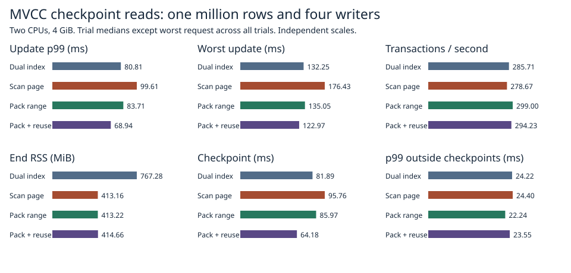

# Cost of building a 64 KiB checkpoint page from MVCC

At 1M rows, four writers, two CPUs and 4 GiB, direct page packing with one encoding per paired page measured **68.9 ms update p99, 123.0 ms worst wait and 294.2 transactions/s** at 414.7 MiB end RSS. The previous direct scan measured 99.6 ms, 176.4 ms and 278.7 transactions/s. The dual-index reference measured 80.8 ms, 132.3 ms and 285.7 transactions/s at 767.3 MiB.



| Path | p99 ms | Worst ms | Tx/s | End RSS MiB | Checkpoint ms |
|:---|---:|---:|---:|---:|---:|
| Dual index | 80.81 | 132.25 | 285.71 | 767.28 | 81.89 |
| Direct scan page | 99.61 | 176.43 | 278.67 | 413.16 | 95.76 |
| Direct pack | 83.71 | 135.05 | 299.00 | 413.22 | 85.97 |
| Direct pack + reuse | 68.94 | 122.97 | 294.23 | 414.66 | 64.18 |

The final candidate beat the original direct scan on p99, worst wait and throughput in each of the three repetitions. Against the dual-index reference it reduced p99 and worst wait in all three and led on throughput in two. Its median RSS was 1.5 MiB above the original direct scan and 352.6 MiB below dual index.

Each trial used 1M seeded rows with alternating 8/32-byte keys and 256-byte values, four closed-loop writers, two CPUs, 4 GiB of RAM, no swap, an old reader and 1,024 durable multi-key requests with three synchronous checkpoints. Rate, RSS and p99 are medians of three per-trial statistics. Worst wait covers all requests across all three trials. Each request includes conflicts, retries and admission wait. The main figures compare runs with phase recording disabled. [Final per-trial results](1m.csv) and [raw request timings](raw/1m/).

## Locating the previous slowdown

In the [preceding experiment](../direct-mvcc-2026-11-07/README.md), all six requests at the p99 rank for the dual-index and direct paths overlapped a checkpoint. The median-ranked p99 values were 84.23 and 96.95 ms. For those two actual requests, checkpoint overlap was 78.50 and 87.81 ms respectively: 9.31 ms of their 12.72 ms difference. The two overall maxima came from different trials: 131.02 and 143.51 ms with 105.56 and 124.32 ms of overlap. The extra overlap exceeded the difference in total time. Across the six trials, p99 among requests entirely outside checkpoints was 22.10–24.81 ms. These archived intervals identify where the regression appeared, but lack operation-level timers.

## Checkpoint phase experiment

| Path | Scan or scan+pack | Other assembly | Write | Sync | Remainder | Whole checkpoint |
|:---|---:|---:|---:|---:|---:|---:|
| Dual index | 0.00 | 55.30 | 18.82 | 15.82 | 4.83 | 94.76 |
| Direct scan page | 10.20 | 53.26 | 17.18 | 15.21 | 5.48 | 101.33 |
| Direct pack | 13.70 | 42.04 | 13.75 | 15.23 | 8.34 | 93.07 |
| Direct pack + reuse | 12.88 | 20.77 | 13.44 | 15.12 | 7.65 | 69.87 |

Phase values are means over three checkpoints in one separate profiled run per path. Nested timers switch categories on the same thread; the rows sum to checkpoint elapsed time up to rounding when the outer residual is included. The scan column includes public scan_page creation and copying on the original direct path. On the packed paths it includes MVCC traversal and filling the final write set while holding the state mutex. The dual-index range iteration belongs to assembly. Compare scan plus assembly across these paths. Assembly includes packing, allocating slots, framing and computing the page checksums. Writes include seek and actual write calls inside write_record; sync measures the sync_data calls. Remaining time includes directory processing, work outside markers and some control-record encoding. All times are elapsed at the application boundary. Timed write includes the two lane writes and their failure-injection hooks. The measured phases and ordering can vary between runs, particularly for individual flushes. [Per-checkpoint breakdown](phases.csv) and [profiled end-to-end statistics](diagnostic.csv).

The former direct path reserves processing bytes row by row, materializes owned scan results and copies each pair into a sorted write set for encoding. The first candidate creates the final sorted write set while walking the pinned visible versions. It holds the state mutex for at most 512 physical entries or one 64 KiB output page before releasing it; storage I/O runs after release. It reserves a conservative 1.25 MiB processing allowance once per checkpoint before touching the dirty pages. This covers temporary data and metadata conservatively, and requires available headroom even for a small checkpoint. The trial combines the copy and reservation changes, so it cannot assign separate speedups to each.

The original disk writer encoded each immutable envelope twice for the two lanes and once more to retrieve its checksum for the directory. The final candidate encodes once, feeds the same bytes to both lane writes and reads the checksum already in the encoded header. The number of writes, their order, the two independently stored copies and the real syncs follow the same protocol. The earlier three-path cohort is archived [separately](first/1m.csv), including slower trials. Packing alone had p99 172.92 ms, maximum 672.85 ms and 112.51 transactions/s in that cohort; the old direct scan had 94.51 ms, 316.65 ms and 265.83 transactions/s. Its observations are excluded from the final four-path medians.

## Safety and reproduction

The release library suite with the candidate selected checks old-generation visibility, same-key/point/range conflicts, pre-sync visibility, persistence failures and process termination at seven transaction/publication boundaries. The additional scan fixture compares output with a normal transaction for empty and partial ranges, a maximum-size row, page splitting, an old snapshot and more than two scan batches of deleted entries. The budget fixture exercises one byte below and exactly at required headroom, checks that a failed reservation preserves the update, and reopens the next successful checkpoint. Full sorted old, latest and reopened maps and recovered commit sequence are checked in every measured candidate trial. The paired-record model permits one detectably damaged copy per record. [Test results](safety.txt).

```sh
docker build -f benchmarks/scaled-gate/Dockerfile -t catdb-page-reuse .
docker run --rm --network none --cpus 2 --memory 4g --memory-swap 4g -e CATDB_TEST_PACK=1 -e CATDB_TEST_DIRECT=1 -e CATDB_TEST_REUSE=1 catdb-page-reuse cargo test --locked --release --lib -- --test-threads=1
docker run --rm --network none -e CATDB_TEST_PACK=1 -e CATDB_TEST_REUSE=1 catdb-page-reuse cargo test --locked --release --lib packed_budget_refusal -- --ignored
python benchmarks/scaled-gate/run_page_reuse.py --stage pilot --out results/pilot
python benchmarks/scaled-gate/run_page_reuse.py --stage diagnostic --out results/diagnostic
python benchmarks/scaled-gate/run_page_reuse.py --stage 1m --out results/1m
python benchmarks/scaled-gate/report_pack.py --reuse results report
```

Run in order with fresh output directories. Environments include measured Rust source hashes and the image digest. For the earlier three-path build, decompress first-image.patch.gz and apply the resulting patch in a disposable checkout, build the same Dockerfile tagged catdb-pack-gate and run run_pack.py for the same stages.
