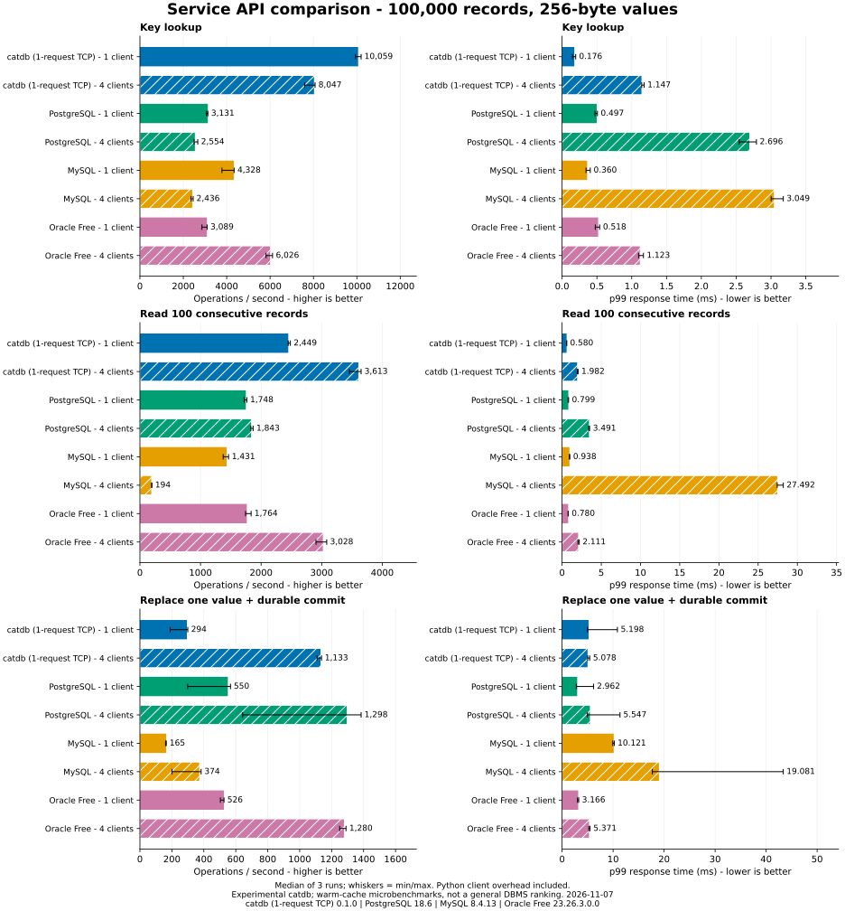
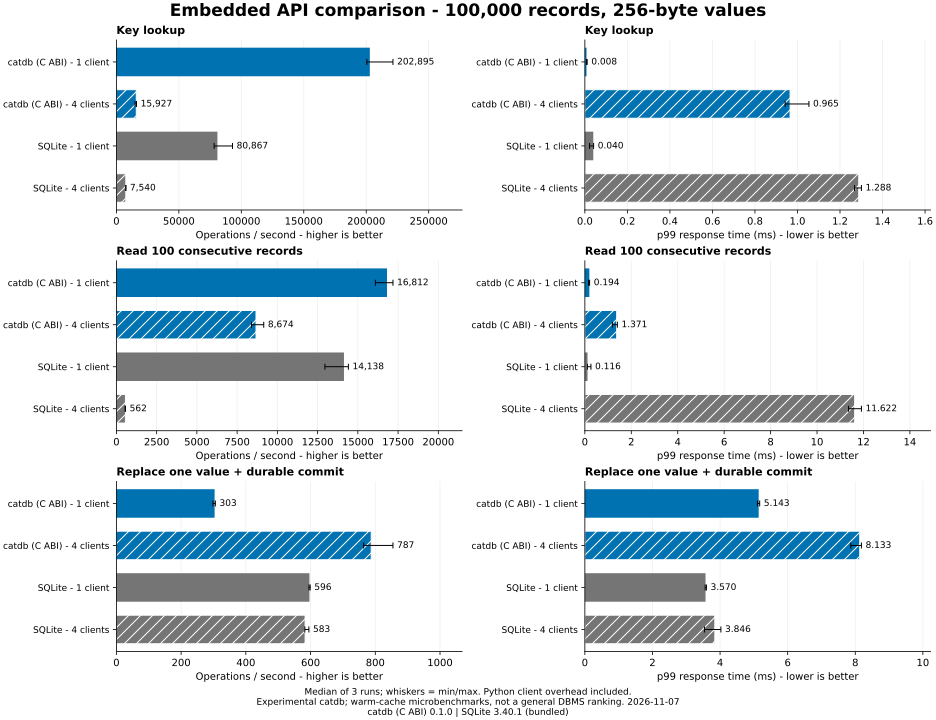
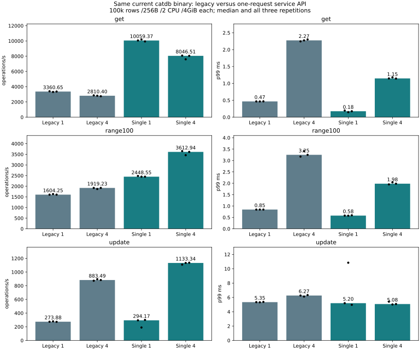

# Refreshed product API comparison — 2026-11-07

**Experimental.** This is a warm-cache, Python-client-observed key/value
microbenchmark. It is not a SQL/TPC benchmark, general DBMS ranking, engine ceiling
or evidence of equivalent SQL features, isolation guarantees or production readiness.

## Findings

All numbers below are medians of three independent runs, not pooled percentiles.

| Service API | Four-client updates/s | Update p99 ms | Key lookups/s | 100-row reads/s |
|---|---:|---:|---:|---:|
| catdb, one request | 1,133.3 | 5.078 | 8,046.5 | 3,612.9 |
| PostgreSQL | 1,297.9 | 5.547 | 2,553.9 | 1,843.1 |
| MySQL | 374.2 | 19.081 | 2,435.8 | 194.2 |
| Oracle Free | 1,280.0 | 5.371 | 6,026.3 | 3,027.6 |

catdb leads the four-client lookup and 100-row read paths in this particular
client benchmark. PostgreSQL and Oracle Free complete more four-client durable
updates, while catdb's median update p99 is lower. PostgreSQL's update throughput
varied substantially across repetitions; the min/max whiskers retain this variation.
The MySQL adapter uses PyMySQL, and catdb uses hex JSON: driver and materialization
costs are included, so these differences cannot be attributed solely to engines.

For embedded single-client updates, SQLite achieves 596.5/s versus catdb 303.5/s,
and p99 3.570ms versus 5.143ms. At four clients catdb completes more updates
(787.4/s versus 583.1/s), but has worse p99 (8.133ms versus 3.846ms). The single-client
100-row read p99 also favors SQLite, despite catdb having higher throughput.

The same current catdb binary with the legacy adapter achieved 883.5
four-client updates/s versus 1,133.3 through the one-request adapter.
The supplementary legacy runs followed the main comparison, rather than being
interleaved; environmental drift limits causal interpretation. Both full timing
sets are retained. Historical November 5 results remain available, but are not
combined with these fresh peer runs to create a cross-date ranking.

## Why Oracle can be fast — and what this test does not establish

Oracle separates modifications in the buffer cache from sequential redo writing
by its log writer. Commit acknowledgement can depend on durable redo rather
than writing every changed data block immediately. This separation reduces the
work required on the commit path. See the official
[LGWR description](https://docs.oracle.com/en/database/oracle/oracle-database/26/dbiad/db_LGWR.html)
and [background-process concepts](https://docs.oracle.com/en/database/oracle/oracle-database/26/cncpt/database-concepts.pdf).
Oracle also documents group commit and distinct WAIT/NOWAIT semantics in
[COMMIT](https://docs.oracle.com/en/database/oracle/oracle-database/26/sqlrf/COMMIT.html).

This run explicitly uses WAIT and IMMEDIATE; it does not relax durability to win
latency. catdb already uses logging, group commit and deferred data checkpointing.
The high-level design alone therefore does not explain the remaining gap.
This benchmark collects client latency, not Oracle LGWR waits or OS I/O traces:
it cannot prove whether remaining differences arise from log I/O, scheduling,
client conversion, protocol exchanges or engine internals. Oracle Free results
must not be generalized to Enterprise Edition, RAC or Exadata.

## Conditions and versions

- Current catdb engine source: `ecc1029e678d45c410bad6e65fd2298debf70c9f`.
  Only comparison adapters/reporting changed for this run; no engine tuning.
  Default inline-latest is enabled; wire-buffer, inline-key and diagnostics are off.
- 100,000 synthetic ordered eight-byte keys, 256-byte values; uniform random hit
  lookup, 100 consecutive rows, replacement plus durable commit. Disjoint writer
  keys avoid intentional conflicts. No joins, secondary indexes or mixed load.
- One/four reused connections, 8000 attempted operations per case, three runs,
  fresh volumes each product/run; product order changes and case order is seeded.
  Closed-loop requests include conversion, request/response and commit/rollback;
  connection warmup and verification are outside timing. No coordinated-omission
  correction or overload-capacity claim. Every update has a different stamp.
- Current service main path: get_latest/scan_latest/put_commit, one request per
  operation. Legacy supplement: explicit begin/get-or-put/rollback-or-commit.
  Full verification uses explicit snapshot transactions in both paths. A latest
  scan is one snapshot, not a retained multi-page transaction.
- Windows host, Docker Desktop Linux/WSL2, Ryzen 9 5950X (16 cores/32 threads),
  137352949760 bytes physical RAM. Each server and client/embedded container has
  a 2-CPU quota and 4GiB limit, with no CPU affinity. Service tests have an extra
  client container and are graphed separately from embedded tests. This is not
  the 1-CPU/512MiB experiment. Fresh named volumes; no Windows bind-mounted DBs.
- One product at a time; ordinary host activity is not fully isolated. Caches
  are warmed by verification. Normal automatic maintenance is enabled; catdb is
  checkpointed after load. No explicit timed checkpoint or cold-read claim.
- SQLite WAL/FULL, PostgreSQL fsync/synchronous_commit on, MySQL flush-at-commit=1
  and sync_binlog=1, Oracle WAIT/IMMEDIATE. SQL adapters request SERIALIZABLE except
  Oracle bulk initialization; that label does not make anomaly guarantees equal.
  catdb requests sync-before-success. Storage must honor synchronization.

Exact engine banners, Python packages, image digests and configuration queries:
[main environment](main/environment.json). These are the available installed
versions, not a claim to compare every product's newest release. Bundled SQLite
is 3.40.1. See [the shared method](../../../benchmarks/README.md) for adapter details.

## Integrity and measured outcomes

All **1,008,000 operations** across 126 main/supplementary cases completed without
operation errors or retries. All **168 full-content checks** passed, including
21 reopen/restart checks. Deterministic final key/value hashes match across products
and across both catdb service paths. Missing keys, empty ranges, last-record bounds
and empty initial databases were checked. A preliminary 1000-row/100-operation
smoke also passed for all six API paths before performance runs began.

The validator recomputes throughput and percentiles from all raw samples, verifies
source hashes, and checks configuration/version stability. These are ordinary
restart checks, not new process-kill, physical power-cut or mission-critical tests.
No failed run was replaced or favorable repetition selected.

## Same-binary API supplement

| API | Clients | Work | ops/s | p50 ms | p95 ms | p99 ms |
|---|---:|---|---:|---:|---:|---:|
| legacy | 1 | get | 3360.646 | 0.282 | 0.389 | 0.467 |
| legacy | 4 | get | 2810.403 | 1.396 | 1.978 | 2.274 |
| single | 1 | get | 10059.371 | 0.094 | 0.130 | 0.176 |
| single | 4 | get | 8046.507 | 0.461 | 0.890 | 1.147 |
| legacy | 1 | range100 | 1604.249 | 0.608 | 0.751 | 0.845 |
| legacy | 4 | range100 | 1919.231 | 2.049 | 2.832 | 3.249 |
| single | 1 | range100 | 2448.546 | 0.398 | 0.499 | 0.580 |
| single | 4 | range100 | 3612.938 | 1.072 | 1.668 | 1.982 |
| legacy | 1 | update | 273.885 | 3.739 | 4.382 | 5.345 |
| legacy | 4 | update | 883.489 | 4.516 | 5.405 | 6.267 |
| single | 1 | update | 294.174 | 3.546 | 4.024 | 5.198 |
| single | 4 | update | 1133.336 | 3.588 | 4.223 | 5.078 |

## Reproduce and inspect all outcomes

[Commands and verification perspectives](../../../benchmarks/peer-refresh/README.md).
Use the recorded image identities to preserve versions. The main runner requires
`--single-request`; omit it for the legacy supplement. The harness image was built
with Rust 1.89 and locked dependencies. Source hashes describe the measured working
tree; the engine commit above describes the runtime source.

[All main cases](main/results.json), [all main percentiles](main/table.md),
[legacy cases](legacy/results.json), and the numeric per-operation gzip files in
each directory retain all outcomes. The image IDs and sanitized runtime metadata
contain no generated credentials. Full operational logs remain local.

SQL Server was not measured or assigned a zero bar: the previously selected SQL
Server 2022 Developer/Express/Evaluation license requires written approval for
benchmark disclosure, which has not been obtained. See
[section 5](https://www.microsoft.com/content/dam/microsoft/usetm/documents/sql-server/sql-server-2022-developer-express-evaluation/retail-packaged/SQLServer2022_SQLServer2022DeveloperExpressEvaluation_English.pdf/).
Oracle Free was obtained under its
[Free Use Terms](https://www.oracle.com/downloads/licenses/oracle-free-license.html).
