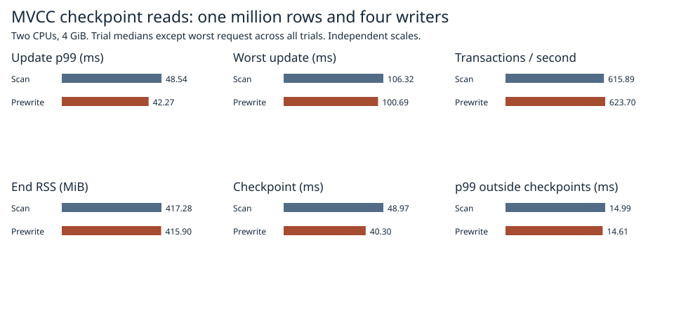
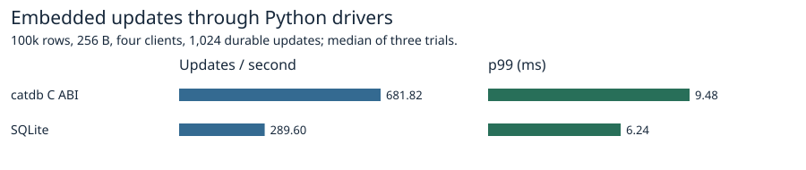
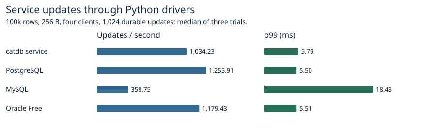

# Prewriting committed MVCC ranges before checkpoint publication

[Measured Rust sources](https://github.com/dhq-boiler/catdb/tree/7151adaf8091198fe13205adb6b5f9ed4d17e19b/benchmarks/scaled-gate). The prototype stages sealed 64 KiB pages in free paired slots. A subsequent commit invalidates every staged source range it touches. The foreground checkpoint reuses surviving references, rebuilds the other ranges, syncs the page file, then publishes the directory. The log still syncs on commit. Restart ignores unreferenced slots. The design was inspired by the division of work between DBW and LGWR in [Oracle Database Concepts](https://docs.oracle.com/en/database/oracle/oracle-database/19/cncpt/process-architecture.html). catdb retains the existing page-file sync before publishing the root. The storage format and production defaults are unchanged.

## Four writers on one million rows

Both policies use the same grouped FIFO commits, two CPUs, 4 GiB, 1,024 updates and three checkpoints with a pinned old reader. Each policy ran three times in alternating order, with verification of the current and retained old views plus a fresh-process reopen. The worker wakes after 4 ms and acquires the same writer turn for a batch of at most four ranges. The retained-page cap is 96 pairs (12 MiB of slot capacity). Split and empty ranges use the existing final scan. The worker can prepare pages for a fourth, untimed checkpoint; its page writes are included in total bytes. Counters are logical page-file write bytes including both copies.

| Metric | Publish-time scan | Prewrite |
|---|---:|---:|
| Update p99 (ms), trial median | 48.54 | 42.27 |
| Slowest update (ms), all trials | 106.32 | 100.69 |
| Transactions/s, trial median | 615.89 | 623.70 |
| Foreground checkpoint (ms), median of trial medians | 48.97 | 40.30 |
| End RSS (MiB), trial median | 417.28 | 415.90 |

[Each trial](1m.csv), [worker and foreground writes](write-volume.csv), [request samples and environment](raw/final/1m/).

Across the three pairs, update p99 and foreground checkpoint time fell in all three. The maximum fell in two pairs and rose in one. Median throughput increased 1.3%. Every measured checkpoint reused 96 ranges (288 per trial). Median total page writes rose from 126.07 to 140.40 MiB, about 11.4%. Retain this as an experiment: selective scheduling might reduce redundant writes to hot ranges and prewrites after the last checkpoint. Three local trials do not establish a universal latency advantage.

## Controlled reuse pilot

12,000 rows, sixteen prepared ranges, followed by sixteen commits to either the same ranges or different ones. Each batch is run synchronously before the follow-up updates to control invalidation. Times below are medians of three trials. Page bytes exclude WAL and manifest I/O. The final distributed pilot had 100% reuse, yet its median foreground pause of 17.05 ms slightly exceeded the 16.92 ms baseline. This small test establishes reuse and byte accounting; the longer concurrent test measures latency. Prewrite plus foreground time is a sum of two timed phases and excludes intervening commits.

| Later updates | Prepared pages reused | Scan / prewrite foreground (ms) | Scan / prewrite phase sum (ms) | Scan / prewrite page writes (MiB) |
|---|---:|---:|---:|---:|
| other ranges | 16/16 | 16.92 / 17.05 | 16.92 / 19.20 | 3.99 / 3.99 |
| same ranges | 0/16 | 16.54 / 13.82 | 16.54 / 15.89 | 2.00 / 3.99 |

[All pilot trials](pilot.csv). A shorter final pause can coexist with more work in the rest of the run. Neither the prior nor current sample size establishes the cause of an individual outlier.

## Failure and lifecycle checks

The focused tests cover a sub-pair byte budget, a full staging allowance, repeated invalidation within a fixed file extent, conflicting reads, retained old snapshots, a split and full deletion, a failed partial page write and retry, and process termination during a speculative page write, immediately before and after page sync, and during and after selector publication. All crash fixtures reopen the committed generation and check every value. These are process-termination tests under the existing paired-record failure model.

[Focused checks and measured pilot](raw/final-pilot.txt), [serial release library suite](raw/serial-suite.txt). An earlier full-suite parallel run encountered file-lock errors in two existing reopen tests. [Output from that run](raw/initial-suite.txt).

## Reproduction

Run from the repository root with Linux Docker containers and new output directories.

~~~sh
docker build -f benchmarks/scaled-gate/Dockerfile -t catdb-prewrite .
docker run --rm --cpus 2 --memory 4g --memory-swap 4g -e CATDB_TEST_ARRIVALS=1 -e PREWRITE_COUNTS=1 catdb-prewrite cargo test --locked --release --lib '::prewrite_' -- --ignored --nocapture --test-threads=1 > pilot.txt
python benchmarks/scaled-gate/run_prewrite.py --stage 1m --out raw/1m
python benchmarks/scaled-gate/report_pack.py --prewrite raw report
python benchmarks/scaled-gate/report_prewrite.py pilot.txt raw/1m report
~~~

[Final parallel suite](raw/final-parallel.txt). The [earlier version](raw/mixed/1m/) advanced its free-slot cursor monotonically until publication. Repeated invalidation could grow its page file. The measured final version makes invalidated slots available to the next worker batch.

## Current cross-product reference

The independent product benchmark uses 100,000 rows, 256-byte values, four clients and 1,024 synchronous single-key updates, three trials per engine. catdb uses its published C ABI and service interfaces. The prewrite prototype only exists in the native test backend; the million-row chart above measures it. Database checksums agree after reopening in each repetition.

[Product medians](products.csv), [versions, settings, latency samples and verification](raw/products/).

~~~sh
docker build -f benchmarks/Dockerfile -t catdb-prewrite-products .
python benchmarks/run.py --image catdb-prewrite-products --single-request --four-updates --rows 100000 --ops 1024 --reps 3 --out products
python benchmarks/scaled-gate/report_prewrite_products.py products report
~~~
