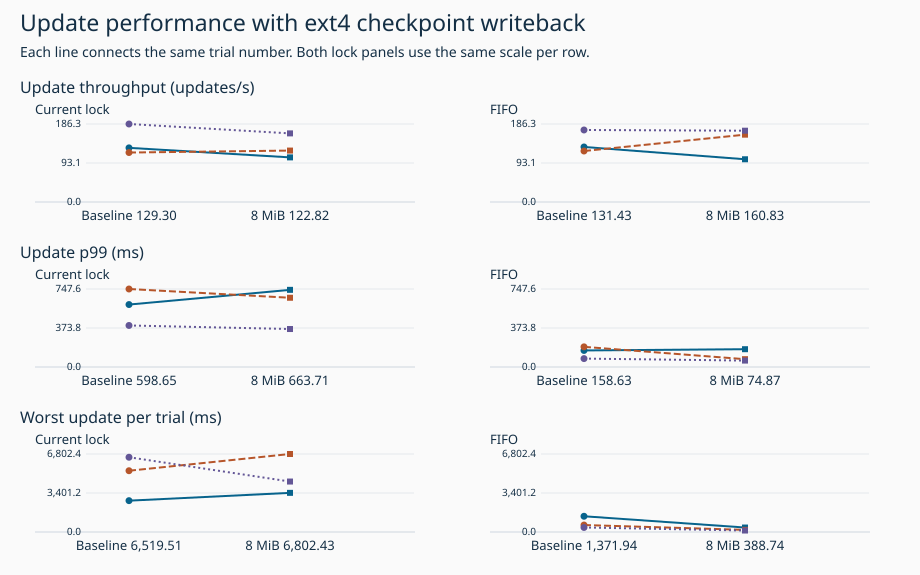
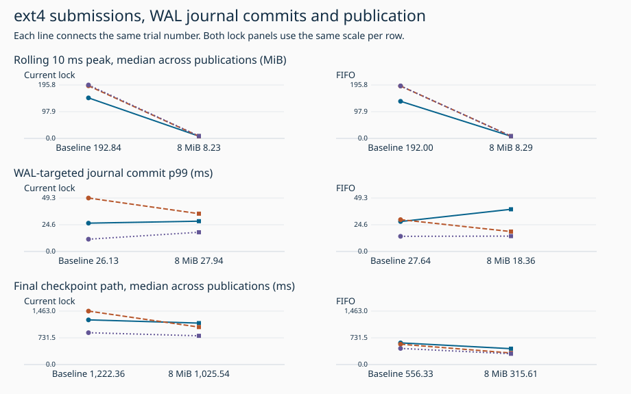
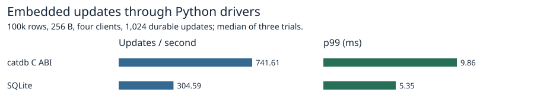
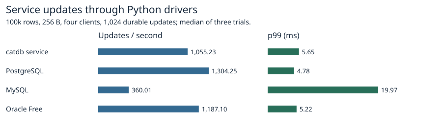

# Production ext4 checkpoint range writeback

With the production configuration API, update p99 changed from **598.65 to 663.71 ms** with the current lock and **158.63 to 74.87 ms** with FIFO. FIFO WAL-targeted journal p99 changed from **27.64 to 18.36 ms**. All twelve measurements used fresh volumes. Disabling and enabling writeback was the only engine setting changed within each lock pair.

| Lock | Measure | Disabled | Enabled | Production change | Prior prototype change |
|---|---|---:|---:|---:|---:|
| standard | Update throughput (updates/s) | 129.30 | 122.82 | -5.0% | +17.4% |
| standard | Update p99 (ms) | 598.65 | 663.71 | +10.9% | -22.7% |
| standard | Worst update per trial (ms) | 6,519.51 | 6,802.43 | +4.3% | -42.4% |
| standard | Rolling 10 ms peak, median across publications (MiB) | 192.84 | 8.23 | -95.7% | -93.7% |
| standard | WAL-targeted journal commit p99 (ms) | 26.13 | 27.94 | +6.9% | -35.0% |
| standard | Final checkpoint path, median across publications (ms) | 1,222.36 | 1,025.54 | -16.1% | -24.9% |
| standard | Submitted bytes in 10 ms bins of at least 32 MiB (%) | 97.72 | 0.00 | -100.0% | -100.0% |
| standard | Throughput including drain (updates/s) | 129.30 | 120.17 | -7.1% | +17.4% |
| standard | Application writes including WAL (MiB) | 17,199.26 | 17,170.03 | -0.2% | +0.0% |
| fifo | Update throughput (updates/s) | 131.43 | 160.83 | +22.4% | +6.9% |
| fifo | Update p99 (ms) | 158.63 | 74.87 | -52.8% | -49.3% |
| fifo | Worst update per trial (ms) | 1,371.94 | 388.74 | -71.7% | -43.5% |
| fifo | Rolling 10 ms peak, median across publications (MiB) | 192.00 | 8.29 | -95.7% | -93.9% |
| fifo | WAL-targeted journal commit p99 (ms) | 27.64 | 18.36 | -33.5% | +10.7% |
| fifo | Final checkpoint path, median across publications (ms) | 556.33 | 315.61 | -43.3% | -25.2% |
| fifo | Submitted bytes in 10 ms bins of at least 32 MiB (%) | 97.31 | 0.00 | -100.0% | -100.0% |
| fifo | Throughput including drain (updates/s) | 131.43 | 160.83 | +22.4% | +6.9% |
| fifo | Application writes including WAL (MiB) | 17,173.97 | 17,173.93 | -0.0% | +0.2% |

Throughput and p99 are medians of three trials per arm. Maximum update is the worst across all three. Each figure line shows one trial pair. Its axis labels use the aggregates in the table. The previous column uses the separate [test-only prototype campaign](../range-writeback-2026-11-08/README.md).

| Lock | Measure | Pairs improving | Median paired change | Pair 1 off → on | Pair 2 off → on | Pair 3 off → on |
|---|---|---:|---:|---:|---:|
| standard | Update throughput | 1/3 | -12.0% | 129.3 → 106.5 | 118.1 → 122.8 | 186.3 → 163.9 |
| standard | Update p99 | 2/3 | -8.6% | 598.7 → 739.6 | 747.6 → 663.7 | 398.1 → 364.0 |
| standard | Worst update per trial | 1/3 | +24.9% | 2,733.1 → 3,414.3 | 5,343.5 → 6,802.4 | 6,519.5 → 4,400.5 |
| standard | WAL-targeted journal commit p99 | 1/3 | +6.9% | 26.1 → 27.9 | 49.3 → 34.9 | 11.3 → 17.7 |
| fifo | Update throughput | 1/3 | -1.0% | 131.4 → 102.0 | 121.8 → 160.8 | 172.0 → 170.3 |
| fifo | Update p99 | 2/3 | -23.7% | 158.6 → 170.6 | 193.2 → 74.9 | 80.6 → 61.5 |
| fifo | Worst update per trial | 3/3 | -69.4% | 1,371.9 → 388.7 | 607.7 → 185.9 | 394.9 → 128.7 |
| fifo | WAL-targeted journal commit p99 | 1/3 | +1.4% | 27.6 → 38.9 | 29.4 → 18.4 | 14.0 → 14.2 |

## Slowest request in each arm

The two overlap columns are subsets of writer lock wait. Each row describes a single request, including retries.

| Lock | Setting | Trial | Total ms | Writer lock wait ms | Wait overlapping checkpoint lock hold ms | Wait overlapping other WAL syncs ms | Own WAL sync ms |
|---|---|---:|---:|---:|---:|---:|---:|
| standard | baseline | 3 | 6,519.51 | 6,513.78 | 31.31 | 6,409.20 | 5.49 |
| standard | range8 | 2 | 6,802.43 | 6,788.74 | 35.46 | 6,673.02 | 13.38 |
| fifo | baseline | 1 | 1,371.94 | 1,361.40 | 0.00 | 1,360.71 | 10.35 |
| fifo | range8 | 1 | 388.74 | 346.51 | 0.00 | 345.80 | 41.93 |

## Conditions and measurement

One million 256-byte values, four writers, 2 CPUs, 4 GiB without swap, 16,384 durable updates and 63 independent checkpoint publications per trial on a WSL2 ext4 volume. The prefix is enabled in both arms. Each pair ran the same release-mode Rust test executable and observer with the order reversed in the second round. The workload called the public Database setter before the initial seed checkpoint and ran the ordinary production checkpoint code. Application latency includes retries. The journal interval is the matching JBD2 start to end for a WAL wait. Whole-request latency also covers lock waits and other writers. Publication time starts at handoff to the final checkpoint path and ends when the call returns. Worst absolute paired change in logical or guest-submitted checkpoint bytes was 0.222% because checkpoint timing can alter suffix length. Maximum observed checkpoint bytes in any rolling 10 ms window across all publications were 224.53 MiB disabled and 8.70 MiB enabled.

The observer matches data submissions by device, inode and checkpoint lifetime, checks for lost events, and verifies the application write total for every publication. Each trial verifies the held snapshot, final records, commit sequence and reopened data. [All trials](trials.csv) · [756 publications](publications.csv) · [Pilot trials](pilot-trials.csv) · [Trace quality](trace-quality.csv) · [Journal cohorts](journal-groups.csv) · [P99 and worst requests](tail-requests.csv) · [Image IDs](images.json). The compressed update and epoch tables are per trial.

## Incomplete kernel captures

The following trials completed the workload and reopened successfully. Kernel ring loss prevented a WAL journal p99. Their application results are preserved separately. Only the affected arm was repeated, with the same observer configuration.

| Lock | Setting | Trial | Lost events | Updates/s | Update p99 ms | Maximum ms |
|---|---|---:|---:|---:|---:|---:|
| fifo | baseline | 3 | 33156 | 120.98 | 268.20 | 718.45 |

[Excluded captures](excluded.csv). Using the incomplete attempt in an application-only throughput sensitivity check gives 2/3 faster pairs for fifo, compared with 1/3 in the retained campaign.

## Reproduction

Build benchmarks/scaled-gate/Dockerfile.fifo as catdb-prod-range8-final. Prepare catdb-fifo-products as described in the [previous benchmark](../ext4-checkpoint-bytes-2026-11-08/README.md). Run `python benchmarks/production-range-writeback/run.py FRESH_RAW_DIR FRESH_REPORT_DIR`. The container needs access to the guest trace events and a disposable ext4 volume. The service and C ABI checks exercise a separately built regular release library and executable.

## Enabling the option

The setting defaults to **off** for every database open. On 64-bit Linux with the database and checkpoint destination on ext4, an embedded Rust application can enable it by calling `db.set_checkpoint_range_writeback(true)?`. To disable it, pass `false`. Cloned handles share the policy. A checkpoint captures it at the start, including when a prepared prefix is finished later. The file format and final snapshot, WAL-suffix and publication synchronization protocol are unchanged.

For the service, set `CATDB_EXT4_CHECKPOINT_WRITEBACK=1` before startup (in Docker, pass `-e CATDB_EXT4_CHECKPOINT_WRITEBACK=1`). Unset or `0` selects the default. The C ABI adds `int32_t ndb_tx_set_checkpoint_range_writeback(uint64_t db, uint32_t enabled)`. Valid inputs are 0 and 1. Success returns 0, an invalid flag or closed handle returns 1, and an unsupported mount/platform returns 27.

Enabling requires a 64-bit Linux process and an ext4 mount as seen by that process. The engine matches an opened file's mount ID to its filesystem type via procfs, including the unpublished replacement at checkpoint start. An overlay or tmpfs is rejected. Lookup and writeback errors propagate. New service databases also validate their destination before creation. Range requests start writeback for completed 8 MiB extents. The ordinary final fsync persists the partial last range and updated header. [Linux mount IDs](https://man7.org/linux/man-pages/man5/proc_pid_fdinfo.5.html) · [Mount filesystem types](https://man7.org/linux/man-pages/man5/proc_pid_mountinfo.5.html) · [Range writeback semantics](https://man7.org/linux/man-pages/man2/sync_file_range.2.html).

## Safety and released-interface checks

The 9 MiB fixture injects a storage-full error after snapshot writing, then exits child processes before final sync, after snapshot sync, and after publication. Both lock modes restored all 2,304 values and the concurrent committed update. Tests with an ext4 volume cover policy capture across cloned handles and reopening, held readers, and point/range conflicts. The tmpfs and native Windows tests verify rejection, disablement and continued checkpoint/reopen. The separately built regular Linux service and cdylib exercised the public entry points on ext4, invalid input, closed handles and unsupported storage. To reproduce the release checks, build benchmarks/Dockerfile, mount a fresh ext4 volume at /data and the release_smoke.py script at /check.py, and run python /check.py inside that isolated Linux container. Process exits exercise guest-level recovery. [Test outcomes](safety.txt) · [Release smoke test](../../../benchmarks/production-range-writeback/release_smoke.py).

## Released interfaces and other products

The separate workload uses 100,000 rows, 256-byte values, four clients and 1,024 single-key synchronous updates. Each of the three runs per interface verified the full digest after restart. catdb uses its normal default settings in this suite. It does not schedule the 63 checkpoints used to measure the new option.

[Product medians](peers/products.csv) · [Versions, settings and verification](peers/environment.json) · [Per-run results](peers/results.json).
