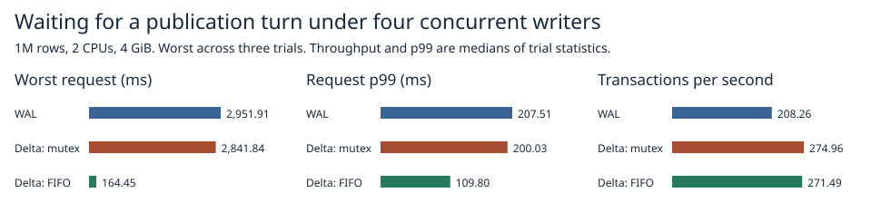

# Four-writer publication waits on 64 KiB checkpoints

FIFO publication completed 271.5 transactions/s at p99 109.8 ms. The worst request across three runs fell from 2,841.8 ms with the original delta mutex to **164.4 ms**. WAL measured 208.3 transactions/s, p99 207.5 ms and a 2,951.9 ms worst request. The original delta path was slightly faster on throughput (275.0 transactions/s).



| Path | Tx/s | p99 ms | Worst ms | Retries per run | End RSS MiB |
|:---|---:|---:|---:|---:|---:|
| WAL | 208.26 | 207.51 | 2,951.91 | 8.00 | 409.25 |
| Original delta mutex | 274.96 | 200.03 | 2,841.84 | 3.00 | 445.07 |
| FIFO delta | 271.49 | 109.80 | 164.45 | 3.00 | 444.75 |

These are 1,024 multi-key transactions over one million 256-byte values, four closed-loop writing threads, two CPUs and 4 GiB RAM with zero swap. Three checkpoints and all conflict retries are included. Each implementation occupied each trial position once. The table uses the median of three trial statistics and the worst individual request across all trials. [Individual trials](1m.csv). [Raw timings and measured source hashes](raw/).

## Attribution of the long request

The previous 2,242.86 ms request intersected a checkpoint for 117.50 ms. The archived timestamps establish 2,125.36 ms outside checkpoints and 510 concurrent completions. They contain no lock or scheduler markers for that request. The following observations come from new executions of the same workload.

| Probe / run | Worst | Checkpoint | Outside | Writer outside | Admission outside | Runnable outside |
|:---|---:|---:|---:|---:|---:|---:|
| 2-observed | 636.33 | 118.83 | 517.49 | 236.58 | 275.87 | 0.000 recorded in sampled spans |
| 3-observed | 538.63 | 110.75 | 427.88 | 328.36 | 98.20 | 0.000 recorded in sampled spans |
| 2-light | 969.63 | 0.00 | 969.63 | 964.74 | 0.00 | ≤ 0.147 |
| 3-light | 1,133.06 | 119.39 | 1,013.67 | 1,009.40 | 0.07 | ≤ 0.024 |

Times in the attribution table are milliseconds for each traced run's slowest request. “Outside” subtracts the union of timed checkpoint intervals. “Writer” starts after ordinary admission and ends after acquiring the publication mutex. It holds shared admission during that wait, so checkpoints cannot overlap it. “Admission” includes the ordinary shared gate, rollover's exclusive gate and draining in-flight requests. Preparation, retry bookkeeping, commit and marker edges account for the remainder. All are elapsed intervals on one monotonic clock.

The detailed probes read the current thread's Linux schedstat counters at each boundary. CPU execution and time runnable on a CPU queue are components of a phase. Adding runnable wait to the elapsed lock-acquisition interval would double-count it. Signed residuals include blocked time, counter granularity and unobserved causes. An interval straddling a checkpoint has bounds on its outside-checkpoint runnable time; the trace cannot assign individual wakeups within it. A CPU contention probe pinned four processes to one CPU and registered 706.44 ms of runnable wait on the target process. The counter counts guest runnable wait including preemption.

The lightweight probes timestamp phases and read each worker's schedstat only at the beginning and end of its whole workload. Its total recorded runnable delay gives an upper bound for any individual request on that thread. The light span CSV leaves per-phase CPU/runnable fields empty. The trace buffers are capped at 128 intervals per request and validated for order, contiguity and request coverage. [Detailed spans](diagnostic-slow-spans.csv) and [lightweight spans](light-slow-spans.csv).

Diagnostic (off → on, two runs per setting): throughput 279.62 → 274.80 transactions/s, p99 153.99 → 190.41 ms and median of run maxima 2,296.43 → 587.48 ms. Light (off → on, two runs per setting): throughput 279.83 → 280.41 transactions/s, p99 234.86 → 258.59 ms and median of run maxima 1,879.65 → 1,051.35 ms. The frequency and magnitude of rare stalls vary with instrumentation and trial order. The main comparison disables both observers.

## Publication and recovery

The candidate assigns tickets on arrival at publication after shared admission. A condition variable parks the waiting threads. The current owner advances the turn on exit, including a conflict that must retry. Checkpoint admission, optimistic validation, actual log sync and visibility order use the same paths as the original experiment. FIFO applies at each publication attempt. A retry takes a new ticket.

Safety checks verify queue order/drain, point, range and write conflicts, old snapshots, and latest and reopened data against replay in recorded commit order. Both dual-record paths pass the existing pre-/post-sync and selector-publication crash tests, including the follow-up fixture routing acknowledgments through the ticket gate. Process termination leaves the host running. The final Linux release library suite passed 102 tests with 24 opt-in entries skipped. [Test outcomes](safety.txt).

## Reproduction

The original diagnostic and performance cohorts used the first image. The follow-up image adds the lightweight observer and explicitly exercises FIFO during the child-process crash test. The reverse patch reconstructs the initial measured sources in a disposable checkout. Each stage records the exact image digest and Rust source hashes.

```sh
python -c "import gzip,pathlib; pathlib.Path('first-image.patch').write_bytes(gzip.decompress(pathlib.Path('docs/benchmarks/publication-waits-2026-11-07/first-image.patch.gz').read_bytes()))"
git apply first-image.patch
docker build -f benchmarks/scaled-gate/Dockerfile -t catdb-wait-gate .
python benchmarks/scaled-gate/run_wait.py --stage pilot --out results/pilot
python benchmarks/scaled-gate/run_wait.py --stage diagnostic --out results/diagnostic
python benchmarks/scaled-gate/run_wait.py --stage 1m --out results/1m
git apply -R first-image.patch
docker build -f benchmarks/scaled-gate/Dockerfile -t catdb-wait-lite .
docker run --rm --network none --cpus 2 --memory 4g --memory-swap 4g -e SCALED_FIFO=1 catdb-wait-lite cargo test --locked --release --lib -- --test-threads=1
python benchmarks/scaled-gate/run_wait.py --stage light --out results/light
python benchmarks/scaled-gate/report_wait.py results report
```
