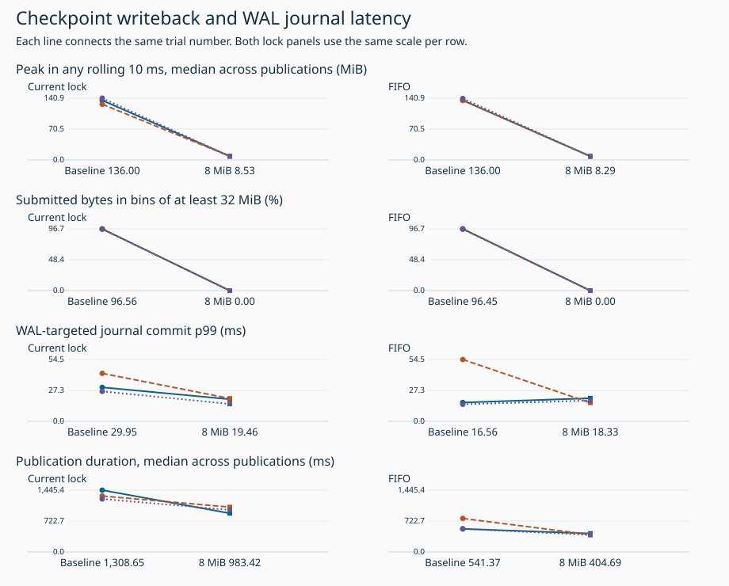
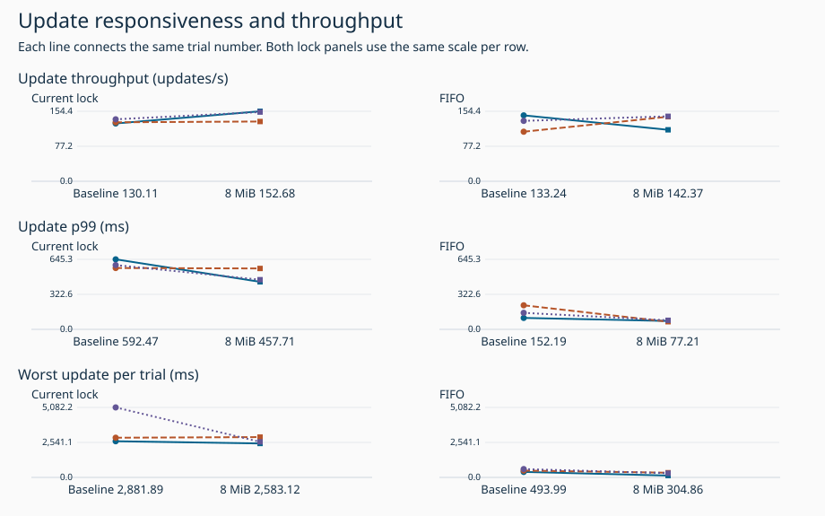
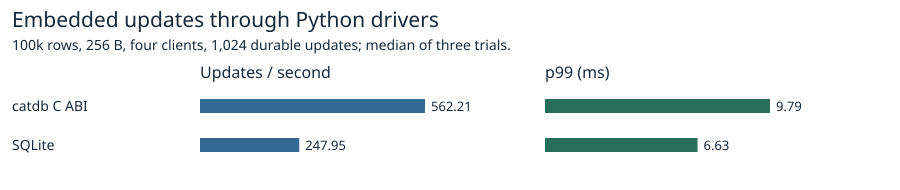
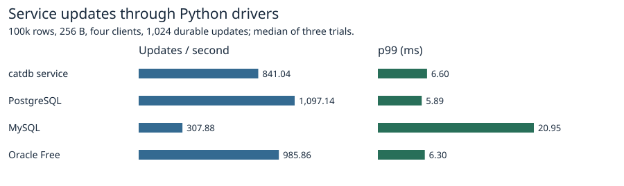

# Scheduling checkpoint writeback every 8 MiB on ext4

The baseline writes the replacement snapshot and synchronizes it before publication. The candidate additionally requests asynchronous writeback of each completed, nonoverlapping 8 MiB snapshot range. The same test executable supports both arms within each lock mode. The final snapshot sync, tail WAL sync, atomic replacement and directory sync retain their original ordering.

During WAL-targeted commits, epochs with at least 32 MiB submitted exclusively for other checkpoint targets fell from 90 to 21 with the current lock and from 83 to 7 with FIFO (three trials per arm). In the fixed first 5 ms of commits lasting at least 5 ms the counts were 49 to 0 and 36 to 0. A long commit can still accumulate several 8 MiB ranges. The FIFO journal p99 and whole-update p99 can move in opposite directions because a request also waits for other writers and checkpoint publication.

| Measure | Current baseline | Current 8 MiB | Change | FIFO baseline | FIFO 8 MiB | Change |
|---|---:|---:|---:|---:|---:|---:|
| Update throughput (updates/s) | 130.11 | 152.68 | +17.4% | 133.24 | 142.37 | +6.9% |
| Update p99 (ms) | 592.47 | 457.71 | -22.7% | 152.19 | 77.21 | -49.3% |
| Worst update per trial (ms) | 5,082.18 | 2,927.37 | -42.4% | 605.45 | 341.87 | -43.5% |
| Peak in any rolling 10 ms, median across publications (MiB) | 136.00 | 8.53 | -93.7% | 136.00 | 8.29 | -93.9% |
| Submitted bytes in bins of at least 32 MiB (%) | 96.56 | 0.00 | -100.0% | 96.45 | 0.00 | -100.0% |
| WAL-targeted journal commit p99 (ms) | 29.95 | 19.46 | -35.0% | 16.56 | 18.33 | +10.7% |
| Publication duration, median across publications (ms) | 1,308.65 | 983.42 | -24.9% | 541.37 | 404.69 | -25.2% |
| Throughput including final drain (updates/s) | 130.11 | 152.68 | +17.4% | 133.24 | 142.37 | +6.9% |
| First prefix start through last publication (s) | 124.55 | 105.92 | -15.0% | 121.44 | 113.18 | -6.8% |
| WAL-targeted journal commit median (ms) | 6.34 | 5.83 | -8.0% | 6.45 | 6.26 | -2.8% |
| All application writes incl. WAL (MiB) | 17,181.27 | 17,186.60 | +0.0% | 17,144.07 | 17,173.94 | +0.2% |

| Pairs improving with 8 MiB | Throughput | Update p99 | Worst update | Journal p99 |
|---|---:|---:|---:|---:|
| standard | 3/3 | 3/3 | 2/3 | 3/3 |
| fifo | 2/3 | 3/3 | 3/3 | 1/3 |

The table uses three-run medians except for worst update, which is the maximum over all three trials. Figure labels are trial medians and each line joins one pair. Application write volume includes WAL plus the published replacement. The largest absolute paired difference in checkpoint logical or guest-submitted bytes was 0.193%. Concurrent WAL suffix lengths vary with publication timing. Across all individual publications, the highest observed rolling 10 ms burst was 188.64 MiB at baseline and 9.00 MiB with range writeback. The header rewrite may dirty its first page again before final sync.

## Individual trials

Each cell shows baseline → 8 MiB.

| Lock | Pair | Updates/s | Update p99 ms | Worst update ms | Publication ms | WAL journal p99 ms |
|---|---:|---:|---:|---:|---:|---:|
| standard | 1 | 127.5 → 154.4 | 645.3 → 438.0 | 2,627.0 → 2,465.0 | 1,445.4 → 905.1 | 29.9 → 19.5 |
| standard | 2 | 130.1 → 131.8 | 565.4 → 561.2 | 2,881.9 → 2,927.4 | 1,308.7 → 1,050.1 | 42.3 → 20.1 |
| standard | 3 | 136.7 → 152.7 | 592.5 → 457.7 | 5,082.2 → 2,583.1 | 1,240.4 → 983.4 | 26.4 → 15.3 |
| fifo | 1 | 145.4 → 113.6 | 105.3 → 77.2 | 397.4 → 133.9 | 539.7 → 432.0 | 16.6 → 20.4 |
| fifo | 2 | 109.3 → 142.4 | 221.6 → 70.4 | 494.0 → 341.9 | 784.7 → 404.7 | 54.5 → 16.3 |
| fifo | 3 | 133.2 → 143.3 | 152.2 → 83.3 | 605.4 → 304.9 | 541.4 → 397.6 | 15.0 → 18.3 |

## Conditions and attribution

Each full run starts from a fresh Docker volume with one million 256-byte values on WSL2/ext4, four writers, two CPUs, 4 GiB, 16,384 durable updates and exactly 63 independent publications. The condition order reverses in the second round. Comparisons hold the observer, update stream and publication count fixed. Guest submissions use the prior ext4_end_bio and checkpoint inode lifetime filter. Publication duration starts when the prepared prefix is handed to the final checkpoint path and ends when the call returns. The separate first-prefix-to-last-publication metric includes the intervening workload. The peak for each publication is the largest sum in any rolling 10 ms interval. Large-burst share counts bytes in fixed monotonic-clock 10 ms bins with at least 32 MiB for that publication. The journal figures measure JBD2 start to end for WAL-targeted commits with verified waits. These two endpoints differ from whole-request latency. [Prior attribution procedure](../ext4-checkpoint-bytes-2026-11-08/README.md).

The pilot ran 768 updates and two publications per arm. Before full runs, both lock modes had to reduce the median per-publication peak by at least 20%, reduce the large-burst share, and keep submitted bytes within 2%. The pilot passed. [Pilot trials](pilot-trials.csv) and [pilot publications](pilot-publications.csv).

## Safety and reproducibility

The range hint applies to the unpublished snapshot in the 64-bit Linux test build. Linux may block a range request under queue pressure. The final fsync flushes the last partial range and supplies durability. [Linux sync_file_range documentation](https://man7.org/linux/man-pages/man2/sync_file_range.2.html). Submission errors propagate and abandon the unpublished checkpoint. All measured runs check retained reads, committed generation order, final values and reopened contents. Results describe this traced guest and device.

Build from the repository root with `docker build -f benchmarks/scaled-gate/Dockerfile.fifo -t catdb-range-writeback .` and the previous observer image `catdb-fifo-products`. Run `python benchmarks/range-writeback/campaign.py FRESH_RAW_DIR REPORT_DIR`, then `python benchmarks/range-writeback/exposure.py FRESH_RAW_DIR/full REPORT_DIR`, `python benchmarks/range-writeback/report_range.py REPORT_DIR` and `python benchmarks/range-writeback/verify_range.py REPORT_DIR --raw FRESH_RAW_DIR/full`. [All twelve trials](trials.csv) · [All 756 publications](publications.csv).

The 9 MiB recovery fixture contains 2,304 values. In both lock modes with range writeback active it injects a storage-full error after writing the snapshot and before final sync, then exits child processes before final sync, after snapshot sync, and after publication. Each reopen checks every value and the concurrent committed update. These are process-exit tests on the running guest. The Rust range-boundary test covers submission failure and the retained offset. The Python tests check rolling and fixed-window boundaries and the pilot gate.

[Time breakdown of each trial at p99 and maximum latency](tail-requests.csv) · [WAL exposure cohorts](journal-groups.csv) · [Capture checks](trace-quality.csv). The compressed epoch tables hold one row per attributed WAL journal epoch. The matching update tables include every response. Recalculate p99, maximum latency and throughput using verify_range.py REPORT_DIR. Reproduce them with `python benchmarks/range-writeback/exposure.py FRESH_RAW_DIR/full REPORT_DIR`. The large recovery test can be run in the test image with `CATDB_TEST_RANGE_WRITEBACK=1 cargo test --locked --release --lib transactions::tests::range_writeback_recovers_after_failure_and_exit_around_final_sync -- --exact --ignored`, with and without `--features fifo-writer`.

Measured workload image: `sha256:2337b0574843a6928ba6e86d15efc56dace19caefc9d5b5046d0633ad493d688`. Observer image: `sha256:1ab8e2ff4619759f99a4a910d2db2079271f5987020eb8af534a098cd187b9f4`.

## Separate released-interface comparison

Fresh measurements using 100,000 rows, four clients, 1,024 durable single-key updates and three runs per product. The workload verifies a full digest after restart. This product suite uses the regular catdb build and does not run the experimental range-hinted checkpoints. The million-row maintenance workload above has different operations and publication requirements. To reproduce this separate panel, build benchmarks/Dockerfile without extra features, run benchmarks/run.py with --image IMAGE --single-request --four-updates --rows 100000 --ops 1024 --reps 3 --out PRODUCTS, then run benchmarks/scaled-gate/report_prewrite_products.py PRODUCTS FIGURES.

[Product medians](peers/products.csv) · [Versions and verification](peers/environment.json) · [Per-run measurements](peers/results.json).
