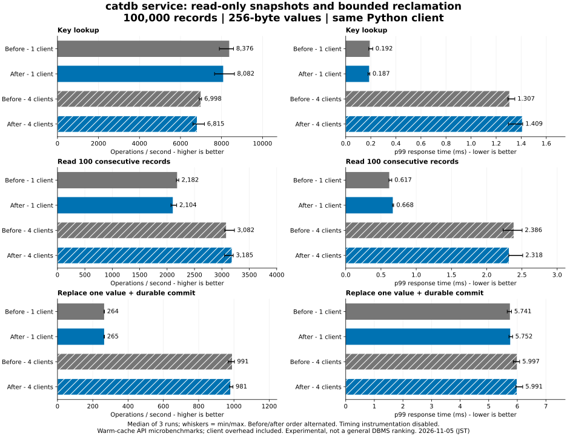

# Read-only snapshots and bounded reclamation — 2026-11-05

**A targeted latency tradeoff, not an across-the-board speedup.** The new path
reduces native large-value read p99 and shortens old-snapshot release. It does
not improve ordinary service throughput consistently, does not bound maximum
response time, and makes full reclamation slower in this diagnostic workload.
All unfavorable conditions and raw repeats are retained.

## Main service comparison

Before: 14e8a7d (runtime 96769c4). After: c0c8cff. Both use the **same
single-request API** and ordinary durable append WAL. Timing instrumentation is
off. 100,000 records, 256-byte values, 1/4 connections, 8,000 operations per
condition, three alternating repeats, 2 CPUs and 4 GiB per server/client.
Same workstation/Docker setup as the [original report](../2026-11-05/README.md).
These are warm-cache closed-loop Python-client measurements, not engine ceilings.

- Four-client lookup: 6,997.6 → 6,814.5 ops/s; p99 1.307 → 1.409 ms (worse).
- Single-client 100-row scan: 2,182.4 → 2,104.3 ops/s; p99 0.617 → 0.668 ms (worse).
- Four-client 100-row scan: 3,082.2 → 3,185.1 ops/s; p99 2.386 → 2.318 ms.
- Four-client durable update: 990.8 → 981.2 ops/s; p99 5.997 → 5.991 ms.

Values are medians of three runs; [all values](table.md) and min/max bars show
repeat variation. These small changes do not establish a general improvement.
No PostgreSQL/Oracle rerun or new product ranking is claimed.
All 288,000 operations, 48 full-content checks and six restarts passed, without
retries or rejected operations. Full-content checks use the original transaction
API, exercising compatibility as well as the new path.

## Separate native diagnostic workloads

These runs include a lock timer and allocation-counting allocator in **both**
versions. They are not directly comparable with uninstrumented service results.
Two readers run with four disjoint writers for mixed/large-value cases. The
reclamation case releases a snapshot pinning 100,000 overwritten values while
two readers continue; all remaining reclamation is included separately.

See the [complete native table](auxiliary/table.md), [all run-level metrics](auxiliary/computed.json),
and [raw per-thread samples](auxiliary/results.json). Each condition has three
repeats; reported maxima below are medians of per-run maxima unless stated.

| Diagnostic | Before | After | Interpretation |
|---|---:|---:|---|
| Mixed 256 B read p99 | 0.018 ms | 0.012 ms | Improved |
| Mixed write throughput | 1,126.7/s | 1,109.0/s | Slightly lower |
| 64 KiB value / four-row read p99 | 0.552 ms | 0.051 ms | Improved |
| Large-value write throughput | 456.8/s | 716.5/s | Improved |
| Large-value read maximum | 4.042 ms | 10.706 ms | Worse |
| Old-snapshot release | 26.086 ms | 0.066 ms | Return much sooner |
| Release plus complete reclamation | 26.086 ms | 58.599 ms | More total time |
| Reclamation maximum lock hold | 26.062 ms | 1.913 ms | Shorter lock occupation |
| Read p99 during reclamation | 0.038 ms | 0.090 ms | Worse |
| Read maximum during reclamation | 26.164 ms | 22.519 ms | Median maximum lower only |

The **worst observed reclamation read** across all three repeats worsened from
26.413 to 32.121 ms. Large-value reads also have worse maxima despite better p99.
Breaking work into small pieces does not guarantee scheduling fairness. The
trace does not identify scheduler, allocation or CPU-quota contributions, so
none is asserted as the cause. Reclamation runs have 1,000 reads per reader,
including reads after completion; p99 is sensitive to that short phase.

## Memory and observer limits

Mixed-case starting requested Rust heap: 44.724 → 46.123 MiB; observed peak:
95.620 → 103.812 MiB. The peak includes latency buffers and result construction:
faster readers generate more samples (median 833,112 → 939,255), so this is not
an isolated engine-memory comparison. The version-container change also changes
metadata footprint. No RSS or allocator-reserved capacity was measured.

Large-value heap peak is 282.877 → 283.241 MiB. Immediately after the timed phase,
modeled retained bytes are 257.063 → 279.272 MiB: deferred reclamation leaves
more old data temporarily resident. A final explicit drain precedes full-value
verification and reopen; its post-drain memory was not sampled in this probe.
In the dedicated complete-reclamation case both end at 50.354 MiB of modeled
retained data. Budget charges are not exact process-memory limits.

## Implementation and safety

- `begin_read` pins a stable snapshot, rejects mutations, and avoids dependency
  recording needed only for later writes. Existing writable transactions retain
  read/write/range conflict detection. Service latest-read operations use it.
- Value references are selected under the state lock, then bytes are copied
  outside it while the transaction still pins their version.
- Old versions use a deque and are detached in bounded portions: 64 keys,
  128 versions and approximately 1 MiB, with one oversized value allowed for
  progress. Memory charges remain until detached values are freed outside the lock.
- Begin/drop advance reclamation; `collect_garbage` lets idle callers finish it.
  This is cooperative reclamation, **not a background worker**. Fixed operation
  budgets are not wall-clock guarantees. Persistence admission remains unchanged.

Targeted tests cover stable old values, write refusal, copy paused while another
writer commits, charge retention through detach/free, many keys, hot-key history,
large-value boundaries, and refusal/recovery under retained-data pressure without
logging rejected writes. Existing conflict, checkpoint, persistence-failure,
subprocess-crash, Rust/C ABI and service compatibility tests remain in place.
Windows/Linux, ordinary/fixed-log feature combinations and Docker passed
[implementation CI](https://github.com/dhq-boiler/SilverHamu/actions/runs/41933922562).
This is not a real power-cut test or a production reliability certification.

## Decision and remaining work

Keep the explicit read-only API and copy/GC changes as experimental functionality,
with the measured tradeoffs documented. The test establishes large-value p99 and
snapshot-release improvements; it **does not meet a universal maximum-wait or
ordinary-throughput improvement goal**. Small-value overhead, reclamation scheduling,
temporary retained memory and allocator/scheduling contributions remain open.
A future scheduling policy should compare complete reclamation time and worst
request latency, not merely the snapshot Drop time. No additional search is part
of this completed experiment, and no claim of a production-ready DBMS is made.

[Reproduction and diagnostic patch](../../../benchmarks/read-gc/README.md) ·
[Environment/image IDs](environment.json) · [Source provenance](provenance.json) ·
[Raw service summaries](results.json)
