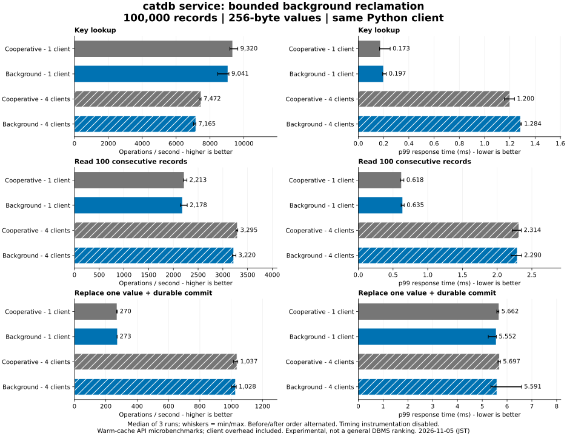
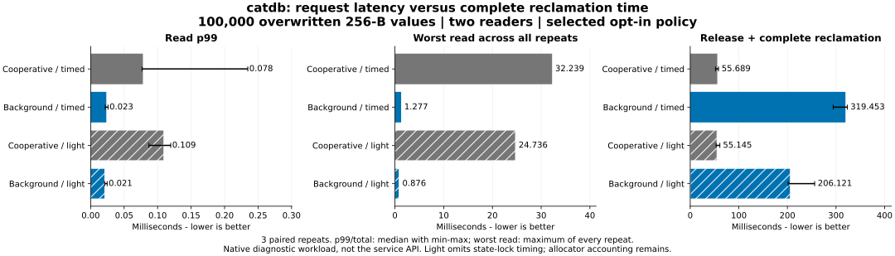

# Moving reclamation off request paths — 2026-11-05

**Background reclamation improves the old-generation-release read tail, but
collects more slowly. It remains opt-in.** Three scheduling candidates were
measured; none won on every metric. The conservative policy is retained because
it favored read p99 in these runs. The other candidates and all unfavorable
measurements are preserved, with no further tuning in this experiment.

## Main service comparison

Same single-request API on both servers, 100,000 records, 256-byte values,
1/4 clients, three alternating repetitions and 8,000 operations per condition.
Main server state-lock timing is disabled. Before: 80423f2; selected candidate:
424e2a5, restored in 99b92b8 with additional failure tests. The baseline image
contains the same runtime as c0c8cff. Resource limits and durable append WAL are
unchanged. Same [workstation/Docker setup](../2026-11-05/README.md).

All **288,000 operations, 48 full-content checks and six restarts** passed,
with zero errors/retries. Median four-client updates are 1,037.2 → 1,028.0 ops/s
and p99 5.697 → 5.591 ms. Four-client lookup throughput declines from 7,472.0 to
7,164.7 ops/s, with p99 1.200 → 1.284 ms. Single-client lookup and scan throughput
also decline slightly. This does not establish a general service speedup.

[Worst values across every repeat](service/maxima.md) are retained separately.
The worst four-client update worsens from **19.155 to 23.510 ms** despite a lower
median p99; ordinary lookup/scan maxima also worsen. The native old-generation
release improvement must not be generalized to every service request.

All conditions, including regressions and min/max repeat ranges, appear in the
[table](service/table.md), [raw summaries](service/results.json) and chart.
This is a warm-cache closed-loop Python API benchmark, not an engine ceiling or
a new DBMS ranking. PostgreSQL and Oracle were not rerun. CPU/memory limits are
2 CPUs / 4 GiB per client/server; checkpoints are not scheduled in the timed runs.

## Old-generation release under two readers

The native fixture overwrites all 100,000 values while holding an old snapshot,
then releases it while two reader threads continue. These are **instrumented
native workloads**, separate from the service chart. Medians of three run-level
values are reported except for the explicitly labeled worst read.

| Selected conservative policy | Cooperative | Background |
|---|---:|---:|
| Read p99, lock timing enabled | 0.078 ms | 0.023 ms |
| Worst read across all three runs | 32.239 ms | 1.277 ms |
| Release plus complete reclamation | 55.689 ms | 319.453 ms |
| Read p99, state-lock timing omitted | 0.109 ms | 0.021 ms |
| Worst read, timing omitted | 24.736 ms | 0.876 ms |
| Complete reclamation, timing omitted | 55.145 ms | 206.121 ms |

The result is **less interruption of readers in exchange for longer-lived
obsolete memory**, not faster collection. The timing-omitted runs reproduce that
tradeoff. Lock-timer overhead changes observed values substantially in some
conditions, so native numbers are not an uninstrumented performance promise.
Allocator accounting, request clocks and worker counters remain in both builds;
this comparison does not measure every observer cost.

## All three candidates

Each candidate has its own paired cooperative controls, three repeats, both
lock-timed and timing-omitted builds. Candidate cohorts ran sequentially; this
is not a randomized cross-policy ranking or a statistical significance claim.

| Candidate, lock-timed | Read p99: cooperative → background | Worst read: cooperative → background | Complete reclamation: cooperative → background |
|---|---:|---:|---:|
| Conservative, retained | 0.078 → 0.023 ms | 32.239 → 1.277 ms | 55.689 → 319.453 ms |
| Burst retry, not retained | 0.104 → 0.500 ms | 28.958 → 0.950 ms | 55.858 → 77.948 ms |
| Pause every portion, not retained | 0.119 → 0.058 ms | 23.847 → 0.489 ms | 62.850 → 446.542 ms |

Burst retries reduce total drain time relative to the first candidate but worsen
p99 against their control. Frequent small pauses improve the worst read but make
complete reclamation slower. Requested sleeps and scheduler waits are not the
same duration; these measurements do not isolate OS scheduling as a root cause.

See every workload and repeat: [conservative table](auxiliary/table.md),
[burst table](burst/table.md), [paced table](paced/table.md), and the raw samples
linked by each directory's results.json. All **108 native runs** verify complete
latest values and reopen equality. Old-generation contents are fully checked in
targeted tests; the timing probe samples key 0 of its pinned snapshot.

## Mixed traffic, large values and memory

In the selected lock-timed build, ordinary 256-B mixed read p99 changes from
0.013 to 0.017 ms (worse), with write throughput 1,101.1 → 1,105.7/s. For 64-KiB
values and four-row reads, read p99 is 0.049 → 0.058 ms (worse) and write throughput
713.9 → 747.9/s. In timing-omitted builds, the read p99 changes instead are
0.019 → 0.011 ms and 0.049 → 0.046 ms. These short, observer-sensitive mixed
results do not establish an across-the-board improvement.

The selected release fixture's requested Rust heap peak is 108.012 → 108.013 MiB;
post-drain heap is **76.641 MiB in both modes**, and modeled retained data is
**50.354 MiB in both**. Mixed and large-value post-drain modeled retained data
also agree (50.354 and 257.062 MiB respectively). Snapshot lifetime fixes the
initial retained backlog here; longer-running workloads could retain more data
while a slower worker catches up. Resource-limit refusal remains possible.

Unlike the previous probe, sample vectors are preallocated before timing and
JSON summaries are constructed after heap measurements. The two readers reserve
32 MB of sample capacity, included equally in those heap figures; writer slots
are also included. Do not compare these absolute peaks with the prior probe.
The measurement counts requested live Rust allocations, **not RSS, allocator
reservation, OS memory or the additional worker thread's stack**. It does not
prove that enabling a worker consumes no extra process memory. Final drain is
sampled after readers finish, the worker is stopped/joined, and explicit cleanup.

## Safety and lifecycle

The mode is disabled by default. Enable in Rust with
`set_background_reclamation(true)` or at service startup with
`CATDB_BACKGROUND_RECLAMATION=1`. It is not exposed through a new C ABI entry.
Existing Rust/C ABI/service APIs, persistence formats and sync acknowledgement
rules remain compatible. No user library or PALV configuration was modified.

The worker does not own the database's outer Arc, avoiding last-owner leaks or
self-join. One worker per DB, serialized enable/disable, bounded portions,
nonblocking lock attempts, pauses, and stop notification constrain its work.
The ownership file remains held until the worker stops. Already-detached memory
stays charged until freed. Failed thread start leaves cooperative operation
available; idle progress does not require foreground requests.

Tests cover stable old values, additions/edits/deletes, read/range conflicts,
checkpoint/reopen, empty/large values, repeated concurrent enable/disable,
last-handle ownership release, injected start failure, resource refusal and
recovery, abrupt child-process exits, and ordinary API compatibility. Existing
held-sync and failed/partial-persistence tests now run with background mode both
off and on: no successful reply or uncommitted visibility before sync, and
confirmed records recover after failure. The complete service suite also runs
with the background option enabled in CI.

[Final implementation CI](https://github.com/dhq-boiler/catdb/actions/runs/41952589201)
passed Windows/Linux, ordinary/fixed-log feature combinations, C ABI and Docker.
Performance was measured in Docker/Linux; native Windows/PALV and mobile
performance were not measured. Process exits and fault injection do not prove
real power-loss or full-disk durability. Those guarantees remain experimental.

## Decision and remaining work

Retain the conservative implementation as **opt-in only**. Its request-tail
benefit is reproducible for this release workload, with a substantial total-time
penalty and observer-sensitive mixed results. Do not enable it globally or infer
an improvement to every maximum latency. Reducing total collection cost and
understanding longer-running backlog/scheduling remain future work, separate
from completing this experiment and from production readiness.

[Reproduction](../../../benchmarks/reclamation/README.md) ·
[Source provenance and CI](provenance.json) · [Service environment](service/environment.json)
