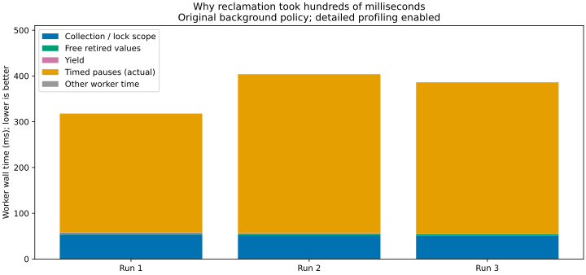
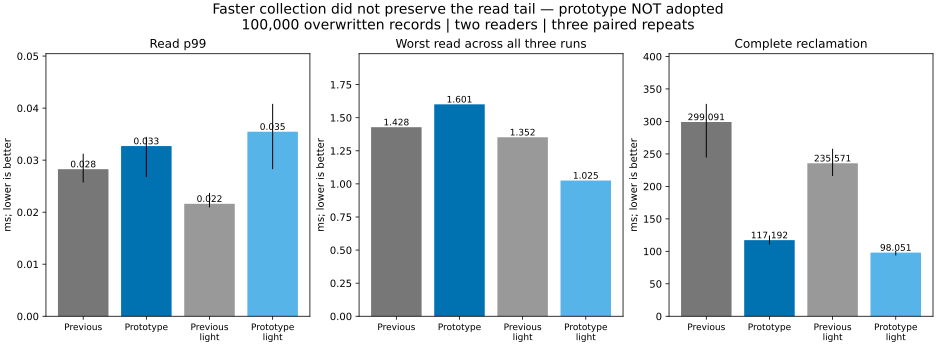
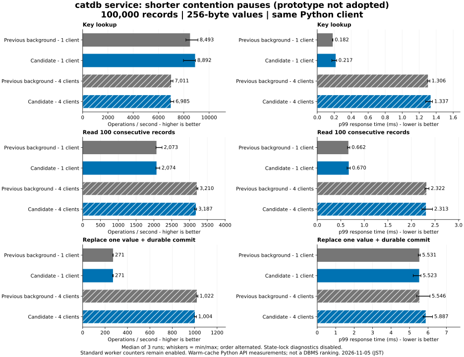

# Reclamation cost investigation

**The combined target was not met.** Three scheduling prototypes shortened pauses or collection portions, but none preserved read p99 while reducing total collection time. Production keeps the previous 64-key / 1 ms contention policy; background reclamation remains opt-in and disabled by default. Only optional diagnostics are retained. These results do not announce a new production performance improvement.

## Cause of the earlier 319 ms result

A new diagnosis cohort reproduces 318–404 ms complete reclamation. Across its three profiled runs, collection/lock-scope work takes 51–53 ms and freeing retired values about 3.3 ms. The worker spends 260–347 ms in timed pauses, 82–86% of worker lifetime. There are 235–320 failed lock attempts and **zero persistence deferrals**. The old policy applies a 1 ms pause to both short lock contention and persistence.

Requested pauses account for 255–340 ms; actual pauses are about 5–8 ms longer. These are wall-clock measurements, not CPU samples: the difference does not isolate scheduler delay from notification/locking overhead. Worker lifetime also includes activity outside the benchmark's complete-GC interval. This is direct evidence for accumulated contention backoff, not an ETW attribution to disk I/O.

## Candidates and decision

Each row has its own paired baseline; do not compare unpaired absolute values between cohorts. Values are medians of three profiled runs, except worst read is the maximum over all three. All variants enable background reclamation.

| Candidate / cohort | Complete GC, previous → prototype ms | Read p99 ms | Worst read ms | Decision |
|---|---:|---:|---:|---|
| 64 keys, 100 µs contention pause / full confirmation | 299.091 → 117.192 | 0.028 → 0.033 | 1.428 → 1.601 | Faster completion, read tail regresses |
| 32 keys, 100 µs / pilot | 314.837 → 237.064 | 0.025 → 0.030 | 1.672 → 0.821 | Better maximum, p99 regresses |
| 16 keys, 50 µs / full confirmation | 355.770 → 640.753 | 0.025 → 0.031 | 0.887 → 0.434 | Better maximum, completion and p99 regress |

The 64-key prototype cuts completion by 61% in the full profiled confirmation. With detailed profiling disabled, completion falls 235.571 → 98.051 ms, but read p99 rises 0.022 → 0.035 ms. The initial 64-key pilot remains published separately; it is not pooled with confirmation or selected instead of unfavorable results.

The read sample window lasts through collection. Faster completion changes sample counts and the share of reads overlapping collection. We keep that metric and do not pad a short run with extra cheap reads to manufacture a p99 improvement. The figures therefore describe this workload, not a workload-independent latency bound. Light runs retain request clocks, allocation tracking and standard worker status counters; they only disable optional lock/worker profiling.

## Ordinary service workload

100,000 records, 256-byte values, 1/4 clients, 8,000 operations per case, three varied-order repeats. Both configurations enable background reclamation; the candidate is the **unadopted 64-key / 100 µs prototype**. No other DBMS was rerun.

Four-client updates change from 1,021.6 to 1,003.7 ops/s and p99 from 5.546 to 5.887 ms. Worst single-client update increases 27.799 → 83.964 ms; four-client worst increases 13.798 → 15.881 ms. These ordinary-workload results do not establish a benefit.

See [all service medians](service/table.md), [worst responses](service/maxima.md), and [raw summaries](service/results.json).

## Correctness, recovery and memory

- All **102 native runs** passed final-value/reopen checks, exact final resource-charge checks and raw percentile validation. GC runs reclaim 32,000,000 charged bytes. All **288,000 service operations, 48 full-content checks and six restarts** passed.
- Existing targeted tests cover pinned old values, write/read/range conflicts, resource refusal/recovery, idle progress, enable/disable races, worker-start failure, shutdown/owner release, checkpoints, interrupted commits and persistence failures. The exact fastest prototype also passed the full `service,fixed-log` suite. These tests are not an actual power-loss certification.
- Restored production source CI [41959378151](https://github.com/dhq-boiler/catdb/actions/runs/41959378151) passed all five jobs, including Windows/Linux, service/fixed-log configurations, C ABI, background-enabled protocol cases and Docker.
- In the GC confirmation, live requested heap peaks at **108.013 MiB** and returns to **76.641 MiB** for both policies; final modeled retained charge is **50.354 MiB**. Mixed and large-value drained allocations also match their paired baselines. See complete tables below for peak values and unfavorable large-value tails.
- Heap includes fixed preallocated reader sample vectors (about 32 MB), but excludes allocator reserves, RSS and thread stacks. Final memory is measured after worker stop and explicit drain, before JSON construction. This checks eventual cleanup, not a hard RSS ceiling.

## Complete evidence and reproducibility

| Cohort | Runs | Numerical table | Raw summaries |
|---|---:|---|---|
| Original-policy diagnosis | 6 | [table](diagnosis/table.md) | [raw](diagnosis/results.json) |
| 64-key initial pilot | 12 | [table](fast-pilot/table.md) | [raw](fast-pilot/results.json) |
| 32-key pilot | 12 | [table](small-pilot/table.md) | [raw](small-pilot/results.json) |
| 16-key full comparison | 36 | [table](tiny-prototype/table.md) | [raw](tiny-prototype/results.json) |
| 64-key full confirmation | 36 | [table](fast-full/table.md) | [raw](fast-full/results.json) |

Each directory contains environment/image IDs, raw compressed samples and recomputed metrics. [Reproduction commands](../../../benchmarks/reclamation-cost/README.md) identify source commits and build settings. Synthetic Docker/Linux data, 2 CPUs / 4 GiB per measured container; performance runs did not overlap heavy builds/tests or other performance cohorts. These are short experiments, not long-duration backlog, Windows/mobile or cross-machine certification.

Runtime versions: baseline + diagnostics `4d09365`; 64-key prototype `bebff39`; 32-key `e8a1aa3`; 16-key `f8e3116`; restored production policy `944bbf2`. The previous report is [preserved](../reclamation-2026-11-05/README.md).

## Remaining work

Stop the scheduling search after the agreed three candidates. Retain diagnostics through `Database::reclamation_profile()` with the optional `lock-timing` feature; existing status/API shapes remain unchanged. The next separate design question is how to reduce shared-state lock acquisitions or move more reclamation preparation outside that lock. That structural work is **not implemented or performance-validated here**. Completion of this experiment does not mean the combined performance goal or production readiness is achieved.
