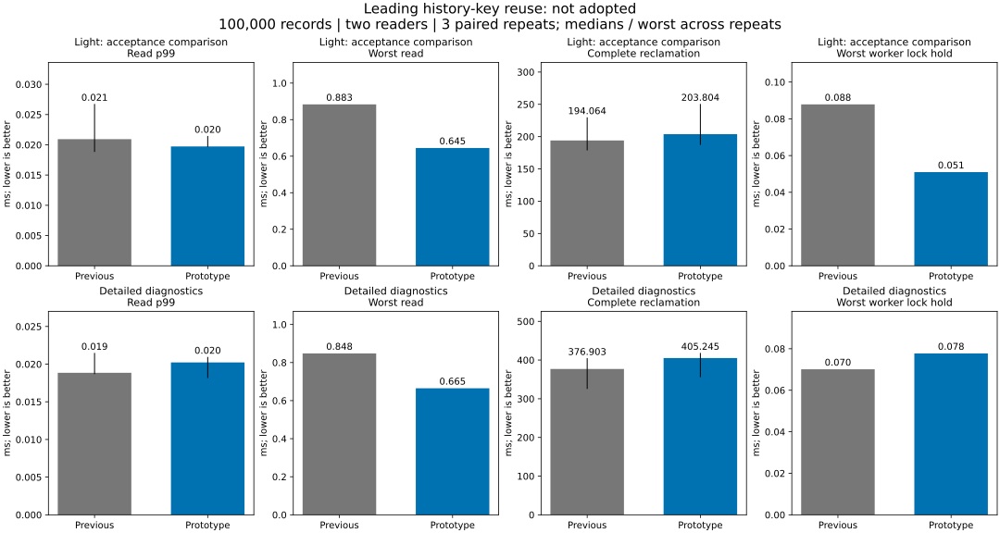
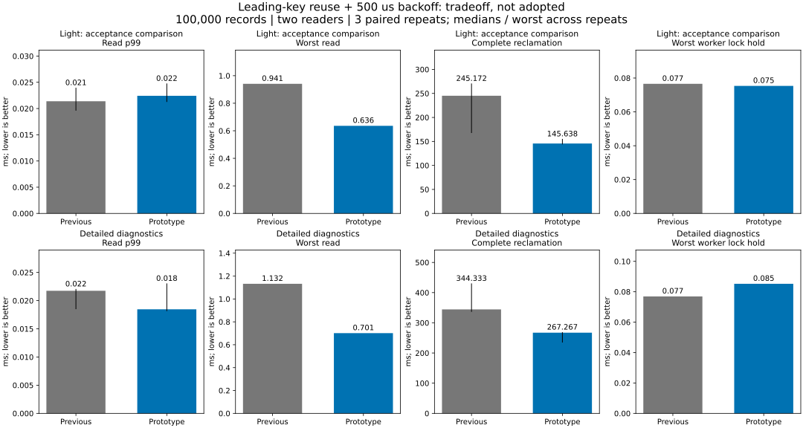

# Leading history-key reclamation

**The collector does less timed work, but the combined read-tail/completion goal
is still unmet. Neither condition is adopted.** Production is restored at
`eea36b1`; background reclamation remains opt-in and off by default.

## Idea and first comparison

Previously each leading history key was found by range search, copied, then
removed by another lookup after collection. Candidate `c8d205f` takes ownership
of the first history key with `pop_first` and reuses it as the cursor. When a
pinned prefix must remain, it restores the key and uses the established range
path for the suffix. Partial collection restores the popped key before returning.
The existing 64-key / 128-version / approximately 1-MiB limits are unchanged.
No preparation buffer, snapshot registry or extra lock is added.

In the first cohort, detailed timed collection work falls **46.7 → 36.0 ms
(23% lower)**. Light read p99 and maximum also improve, but median reclamation
completion grows slightly, so this structural change alone fails the gate.

| Light comparison, three runs | Previous | Leading-key reuse |
|---|---:|---:|
| Read p99, median | 0.020930 ms | 0.019726 ms |
| Worst read across repeats | 0.883 ms | 0.645 ms |
| Complete reclamation, median | 194.064 ms | 203.804 ms |
| Worst worker lock hold | 0.088 ms | 0.051 ms |

## One declared follow-up condition

After the first cohort, one follow-up was declared and recorded before measuring:
combine leading-key reuse with **500 us rather than 1 ms** after a failed data-lock
attempt. When the worker acquires the lock and observes persistence in progress,
its deferral remains 1 ms. The other batch/idle pauses remain unchanged. Commit
synchronization and visibility rules are untouched. The follow-up is a separate
cohort (`a965e2d`), not pooled with or substituted for the first one.

| Light follow-up, three runs | Paired previous | Reuse + 500 us |
|---|---:|---:|
| Read p99, median | 0.021390 ms | 0.022422 ms |
| Worst read across repeats | 0.941 ms | 0.636 ms |
| Complete reclamation, median | 245.172 ms | 145.638 ms |
| Worst worker lock hold | 0.077 ms | 0.075 ms |
| Drained requested heap | 80,363,726 bytes | 80,363,726 bytes |
| Drained modeled retained charge | 50.354 MiB | 50.354 MiB |

Completion is **41% shorter** and the worst release-phase read **32% lower**,
but p99 increases by **1.032 us (4.8%)**. This small observed p99 change is not a
statistical proof of a population regression. It nevertheless does not establish
the required non-regression, and the mixed workload has a less favorable maximum:
light mixed worst read grows **1.015 → 3.415 ms**, with p99 **0.010 → 0.011 ms**.
We therefore retain the production policy rather than claim the joint goal met.

Detailed profiling in that follow-up looks more favorable: release p99 changes
0.021751 → 0.018468 ms, worst read 1.132 → 0.701 ms, completion
344.333 → 267.267 ms. These do not override the light acceptance criterion.
The [first full table](native/table.md) and [follow-up full table](half/table.md)
include every mixed/large/release condition, write throughput and unfavorable tails.

## Correctness, recovery and memory

All **72 native runs** pass latest full-content/reopen checks, raw percentile
recomputation and exact final modeled resource-charge checks. Each release case
reclaims 32,000,000 charged bytes. Old values are sampled in the timing probe and
checked fully in the safety tests.

Added tests exercise a retained leading key followed by reclaimable keys across
batch boundaries, and 63/64/65 keys with exact resumption. Existing hot-key tests
cover 128-version partial reclamation and byte/oversized-value boundaries, including
restoring the popped key before returning. The full suite retains old snapshots,
write/read/range conflicts, resource recovery, worker lifecycle, checkpointing,
persistence failure and child-process termination tests.

Both candidates pass local full `service,fixed-log` tests and Clippy. Candidate
CI [41971111288](https://github.com/dhq-boiler/SilverHamu/actions/runs/41971111288) and
follow-up CI [41971642720](https://github.com/dhq-boiler/SilverHamu/actions/runs/41971642720)
pass all five jobs, including Windows/Linux, C ABI, background-enabled service
protocol cases and Docker. These process-crash checks are not actual power-loss
certification.

Drained release-case heap matches exactly in both cohorts: **80,363,726 bytes**
light and **80,363,758 bytes** with detailed profiling. Peak requested heap rounds
to **108.013 MiB** on both sides. These quantities include fixed sample arrays;
they exclude RSS, allocator reserves and thread stacks and do not prove a hard
process-memory bound. There is no added per-record metadata or new work buffer.

## Conditions and interpretation

Both sides enable background reclamation. Same synthetic native workloads:
100k x 256 B with two readers and four writers, 4096 x 64 KiB for large values,
and a release case with two readers after overwriting all 100k records. Three
alternating repeats, 2 CPUs / 4 GiB per measured container. No heavy local
build/test or second benchmark overlaps measurement.

P99 pools both readers per run, then reports the median across repeats. Worst
response and worker lock hold are maxima over all three repeats. The read window
ends with collection; sample counts and contended/uncontended proportions change
when completion time changes. Light instrumentation still includes request clocks,
allocation tracking and standard worker counters. Timed locked work is elapsed
wall time, not CPU instruction cost. Three repeats do not establish universal
performance or statistically significant differences.

## Evidence and decision

| Cohort | Runtime | Runs | Raw summaries | Environment |
|---|---|---:|---|---|
| Leading-key reuse | `c8d205f` | 36 | [raw](native/results.json) | [configuration](native/environment.json) |
| Reuse + 500 us | `a965e2d` | 36 | [raw](half/results.json) | [configuration](half/environment.json) |

The baseline images use `4d09365`, whose collector matches pre-experiment
production `a861a50`. Compressed samples and recomputed metrics accompany both
cohorts. See [reproduction instructions](../../../benchmarks/reclamation-front/README.md).

Stop after the structural candidate and the one declared follow-up. Because the
joint native gate fails, the longer 1/4-client service comparison and other-product
benchmarks are not rerun. Previous service charts remain historical results.
No PALV or Z: data is changed. Both prototypes and their tests remain reproducible
in Git history; production code is restored.

The useful finding is a lower-cost collection loop and a measurable completion /
read-tail tradeoff, not a universally faster implementation. Fixed-arrival-rate
or interference measurements could help explain that tradeoff in a separate task;
no additional scheduling search or larger redesign is implemented here.
