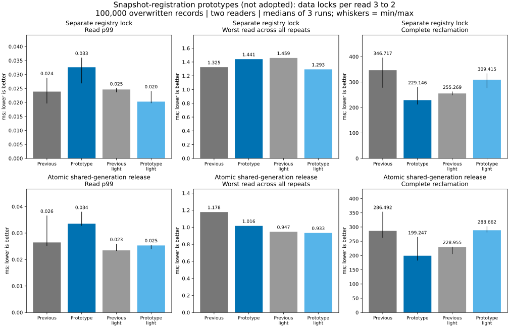
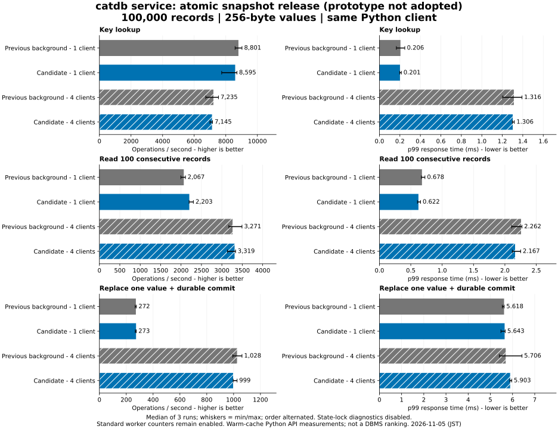

# Snapshot-registration lock reduction

**Neither prototype met the combined goal; neither is adopted.** The experiment
reduces data-state mutex acquisitions from **3 to 2 per read** without changing
snapshot semantics or the collection scheduler. The improvement does not reliably
translate into lower read p99, worst wait and total reclamation time together.
Production snapshot tracking is restored at `0755213`; its [five CI jobs](https://github.com/dhq-boiler/catdb/actions/runs/41965900906) also pass.

## What changed and why it is safe

The prior read loop acquires the shared data mutex at transaction begin, get/page
read, and transaction destruction. Prototype 1 gives snapshot registration its
own small mutex, so background-enabled destruction does not take the data mutex.
Prototype 2 uses a per-generation atomic reference count, avoiding even the
registry mutex for non-last releases. Last release rechecks identity and count
under the registry mutex before removing the entry, preserving concurrent
re-pinning of that generation.

Registration still takes place while holding the data mutex, as does choosing a
collection floor. Releasing a generation never holds the registry while acquiring
data state. This prevents resurrecting a generation already reclaimed and avoids
a reverse lock order. Persisted formats, synchronization-before-acknowledgement,
conflict validation, GC batch limits and pause constants are unchanged.

The lock-count check passed for **every profiled reader thread** in both cohorts:
exactly three data-lock acquisitions per completed read before and two after.
This does not count all engine locks: a separate registry mutex and, in the second
prototype, atomic operations add work of their own.

## Old-generation release results

Each row uses its own paired baseline. P99 and completion are medians of three
runs; worst read is the maximum across all three runs. Two readers, 100,000
records overwritten before the old generation is released, 256-byte values.

| Prototype / instrumentation | Complete GC, before → after ms | Read p99 ms | Worst read ms |
|---|---:|---:|---:|
| Separate registry / profiled | 346.717 → 229.146 | 0.024 → 0.033 | 1.325 → 1.441 |
| Separate registry / light | 255.269 → 309.415 | 0.025 → 0.020 | 1.459 → 1.293 |
| Atomic release / profiled | 286.492 → 199.247 | 0.026 → 0.034 | 1.178 → 1.016 |
| Atomic release / light | 228.955 → 288.662 | 0.023 → 0.025 | 0.947 → 0.933 |

The atomic prototype cuts profiled completion by about 30%, but its lighter-mode
completion instead grows by about 26%. In that light cohort, aggregate native
reader throughput rises from about 587k to 672k reads/s. In the profiled cohort,
throughput instead falls from 631k to 456k reads/s and worker lock misses fall
from a median 208 to 124. These results show strong observer/scheduling dependence;
the exact causal contribution of registry contention and CPU scheduling is not
isolated. Reducing locks per request alone does not guarantee fewer conflicts
per second in a closed-loop workload.

The sample window lasts through reclamation and therefore changes duration and
sample count. We retain this definition rather than pad fast runs with cheap
reads. Light runs still include request clocks, allocation tracking and standard
worker counters. They are not completely uninstrumented.

Mixed and large-value results are retained, including regressions. For example,
atomic light mixed read p99 improves 0.011 → 0.009 ms while the worst read grows
0.830 → 3.205 ms; large-value light read p99 grows 0.048 → 0.058 ms.

## Ordinary service confirmation

The same 100,000 records / 256-byte values / 1 and 4 clients / 8,000 operations
per case were run three times in alternating order, with both servers using
background reclamation and optional profiling disabled. The candidate is the
unadopted atomic prototype, not current main. All **288,000 operations, 48
full-content checks and six restart checks** passed.

Four-client updates change **1,027.6 → 998.7 ops/s**, with p99
**5.706 → 5.903 ms**. Single-client 100-record scans improve
**2,067.4 → 2,202.6 ops/s** and p99 **0.678 → 0.622 ms**. Worst
single-client update grows **14.115 → 17.852 ms**, while worst four-client
update falls **17.996 → 13.756 ms**. These mixed results do not reverse the
native-workload decision. Other DBMS products were not rerun.

See [all service medians](service/table.md), [all worst responses](service/maxima.md),
[raw summaries](service/results.json) and [environment](service/environment.json).

## Memory, correctness and recovery

- Both native cohorts (72 runs total) pass final full-content/reopen checks,
  percentile recomputation and exact final modeled resource charges. The GC
  release case reclaims 32,000,000 charged bytes in every background run.
- Final GC heap is **80,363,758 → 80,363,798 bytes** when profiled and
  **80,363,726 → 80,363,766 bytes** in light mode: **40 extra bytes**, not exact
  allocation equality. Both round to 76.641 MiB. Final modeled retained charge
  stays 50.354 MiB. Atomic counters additionally cost memory while generations
  remain registered; the complete tables include measured peaks.
- Heap is live requested Rust allocation size, including fixed sample vectors,
  after worker stop and explicit drain, before JSON construction. It is not RSS,
  allocator reserves, thread-stack usage or proof of bounded long-duration growth.
- New tests verify read/write transaction destruction while the data lock is
  held, duplicate/out-of-order generations, non-last release while the registry
  lock is held, and last-release/concurrent-repin ordering. Existing tests cover
  full old generations, write/read/range conflicts, resource failure/recovery,
  enable/disable races, owner release, checkpoints, persistence failures and
  process termination around durable publication.
- The exact atomic prototype passes the local full `service,fixed-log` suite and
  [all five CI jobs](https://github.com/dhq-boiler/catdb/actions/runs/41965553592),
  including Windows/Linux, C ABI, background-enabled protocol tests and Docker.
  Prototype 1 passed runtime tests but its first CI failed the nested-if lint;
  prototype 2 fixes that lint. Process-crash checks are not actual power-loss
  certification. The candidate tests remain reproducible at the linked commits.

## Evidence and reproduction

| Cohort | Runtime | Runs | Table | Raw summaries |
|---|---|---:|---|---|
| Separate registry | `0ae18bf` | 36 | [table](native/table.md) | [raw](native/results.json) |
| Atomic release | `44207da` | 36 | [table](atomic/table.md) | [raw](atomic/results.json) |

Baseline images use `4d09365`, with the same production policy as `23c22b6`.
Each cohort includes environment/image IDs and compressed latency samples.
[Reproduction commands and measurement limits](../../../benchmarks/reclamation-pins/README.md)
retain the exact previous workloads, CPU/memory limits, three varied-order repeats
and both instrumentation modes. No heavy local build/test overlapped measurement.
All data is synthetic; no PALV or Z: library was modified.

## Decision and remaining uncertainty

Stop after the planned two structural candidates. Restore the established
snapshot registry; leave background collection opt-in and off by default. The
candidate implementations remain in Git history for reproducibility, not enabled
in current main. The preceding [pause-cost diagnosis](../reclamation-cost-2026-11-05/README.md)
and its optional diagnostics remain intact.

A future design would need to reduce interference during the actual data read or
reclamation work, rather than only remove the destruction-time lock acquisition.
An immutable published read view or a different ownership/index layout may help,
but its copy cost, memory budget and conflict semantics require separate design
and measurement. That work is not implemented here. Experiment completion is not
achievement of the combined performance goal or production readiness.
