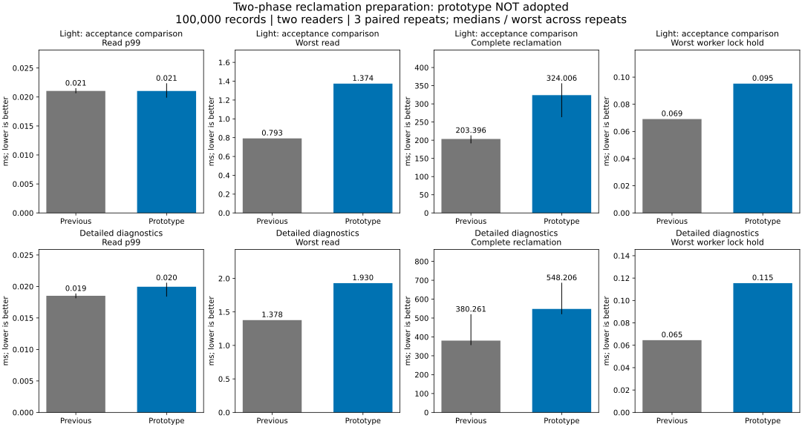

# Two-phase reclamation preparation

**Rejected at the native comparison gate.** Moving bounded preparation outside
the shared data lock does not improve this workload. Lighter instrumentation is
the acceptance criterion; detailed profiling is only supporting evidence. The
production collector is restored at `62af581`, with background reclamation still
opt-in and disabled by default.

## Result: primary light comparison

100,000 records, 256-byte values, old generation released after all records are
overwritten, two readers. Medians of three paired runs except maxima, which span
all three runs.

| Metric | Previous | Prototype |
|---|---:|---:|
| Read p99 | 0.021041 ms | 0.021034 ms |
| Worst read | 0.793 ms | 1.374 ms |
| Complete reclamation | 203.396 ms | 324.006 ms |
| Worst worker lock hold | 0.069 ms | 0.095 ms |
| Peak requested heap, median | 108.013 MiB | 108.022 MiB |
| Heap after complete drain | 80,363,726 bytes | 80,363,726 bytes |
| Modeled retained charge after drain | 50.354 MiB | 50.354 MiB |

P99 is essentially unchanged, while complete reclamation grows **59%** and the
worst read grows **73%**. Each of the three light prototype runs takes longer to
reclaim than its paired control. The desired lock-hold reduction is also absent.
Peak requested heap rises by about 9.7 KiB; final allocations match exactly in
this fixture. This is not evidence about RSS or long-duration memory growth.

## What was actually moved

The prototype captures up to 64 keys and 192 version-metadata entries under the
state lock. It allocates bounded work buffers and computes removal counts outside
the lock, then reacquires the lock to validate the target generation, cursor and
version prefixes before detaching values. Preparation memory is included in the
DB buffer budget; allocation refusal falls back to the previous collector.

**BTreeMap lookup and metadata capture still require the data lock.** This is not
an immutable read view or fully off-lock traversal. Capture and application add
metadata copies, row lookups, validation and a second lock acquisition. In the
detailed runs, timed locked work increases from a median **46.8 to 76.5 ms**, and
worker lock misses from **306 to 440**. Total reclamation increases
**380.261 → 548.206 ms** and read p99 **0.018520 → 0.019957 ms**.

These measurements support rejecting this particular two-phase design; they do
not prove that all off-lock preparation is ineffective. Timers report elapsed
wall time, not CPU instruction cost, and outside-lock preparation is not included
in `work_ns`. The precise contributions of copying, tree lookup and scheduling
were not separately isolated.

## Other workloads and observer limits

All mixed and large-value conditions are retained in the [complete table](native/table.md).
Light mixed read p99 improves 0.011 → 0.010 ms while write p99 worsens
4.748 → 5.439 ms. Light large-value read p99 changes 0.037 → 0.038 ms and
writer throughput 770.3 → 756.6 operations/s. These do not reverse the gate decision.

The read window ends with reclamation; different durations change the sample
population. Light mode still has allocation tracking, request clocks and standard
worker counters. Peak memory includes fixed sample arrays. This is a short native
Docker/Linux comparison, not a hardware-independent bound or DBMS ranking.

## Correctness and recovery

All **36 native runs** pass full latest-content and reopen verification, raw
percentile validation and exact final budget-charge checks. Each release case
reclaims 32,000,000 charged bytes. Old generations are sampled in the timing probe
and checked fully by the safety tests.

Seven added tests cover concurrent append/delete with a pinned generation,
stale-plan rejection, persistence exclusion, key/version/byte bounds, exact
preparation-budget boundaries, tombstones/empty completion, and progress when
preparation buffers cannot be reserved. Existing tests preserve write/read/range
conflicts, old generations, lifecycle/resource recovery, checkpointing, persistence
failures and process termination around durable publication.

The prototype passes local tests and [all five CI jobs](https://github.com/dhq-boiler/SilverHamu/actions/runs/41969847057),
including Windows/Linux, service/fixed-log, C ABI, background-enabled protocol
checks and Docker. Process-crash testing is not actual power-loss certification.

## Evidence, reproduction and decision

- [Raw run summaries](native/results.json), [recomputed metrics](native/computed.json),
  [numerical table](native/table.md), [environment and image IDs](native/environment.json).
- [Reproduction commands and exact limits](../../../benchmarks/reclamation-plan/README.md).
- Runtime baseline `4d09365` matches the production collector at `4e0fc41`;
  prototype `6c6667b`; restored collector `62af581`. The prototype and its tests
  remain available in history for reproduction.

Stop after this one bounded structural prototype. Because the small native gate
fails, the longer 1/4-client service comparison and other-product comparisons are
**not rerun**, and earlier service charts retain their historical meaning.
README figures are updated with the native evidence, including adverse results.
No PALV or Z: data is modified; no new runtime behavior is adopted.

Moving more work outside the lock would require a different ownership/read-index
representation so candidate discovery need not copy and revalidate the same tree
entries. That larger design is unimplemented and unmeasured here. This experiment
is complete; the combined latency/completion goal remains unmet.
