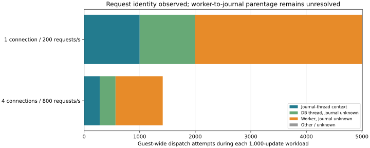

# I/O request identity feasibility — 2026-11-06

**Progress: dispatch attempts can now be followed by request identity, but worker-to-journal parentage is still missing.** The full 8,000-request / three-repetition comparison was not run because both identity and journal attribution were prerequisites. No maximum-latency improvement or production-policy change is claimed.

## Method

The unchanged server and client use 100,000 synthetic records × 256 bytes, 1 connection at 200 offered requests/s and 4 at 800/s. The final pilot has one off/on run per condition and only 1,000 updates each. A private trace instance captures existing scheduler/journal/block events plus six owned dynamic probes: request start, end, update entry/return, free and requeue. Kernel request addresses are replaced with opaque aliases before export; the aliases are per-capture memory slots, not permanent request or database transaction IDs. Each new dispatch gets a sequence number.

| Condition | Dispatch attempts | Observed data completion | Direct journal-thread context | Journal context unknown | No end-function hook |
|---|---:|---:|---:|---:|---:|
| candidate-profile-trace-r1-c4-rate800-normal | 1415 | 1415 | 283 | 1132 | 1132 |
| candidate-profile-trace-r1-c1-rate200-normal | 5007 | 5007 | 1000 | 4007 | 4007 |

All 6,422 observed dispatch attempts in the final workload windows reached an observed data-completion return. The captures reported zero ring overruns/drops and zero missed dynamic-probe instances. The 1,283 fsync calls agreed with the service counters. These are **guest-wide observations during the workload**, not proof that every request belongs to this database. Direct journal-thread context was observed for 1,283 dispatches; the other 5,139 include DB-thread writes, worker work and possibly unrelated I/O.

Repeated use of the same request slot occurred. Moreover, 5,139 completed dispatches did not pass through the ordinary request-end hook. Following only that hook or treating the opaque slot as a permanent ID would miss completions or merge distinct attempts. The update-return value distinguishes whether data remain; data completion is not equivalent to logical-request release, flush completion, database commit or durability. The analyzer retains free/requeue events separately. No real partial update or requeue occurred in this short pilot; those branches were checked with synthetic event sequences, not claimed as live fault-injection coverage.

## What still prevents attribution

Some requests are dispatched by a worker rather than the journal thread. This observer has no proven parent/child mapping from an originating journal transaction through the flush queue, worker handoff, request merging/splitting and completion. Temporal overlap is deliberately not used to invent that relationship. The next required evidence is that handoff mapping, not another long run of the same observer. Native Windows/device attribution also remains outside this guest trace. The previous 129-ms event is not explained retrospectively.

The [kernel tracing interface](https://docs.kernel.org/trace/kprobetrace.html) supports capturing function arguments and return values. The interpretation of request update/end paths was checked against [the Linux block request implementation](https://raw.githubusercontent.com/torvalds/linux/v6.18/block/blk-mq.c). These probes are kernel-version-specific diagnostics, not a portable DB API. The collector uses SYS_ADMIN, owned dynamic event names and a private trace instance; it does not truncate the global probe registry or change storage policy.

## Preliminary observer results

| Connections / rate | Trace | p99 response ms | Maximum response ms | Updates/s |
|---|---|---:|---:|---:|
| 4 / 800 | off | 7.763 | 9.726 | 797.9 |
| 1 / 200 | off | 5.858 | 13.022 | 200.0 |
| 4 / 800 | on | 10.507 | 14.733 | 796.2 |
| 1 / 200 | on | 6.020 | 9.009 | 200.0 |

One short repetition cannot establish tracing overhead or a performance improvement. The bounded ring still reserves up to 16 MiB per CPU (512 MiB on this guest). No durability policy, service source or Rust engine implementation changed. All 4,000 updates committed, with zero rejection/operation error; eight full-content checks including two restarts passed. The safety suites ran after timing completed.

## Retained development attempts and safety

`request-id-pilot` failed observer registration: Python append-mode file initialization attempted a seek unsupported by tracefs. Raw append writes fixed it without truncating existing probes. `request-id-pilot-v2` captured only the five entry probes and therefore lacked the update return. `request-id-pilot-v3` added returns but failed to retain probe-miss statistics because this kernel reports event names without the group prefix. These attempts are retained separately and are not pooled with the final results. A malformed return-expression construction was also caught by a registration-only check before workloads.

The final observer rejects conflicting preexisting event names, bounds capture duration, records probe-miss counters, and removes its event registrations after disabling/removing its instance. Export failure was injected successfully and a separate inspection confirmed no remaining probes or instances. Forced process/VM termination can still prevent cleanup; this is not a production monitoring service.

Existing engine tests cover snapshots, conflicts, persistence failure and process-crash recovery; new event tests cover reuse, partial updates, requeue, preexisting requests, unmatched entry/return, invalid returns and refusing temporal journal assignment. See [validation.txt](validation.txt). These tests do not prove physical power-loss durability or every real I/O error path.

See [reproduction](../../../benchmarks/request-id/README.md), [results](results.json), [summary](summary.json), [exact attempts](request-analysis.json.gz), [source/image provenance](provenance.json), and the trace folders for evidence. No raw kernel addresses are published in the exported request fields.
