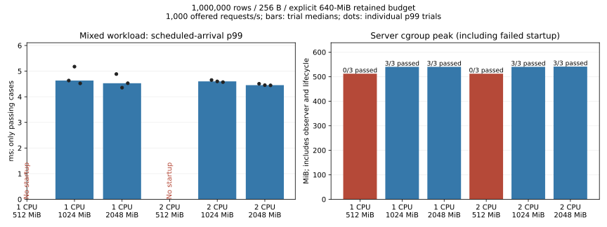

# Explicit service budgets under container limits

Date: 2026-11-06. Experimental; synthetic data only.
Engine/API commit: `c46066218aac182da238c2690e861c377da1005a`.
Image: `catdb-resource-config:local`, SHA256
`10562126d4e0c99d2e14b52803a938af0093d517d5190d53e9a7741e0d9b0d30`.

## Decision

Explicit service budgets remove the previous default-budget startup barrier.
With a 640-MiB logical retained-data budget, all twelve million-row trials at
1/2 CPUs and 1/2 GiB container memory passed. All six 512-MiB trials failed
with actual OOM; each database was subsequently verified in full in a separate
1-GiB rescue run. Rescue does not turn the original failure into a passing case.

This is a capacity/configuration improvement, not a demonstrated engine speedup.
The previous default-budget million-row cases never started, so they provide
no valid latency baseline. Increasing CPU or memory above 1 GiB did not produce
a large latency difference at this offered rate. No maximum-throughput claim
is made. Reducing per-record/history memory is a candidate for the next study;
neither its savings nor operation within 512 MiB has been established.

## Change and compatibility

The service accepts `--max-retained-bytes`, `--max-staged-bytes`,
`--max-dependency-bytes`, and `--max-buffer-bytes`. Values must be positive decimal
byte counts fitting the platform's `usize`. Defaults remain 128/32/16/16 MiB,
respectively. Existing Rust `Config` and `Server::bind` remain unchanged;
`Server::bind_with_limits` is additive. Invalid limits are rejected before opening
the database. Explicit budgets do not cap RSS, and recovery also requires enough
buffer/retained budget. There is no automatic budget increase or durability change.
See [service options](../../service.md).

## Measurements



Each row reports medians of three trials. Failed cases have no workload latency.
Peak memory includes the server container observer and the complete boot lifecycle.
Launch times include Docker orchestration; they are not pure database-open times.

| CPU | Container MiB | Passed / attempted | Read p99 ms | Mixed p99 ms | Peak cgroup MiB | Launch ms | Reopen launch ms |
|---:|---:|---:|---:|---:|---:|---:|---:|
| 1 | 512 | 0 / 3 | — | — | 512.000 | — | — |
| 1 | 1024 | 3 / 3 | 0.339 | 4.633 | 540.020 | 1625.000 | 1578.000 |
| 1 | 2048 | 3 / 3 | 0.316 | 4.528 | 540.004 | 1579.000 | 1625.000 |
| 2 | 512 | 0 / 3 | — | — | 512.000 | — | — |
| 2 | 1024 | 3 / 3 | 0.328 | 4.600 | 540.102 | 1625.000 | 1578.000 |
| 2 | 2048 | 3 / 3 | 0.323 | 4.453 | 540.922 | 1579.000 | 1578.000 |

The unchanged-default control (100,000 rows, 1 CPU, 512 MiB) passed all three
trials: median read p99 0.318 ms and mixed p99 4.404 ms. Across all passing cases,
240,000 requests completed with zero queue refusals and zero processing errors.
All 66 full-content checks passed, including six OOM rescues. Fifteen passing
fixtures also retained old-generation reads through updates and verified content
after deliberate server-process termination and reopening.

## Method and limits

- One million ordered 8-byte keys and 256-byte values; explicit retained budget
  671088640 bytes. CPU quota 1/2, memory 512/1024/2048 MiB; three trials per cell.
- Each workload offers 8,000 requests at 1,000 requests/s. Read-only uses four
  connections. Mixed uses one reader and four writers, with 80% reads and 20%
  independent updates. Mixed throughput is not update-only transactions/s.
- Per-kind client queues hold at most 64 requests. No retries. Successful-request
  p99 spans scheduled arrival through client queue and response; refusal counts
  are separate. Achieved throughput is approximately the offered 1,000 requests/s.
- The client has its own 2-CPU/2-GiB container. Server sampling runs every 100 ms;
  cgroup totals include its Python supervisor. Process RSS, cache, swap and CPU
  throttling records are retained separately. Swap is disabled. CPU quota is
  aggregate scheduling allowance, not physical core pinning.
- Seed generation is outside the measured memory cap. Shared host caches are
  warm; these are not cold-start tests on a physically low-memory PC. Only this
  short workload and value distribution are established. Sampling overhead was
  studied in the [prior experiment](../resource-envelope-2026-11-06/README.md);
  it was not independently re-estimated in this configuration follow-up.
- Initial content, content after each workload, old snapshot values for updated
  keys, and content after SIGKILL/reopen are checked. Process death and OOM are
  not physical power-loss testing. The existing sync-before-success policy remains.

## Safety and regression checks

The local Rust suite passed 140 tests (11 intentionally ignored); Windows and
Linux service protocol suites each passed 23 tests, C ABI checks passed 35, and
Clippy passed with warnings denied. Coverage includes invalid flags without file
changes, retained-budget boundaries and reopen refusal, staged/dependency/buffer
refusal and subsequent recovery, old snapshots, conflict detection and existing
crash-recovery tests.

[CI run 42125518466](https://github.com/dhq-boiler/catdb/actions/runs/42125518466)
finished with all 15 jobs passing. Its first attempt had one failure in the
unchanged fake-adapter backlog test: the assertion expected one failed request
in the first batch but observed two. The failed job passed when rerun without
code changes. This timing-sensitive test result is retained here rather than
presented as an entirely clean first attempt.

## Reproduce and inspect

From the repository root:

```sh
docker build -f benchmarks/Dockerfile -t catdb-resource-config:local .
python benchmarks/resource-envelope/run.py --out artifacts/resource-config-default --rows 100000 --cpus 1 --memory 512 --reps 3 --image catdb-resource-config:local
python benchmarks/resource-envelope/run.py --out artifacts/resource-config-million --rows 1000000 --retained-bytes 671088640 --image catdb-resource-config:local --recover-memory 1024
python benchmarks/resource-envelope/config_report.py --artifacts artifacts --out docs/benchmarks/resource-config-2026-11-06
```

See [summary](summary.json), [normalized source hashes](source-sha256.json),
[raw default control](raw/resource-config-default), and
[raw million-row results including failures](raw/resource-config-million).
Environment records include image/configuration details. Raw request records,
resource samples, command lines, server logs, Docker failure states and rescue
checks are preserved; most files are gzip-compressed. The report validates
request accounting, timestamps and resource records before plotting.
