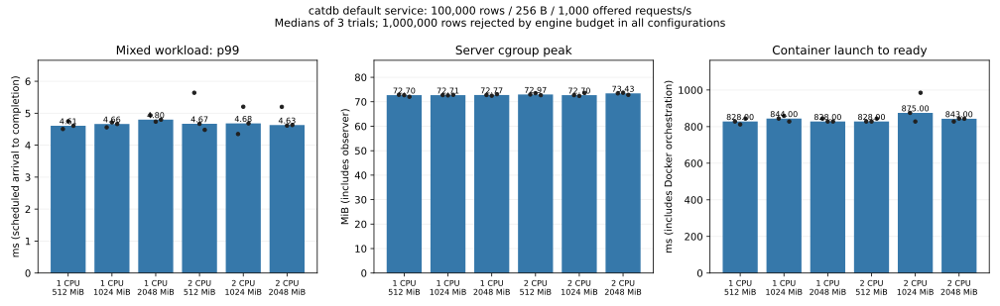
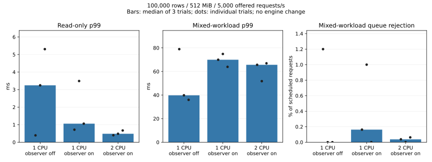

# Default service under CPU and memory constraints

The experiment exposed a **service configuration limit before an OS memory
limit**: all 18 one-million-row attempts were rejected by catdb's default resource
budget, including the 2-GiB containers. No engine optimization or default change
was made. The result is not evidence that a million rows need more than 2 GiB.

## Main matrix

Same production engine at `b2a92c0`, release `service` build, 256-byte values,
1/2 CPU quotas, 512/1024/2048 MiB, 100k/1M rows, three seeded-order repetitions.
The applied cgroup limits and disabled swap are checked. See the [reproduction
and exact workload](../../../benchmarks/resource-envelope/README.md).

All 18 **100k-row** cases handled the offered **1,000 requests/s**, with zero
queue refusals and zero operation errors: 288,000 completed requests and 72
full-content checks, including 18 crash/reopen checks. This is an offered-load
result, not a maximum-throughput measurement. CPU throttling was zero in these
successful cases.

Each table entry is the median of three trial results. p99 includes the client's
scheduled-arrival and queue delay. Read-only uses four connections; mixed uses
one reader and four writer connections, 80% reads / 20% independent updates.

| CPU quota | MiB limit | Read p99 ms | Mixed p99 ms | Peak cgroup MiB | Launch ms | Reopen launch ms |
|---:|---:|---:|---:|---:|---:|---:|
| 1 | 512 | 0.348 | 4.607 | 72.703 | 828.000 | 829.000 |
| 1 | 1024 | 0.338 | 4.663 | 72.715 | 844.000 | 828.000 |
| 1 | 2048 | 0.347 | 4.799 | 72.766 | 828.000 | 813.000 |
| 2 | 512 | 0.364 | 4.669 | 72.969 | 828.000 | 828.000 |
| 2 | 1024 | 0.345 | 4.682 | 72.699 | 875.000 | 813.000 |
| 2 | 2048 | 0.343 | 4.630 | 73.434 | 843.000 | 828.000 |

Bars are medians; dots show every trial. The server cgroup peak includes the
observer and lifecycle/helper overhead. Sampled engine RSS was approximately
55–56 MiB for the successful main cases. RSS, cgroup peaks, and anonymous/file
memory are separately retained in the raw data. Launch timings include Docker
orchestration; they must not be presented as engine-only recovery times. The
separate process-ready probe has 100-ms resolution and is not a precise timer.

## Why the million-row cases cannot run

Every failed million-row server log reports `resource exhausted: database resource
budget`. All have zero cgroup OOM kills. The server constructs
`ResourceLimits::default()` (overriding only the connection count), whose retained
data budget is **128 MiB**. This includes current rows, not only old generations.
The CLI does not currently expose that budget.

For an initially absent 8-byte key and 256-byte value, the current admission
formula charges `192 + 2*8 + 64 + 256 = 528` bytes. Thus one million such rows
require approximately **503.54 MiB of logical retained budget**, before additional
versions. This is a code-derived explanation, not an RSS prediction or a tested
exact maximum row count. See [service defaults](../../../src/service.rs),
[resource limits](../../../src/resources.rs), and
[retained-growth accounting](../../../src/transactions.rs).

Consequently, no million-row workload p99 or throughput is plotted as zero or
silently omitted from the availability result: **all six configurations failed
startup in all three repetitions**. A configurable, explicitly bounded service
budget is the next prerequisite for the million-row resource comparison. Raising
it is not automatically safe: the logical budget is not a hard process-RAM bound.

## Higher arrivals and observer cost

A separate short diagnostic offers **5,000 requests/s**, still 8,000 requests
per workload, with 100k rows and 512 MiB. Observer on/off order alternates over
three repetitions at one CPU; each pair is followed by the two-CPU sampled case.
These are not steady-state soak runs or a complete capacity curve.

| CPU / observer | Work | Completed/s | p99 ms | Median trial max ms | Queue refusals / 24,000 |
|---|---|---:|---:|---:|---:|
| 1 / off | read | 4998.685 | 3.244 | 4.468 | 0 |
| 1 / off | mixed | 4887.841 | 39.797 | 42.116 | 96 |
| 1 / on | read | 4998.420 | 1.058 | 2.519 | 0 |
| 1 / on | mixed | 4788.838 | 69.928 | 74.796 | 93 |
| 2 / on | read | 4998.577 | 0.483 | 2.232 | 0 |
| 2 / on | mixed | 4814.437 | 65.628 | 70.915 | 8 |

Read-only requests had no queue refusals. Mixed updates produced **197 client
queue refusals out of 72,000 scheduled mixed requests** across these nine runs;
submitted operations had zero errors. All 197 refusals were write requests.
Mixed throughput counts reads plus writes, not update-only TPS. All acknowledged changes were verified
after each workload and crash/reopen. Rejected requests were never submitted or
silently retried. Percentiles cover successful requests, so the refusal counts
are essential when interpreting them.

| CPU / observer | Mixed producer lag p99 ms | Mixed client queue p99 ms | Mixed request p99 ms |
|---|---:|---:|---:|
| 1 / off | 0.414 | 35.647 | 4.976 |
| 1 / on | 0.442 | 65.502 | 5.418 |
| 2 / on | 0.416 | 61.042 | 5.109 |

These are medians of separate trial percentiles and **must not be added** to
reconstruct a whole-request percentile. They show that queue delay is material
even when the actual request/response p99 remains around 5 ms. This run does not
subdivide that request time into log synchronization and other engine work.

The sampled server consumed approximately 0.33–0.39 CPU cores during these
workloads and recorded zero CPU throttling. The two-CPU cohort had fewer mixed
queue refusals, but the data do not establish CPU saturation as their cause.
The client, OS scheduling, short-run variation and storage remain possible
contributors; no new storage attribution is claimed.

Observer cost is **not declared negligible**. At one CPU, median mixed p99 was
39.797 ms without periodic sampling versus 69.928 ms with it, while read-only
p99 moved in the opposite direction. The three-trial distributions overlap and
do not isolate a stable causal overhead estimate. Both outcomes and every raw
trial are retained. No optimization decision is based on these differences.

## Failure and safety checks

An additional 100k-row **32-MiB** startup reached the OS memory limit: Docker
reported OOMKilled and `memory.events` reported one OOM kill. Reopening the
**same volume at 512 MiB** recovered all 100,000 pre-existing values. The original
32-MiB outcome remains a failure; it is not reclassified as a passing matrix case.

Across the main matrix and supplementary successful workloads: **432,000 offered
requests, 431,803 successful requests, 197 queue refusals, zero submitted-operation
errors, and 109 full-content checks** including the OOM rescue. All 27 successful
workload fixtures survived intentional server-child SIGKILL and full verification
after reopening. Held old snapshots were checked for every successfully updated
key. Existing sync-before-success behavior was unchanged; this is not an actual
power-loss test.

The five workload-oracle tests passed on Windows and inside the Linux container.
They cover mixed-to-read transitions, old values, bounded admission and drain,
corruption rejection, invalid capacity and percentile boundaries. The first
timer-boundary test caught a possible early wake; the scheduler now rechecks its
deadline. Every published request record passes timestamp, uniqueness and count
validation. Startup diagnostics were also shortened after the first two failed
million-row probes; their original timeout/error records are retained. Neither
change alters the production engine.

## Interpretation and limits

- The default service is usable for this 100k-row, moderate, warm-cache workload
  at 1 CPU / 512 MiB. It is not evidence for all databases or larger values.
- The default retained-data budget, not the tested container limit, prevents the
  million-row experiment. Exposing safe resource configuration comes before an
  architectural conclusion about paging or out-of-core storage.
- Seeds are prepared outside the limit. Ingestion is not measured. Copy-warmed
  and shared host page cache may be charged outside the server cgroup. A warm
  existing-volume restart does not demonstrate cold startup on a small host.
- The Python client has its own resource quota and can contribute delays. CPU
  quotas do not pin physical cores; the host and virtual storage are shared.
- The benchmark helper image runs the server supervisor as root; this does not
  change the separately supplied non-root production Dockerfile. No privileged
  containers, host cache eviction, production libraries or real credentials are
  used. Fixture cleanup targets only generated names.
- Core Rust, C ABI, file formats and durable acknowledgement are unchanged.
  Existing full core suites are left to the repository CI; the experiment does
  not substitute for them or claim complete fault coverage.

## Artifacts

- [Summary, classification and per-trial metrics](summary.json).
- [Compressed raw requests, resource samples, startup logs and environments](raw/).
- [Benchmark source and reproduction](../../../benchmarks/resource-envelope/README.md).
- [Source file hashes](source-sha256.json).

Kudaki reflection was explicitly deferred by the user while its approval UI was
unavailable. The experiment result is complete; the proposed WBS update and any
subsequent production configuration work are separate pending items.
