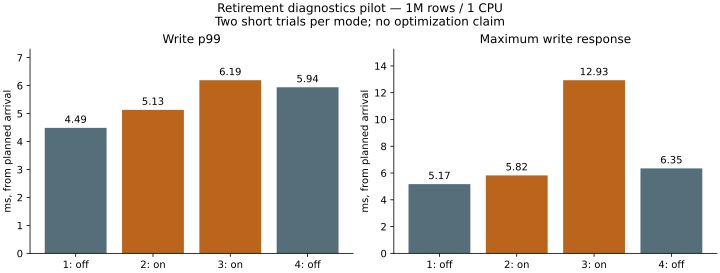
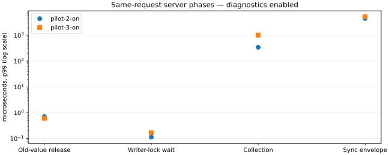

# Post-publication retirement timing pilot (2026-11-06)

## Decision

**Do not move reclamation or change defaults on this evidence.** In 800 measured
updates, 779 old versions were directly retired in 779 eligible groups. Their
release was at most **0.860 microseconds**, while the slowest request took
**12.931 ms**, including a **12.330-ms sync envelope**. The hypothesized ordinary
old-value destruction bottleneck is not supported in this workload. The proposed
three-variant long comparison was conditional on such evidence and was not run.
This does not establish the cause of the previous eight-second experiment's p99
regression, nor rule out problems with larger values, CPU saturation or long runs.

## Method and observer cost

Base commit `b2295f8228098642e14cc212ae5272866ad1f771`, plus the optional
`retirement-timing` diagnostics in this report. Both images use
`skip-unneeded-history`; off has no lock/retirement instrumentation, on enables
`retirement-timing` and `CATDB_DIAGNOSTICS=1`. Docker image IDs, source hashes and
host details are retained alongside each trial. A test-only group-enable fix
was made after image creation; production code was unchanged.

One million 8-byte keys / 256-byte values, 1-CPU quota, 1 GiB cgroup limit,
no swap, 640 MiB logical retained budget. Synthetic disposable volumes only.
No fixed reader during timed workloads. Each trial has 2,000 read-only requests
and 2,000 mixed requests (80% reads, 20% writes; one read and four write workers).
Arrival rate 1,000 requests/s, finite queues of 64 per kind. These are **two-second
phases**, not the preceding 8,000-operation runs. Trial order off/on/on/off.
The read-only phase has four read workers. Client resources and 100-ms cgroup
sampling are identical across modes. Full validation lies outside timed phases.

Elapsed response time starts at **planned arrival**, including client queueing.
Off/on includes instrumentation clocks, existing lock timing, serialization,
extra response bytes and client parsing. It is not a pure timer-cost measurement.
On write p99s are higher, and one on maximum is much higher: two short trials
cannot distinguish observer cost from host/storage variability. Do not call this
instrumentation free or use it as proof of a performance improvement.
Throughput is arrival-limited, not a saturation capacity measurement.

| Trial | Write p99 ms | Write max ms | Mixed read p99 ms | Mixed requests/s | Peak RSS MiB | Peak cgroup MiB |
|---|---:|---:|---:|---:|---:|---:|
| pilot-1-off | 4.486 | 5.170 | 0.337 | 1000.2 | 414.21 | 422.79 |
| pilot-2-on | 5.132 | 5.822 | 0.325 | 1000.2 | 413.96 | 423.40 |
| pilot-3-on | 6.191 | 12.931 | 0.310 | 1000.1 | 413.97 | 422.86 |
| pilot-4-off | 5.940 | 6.346 | 0.352 | 1000.2 | 414.20 | 427.00 |

RSS/cgroup peaks cover the entire boot-to-stop interval, including validation;
they are sampled, not exact peaks of the two-second mixed phase. Cgroup usage
includes cache and observer; it is not Rust allocation size. Swap and OOM kills
were zero. Raw CPU usage/throttling counters remain in the resource logs; this
pilot does not isolate CPU overhead.



## Attribution

Each diagnostic uses one server-local monotonic clock. Client durations are
computed separately; no subtraction between client and diagnostic origins.
All 800 successful write records passed required-field and time-order checks.
Groups are deduplicated by free-start timestamp: 400 and 399 groups, 397 and 382
eligible groups. Their retired charges were 127,040 and 122,240 bytes in total.
These are logical retained charges, not a claim that RSS shrank by that amount.

| Server phase | On trial 2 p99 / max us | On trial 3 p99 / max us |
|---|---:|---:|
| publish_to_free | 0.510 / 0.652 | 0.696 / 4.036 |
| free | 0.717 / 0.860 | 0.612 / 0.649 |
| free_to_writer_release | 0.690 / 0.765 | 0.771 / 0.922 |
| writer_to_persist_return | 0.076 / 8.623 | 0.075 / 0.094 |
| persist_to_reply_ready | 1.577 / 2.494 | 2.568 / 5.032 |
| reply_ready_to_received | 9.748 / 16.813 | 17.504 / 24.707 |
| received_to_dispatch_end | 2.012 / 2.484 | 2.323 / 11.607 |
| sync_envelope | 4489.552 / 5298.215 | 5187.660 / 12329.864 |
| publication | 7.140 / 15.037 | 11.542 / 127.270 |
| writer_wait | 0.113 / 0.123 | 0.169 / 0.339 |
| collection | 344.677 / 1041.202 | 1017.736 / 1066.218 |



The largest on request's 12.931 ms breaks down into a 12.625-ms server dispatch,
0.106-ms client scheduling/queue interval, and a 0.201-ms residual containing
communication, encoding/decoding and other client work. Inside it, the sync
envelope is 12.330 ms, collection 0.259 ms, publication 4.290 us, retirement
0.075 us and reply-ready-to-received 12.802 us. Do not add unrelated p99s or maxima.
The sync envelope includes bookkeeping immediately around `sync_all`; it is not
an OS-level attribution of I/O versus scheduler waiting.

`retirement` is an optional six-element diagnostic: free start, free end,
writer release marker, retired version count, retained charge bytes, persist-group
return marker. Free starts after the state lock is released. Release covers Arc
destruction, buffers and budget release; it does not guarantee allocator pages
were returned to the OS. Writer release is marked immediately after dropping the
guard (scheduling can occur at that boundary). A guard wrapper preserves existing
local drop order. Group return and existing reply-ready/received/dispatch-end
markers bracket the remaining work. The coordinator leader remains held while
retiring and preparing replies; moving only the writer lock would not by itself
unblock the next group. Its precise release instant is not separately measured.

Zero timestamps indicate unreached phases, not zero cost. Empty retirement still
has timestamps and count zero. Invalid requests clear the record. Failed commits
retain only reached phases. Explicit multi-operation batch outcomes report null
for this new field because per-outcome retirement transfer is not implemented;
the pilot exclusively uses `put_commit`. Record storage is six integers per group/
reply; diagnostic payload stays below the existing 2-KiB test bound. Client
storage is bounded by the explicitly supplied operation count.

## Safety and validation

16,000 requests completed, no errors or queue rejections. Sixteen full-content
checks passed (initial, after each workload, and after killing/reopening the
owned server). Timing diagnostics do not change sync, visibility, conflict
checking, retirement limits, memory budgets or file formats.

New characterization tests delay release by 10 ms: published values remain
readable, writer ownership and retained charge last until release, and trace
order reaches the caller correctly. They also distinguish pinned/empty/failed
commits and reset stale diagnostics. The artificial delay demonstrates possible
blocking, **not** that normal destruction caused prior tail latency.
Existing tests cover old generations, readers starting during sync, group
point/range conflicts, retained limits, failed persistence and child-process
crashes. Windows diagnostic Rust suite: **158 passed / 12 ignored**; default service
library regression: **63 passed / 9 ignored**. New analyzer tests: **4 passed**;
resource client tests: **6 passed**; actual service diagnostic/protocol tests:
**26 passed**; C ABI: **35 passed**. Clippy for the diagnostic library/server and
an all-features compilation check passed. Windows/Linux CI adds the
`service,retirement-timing` combination. Test logs are retained as gzip.
The initial new group test accidentally used the default single-commit mode;
it was corrected to enable group commit before the successful run.

## Reproduce

```sh
docker build -f benchmarks/Dockerfile --build-arg EXTRA_FEATURES=,skip-unneeded-history -t catdb-retirement:off .
docker build -f benchmarks/Dockerfile --build-arg EXTRA_FEATURES=,retirement-timing -t catdb-retirement:on .
python benchmarks/retirement-timing/run.py --out artifacts/retirement-pilot-new
python benchmarks/retirement-timing/test_analysis.py
```

The output path must not exist. All raw records are preserved as lossless gzip;
the analyzer accepts plain or compressed records. See [summary](summary.json)
and the four `pilot-*` directories. The existing default remains unchanged;
the skip-history prototype is still opt-in. End this experiment here rather than
extend exploration without evidence. A separate future decision could investigate
sustained memory pressure or inline-latest adoption; neither is established by
this pilot.
