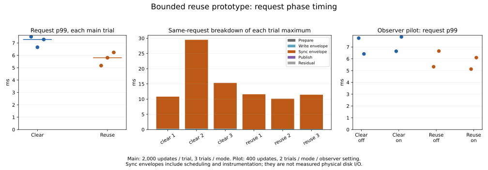

# Request-phase investigation in the bounded reuse prototype (2026-11-07)

## Finding and decision

The long requests observed **in this run** are dominated by the synchronization
envelopes, not by map preparation, writes/encoding or publication. The six main
trials spend **94.39–94.59%** of summed request time in sync envelopes. Each trial's
worst request spends approximately **97.38–99.14%** there.

The largest clear-mode request is **29.505 ms**, including **29.194 ms** of sync
envelopes (append 11.513 ms + transition 17.681 ms). The largest reuse-mode request
is **11.599 ms**, including **11.499 ms** of append sync, with no transition.

These envelopes include scheduling, filesystem/device waits and small recorder/counter
costs. They are **not physical disk I/O measurements**. This does not identify the
cause of the prior uninstrumented 18.214-ms event, nor establish that reuse fixes
maximum latency. The ordering of maxima reversed from the preceding experiment.
No engine optimization, production/default change or extended OS tracing was undertaken.



## Main comparison, all trials

Each mode runs 2,000 updates + 500 transitions, in clear3/reuse3/reuse4/clear4/clear5/reuse5
order. IDs 3–5 are shown as trials 1–3 in the figure. Both modes have tracing enabled.
The same optimized binary, single writer, 2 CPU quota / 4 GiB limit and Docker Desktop
named-volume path are used. Dataset, 34-update warmup, retained old map, 32 prepared
change sets and 100 warm reopens per trial match the preceding small-fixture experiment.

| Mode / raw trial | Updates/s | Request p99 ms | Request max ms | Sync in that same max ms | >10ms | >20ms |
|---|---:|---:|---:|---:|---:|---:|
| clear / 3 | 359.68 | 7.504 | 10.824 | 10.540 | 3 | 0 |
| clear / 4 | 361.33 | 6.656 | 29.505 | 29.194 | 6 | 2 |
| clear / 5 | 351.05 | 7.282 | 15.334 | 15.038 | 3 | 0 |
| reuse / 3 | 418.32 | 5.170 | 11.599 | 11.499 | 1 | 0 |
| reuse / 4 | 408.62 | 5.806 | 10.129 | 9.915 | 1 | 0 |
| reuse / 5 | 405.24 | 6.236 | 11.453 | 11.254 | 1 | 0 |

Median trial throughput is **359.68 / 408.62 updates/s** for clear/reuse; median trial
request p99 is **7.282 / 5.806 ms**. >10-ms counts are **12 / 3**, and >20-ms counts
**2 / 0**, each out of 6,000 requests. The prior uninstrumented comparison had >10-ms
counts 11 / 8 and maxima 15.070 / 18.214 ms. These short samples do not establish a
stable tail-rate difference or a guaranteed latency bound.

## Contiguous delay evidence

Clear trial 4 has a delay episode around requests 1315–1324. Append sync envelopes
in neighboring requests reach 5.6–6.5 ms instead of approximately 1.3 ms after the
episode; transition sync envelopes also increase. This resembles the previous
observation of adjacent slow appends and transitions, but it does not prove a common
physical cause or retrospectively explain the earlier event.

| Request | Append sync ms | Transition sync ms |
|---:|---:|---:|
| 1315 | 5.727 | 0.000 |
| 1316 | 5.713 | 17.516 |
| 1317 | 5.601 | 0.000 |
| 1318 | 6.499 | 0.000 |
| 1319 | 5.653 | 0.000 |
| 1320 | 11.513 | 17.681 |
| 1321 | 5.704 | 0.000 |
| 1322 | 6.521 | 0.000 |
| 1323 | 5.762 | 0.000 |
| 1324 | 1.308 | 17.606 |
| 1325 | 1.257 | 0.000 |

## Observer pilot

400 updates + 100 transitions per run; two repetitions for each mode/observer setting.
Order: clear-off1, clear-on1, reuse-off1, reuse-on1, reuse-on2, reuse-off2,
clear-on2, clear-off2. Warmup and all correctness checks remain enabled. The disabled
path uses the same binary and hooks but does not collect phase timestamps.

| Mode | Observer | Median updates/s | Request p99 range ms | Worst request ms |
|---|---|---:|---:|---:|
| clear | off | 354.79 | 6.412–7.751 | 16.885 |
| clear | on | 358.61 | 6.640–7.855 | 9.471 |
| reuse | off | 415.57 | 5.326–6.654 | 8.805 |
| reuse | on | 417.90 | 5.126–6.099 | 8.173 |

No throughput deterioration was evident in this pilot; timestamp reconciliation and
safety checks passed, so the planned main comparison proceeded. p99 changes varied
in direction. Two ~1-second repetitions cannot isolate instrumentation cost from
run-to-run storage/scheduler variability; this is **not a zero-overhead claim**.
No repeated search was performed to obtain a favorable observer result.

## Interval definitions and bounded recording

- Prepare: operation entry through validation, production frame construction and
  next-map/checkpoint preparation. Not all encoding belongs here.
- Write envelope: outer-record encoding/validation, seeks, writes, write accounting
  and hooks; includes clearing in clear mode. It is not raw write-syscall time.
- Sync envelope: before-sync hook through return from `sync_data` and the synced hook;
  includes sync accounting and elapsed time while the thread is not running.
- Publish: state/visible-map publication and operation cleanup. Reclaim in clear mode
  moves back into write/sync phases before final cleanup.
- Request elapsed includes a transition when due, then append, plus recording/bookkeeping
  residual. Append and switch are nested fields and must not be added to request total.
  Prepare/write/sync/publish partitions sum exactly to their own operation interval.
- Each operation has a fixed **16-entry** phase array. Successful append/reuse-switch/
  clear-switch traces contain exactly **5/7/10** points including endpoints. Bad time
  order, invalid phase, overflow and recording after completion are rejected.
  Recording is limited to 2,000 requests; output happens after the timed loop.
- Off-mode phase fields are zero because unmeasured, not because work is absent.
  The published CSV includes monotonic request start offsets, enabling adjacency checks.
  The individual transition sync calls are aggregated; data/selector/reclaim sync times
  are not separated in this result. There are no OS events or physical-I/O timestamps.

## Correctness and scope

The measured build reran **20 passing safety/recorder tests**, with four ignored
entries (two child helpers and two opt-in measurements). Tests cover trace ordering,
capacity, phase sums, real clear/reuse operations and a recorded failure before sync;
existing model, partial-write, old-map and external-kill tests remain passing.

All **15,200 measured updates**, 14 final full-map checks, 14 retained-old-map checks,
and **1,400 warm reopen full-map checks** passed. All 14 timing runs exited successfully;
no reopen needed repair. Real syncs are preserved. Main clear/reuse runs retain the
expected 3,500 / 3,000 sync calls and 185,751,000 / 21,911,000 submitted bytes.
All output records passed timestamp/order and nested-interval reconciliation checks.

The test-only store still has a one-slot checkpoint limit and bounded one-detectably-
damaged-copy assumption. Both-copy loss remains a negative control. This is not
production MVCC/group commit, a large DB benchmark, a cold restart or a power-cut test.
No throughput/latency improvement is attributed to instrumentation itself.

## Reproduction and evidence

```sh
docker build -f benchmarks/variable-gate/Dockerfile -t catdb-reuse-phases .
python benchmarks/reuse-phases/run.py --stage pilot --output artifacts/phases-pilot
# Inspect the observer pilot before electing to run the main comparison.
python benchmarks/reuse-phases/run.py --stage main --output artifacts/phases-main
python benchmarks/reuse-phases/analyze.py --input artifacts/phases-pilot artifacts/phases-main
python benchmarks/reuse-phases/chart.py --report artifacts/phases-pilot/report
```

The portable runner refuses an existing output directory and retains its dedicated
volume. The recorded run used the equivalent sequential PowerShell runner in
[recorded-run.ps1.txt](recorded-run.ps1.txt); Python runner CLI and analyzer were checked,
not used to repeat the timings. Matplotlib is needed only for the figure.

Rust 1.89, Docker Desktop Linux, 2 CPU / 4 GiB. Recorded image:
`sha256:ccf984c98c7f4e907ada3684881da5b020a1bcbf3a9b5fb26ee9c317ad392b4d`.
[LF-normalized source hashes](source-sha256.txt), [build/safety log](build.log),
[per-trial statistics](trials.csv), [every request](requests.csv),
[JSON summary](summary.json). All 14 raw run logs are beside this document;
only trailing whitespace and line endings were normalized.

## Next decision

There is no evidence here for optimizing map preparation/publication to remove the
observed long waits. The remaining cause *inside* sync envelopes is unresolved.
Rather than automatically extending OS tracing, a separately scoped investigation
could test less frequent transitions with bounded log capacity and unchanged commit
sync guarantees. Scalable checkpointing, global budgets and production integration
remain separate gates. No such change was made in this experiment.

Kudaki reflection is pending: list_documents again failed session initialization.
No WBS file was edited directly; these runs belong under the existing experiment L1/L2.
