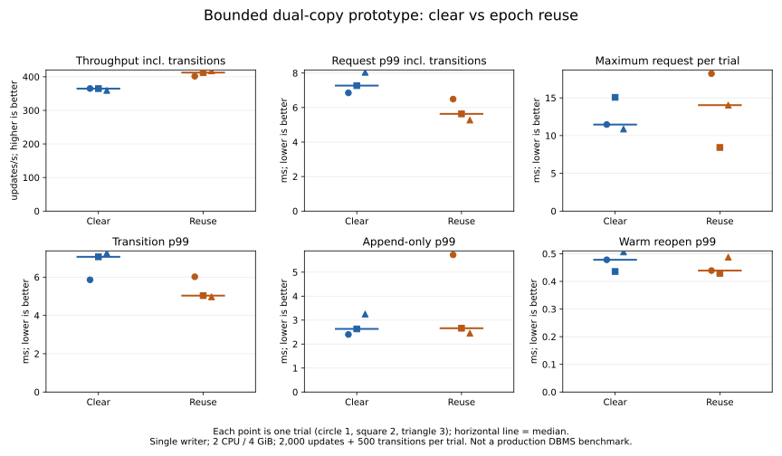

# Bounded epoch-reuse timing (2026-11-07)

## Result

In this **small, single-writer prototype**, removing whole-bank clears improves
median throughput including transitions from 364.89 to 412.68 updates/s (**+13.1%**)
and median per-trial request p99 from 7.271 to 5.632 ms (**-22.5%**).
All three reuse throughput results exceed all three clear results in this short run.
This is not a production DBMS, service or large-data benchmark.

The worst request across trials **worsens from 15.070 to 18.214 ms**. Append-only
p99 does not consistently improve: its per-trial median changes from 2.632 to
2.661 ms, and reuse trial 1 reaches 5.723 ms. Removing clears reduces transition
work but does not eliminate synchronization/scheduling outliers. No causal OS
attribution was attempted.



## Median of the three trial statistics

These are medians of per-trial percentiles, not a pooled percentile. Nearest-rank
percentiles use ceil(p*n). The complete per-trial p50/p99/max values are in
[trials.csv](trials.csv), and every timed operation in [requests.csv](requests.csv).

| Metric | Clear | Reuse |
|---|---:|---:|
| Throughput incl. transitions (updates/s) | 364.886 | 412.682 |
| Request p50 incl. transition (ms) | 1.470 | 1.465 |
| Request p99 incl. transition (ms) | 7.271 | 5.632 |
| Append-only p50 (ms) | 1.401 | 1.405 |
| Append-only p99 (ms) | 2.632 | 2.661 |
| Transition p50 (ms) | 4.571 | 3.366 |
| Transition p99 (ms) | 7.062 | 5.036 |
| Warm reopen p50 (ms) | 0.398 | 0.401 |
| Warm reopen p99 (ms) | 0.478 | 0.439 |

## Every trial

| Execution order | Mode | Updates/s | Request p99 ms | Request max ms | Transition p99 ms | Append p99 ms | Warm reopen p99 ms |
|---:|---|---:|---:|---:|---:|---:|---:|
| 1 | clear 1 | 365.10 | 6.851 | 11.467 | 5.861 | 2.401 | 0.478 |
| 2 | reuse 1 | 401.74 | 6.490 | 18.214 | 6.019 | 5.723 | 0.439 |
| 3 | reuse 2 | 412.68 | 5.632 | 8.430 | 5.036 | 2.661 | 0.429 |
| 4 | clear 2 | 364.89 | 7.271 | 15.070 | 7.062 | 2.632 | 0.436 |
| 5 | clear 3 | 359.51 | 8.042 | 10.869 | 7.259 | 3.251 | 0.507 |
| 6 | reuse 3 | 417.58 | 5.275 | 14.040 | 4.972 | 2.452 | 0.487 |

## Matched conditions and timing boundaries

- Same optimized Rust 1.89 binary, default features, corrected inner-copy validation
  in both modes. Only the `clear` policy differs. This comparison cannot isolate the
  cost of adding inner validation versus an older recovery implementation.
- Docker Desktop Linux, engine 29.9.2, WSL2 kernel 6.18.54.1-microsoft-standard-WSL2;
  2 CPU quota / 4 GiB container limit. A dedicated named volume stores the databases,
  not the container's writable image layer. Host storage placement and host background
  I/O were not traced. Host CPU affinity was not pinned.
- Single synchronous writer, no service/network/arrival queue. Closed-loop operation:
  the next update starts after the previous returns. Not a fixed-arrival-rate test.
- Same small data shape as the prior gate: three retained keys, 4,236 bytes of key/value
  payload, two checkpoint copies in fixed 16-KiB slots, four append slots per bank.
  32 prepared change sets vary one value byte. Dataset is not 100k or 1M rows.
- Each trial creates a new file without overwriting anything, seeds two updates,
  warms up with 34 updates and retains an old snapshot. Warmup ends with a full log.
  Initialization and warmup are outside timed measurements.
- Each trial times **2,000 appends and 500 transitions**. Every fourth request must
  switch first. Request elapsed includes that switch when due; append elapsed excludes
  it. Transition elapsed includes checkpoint preparation, writes, required syncs,
  selector publication, and clearing/reclaim when enabled. All real sync calls remain.
- Throughput is updates divided by the whole 2,000-request loop time, including
  in-loop timing/row recording overhead. Output and correctness checks occur outside
  the timed loop. The total request duration contains nested measurements, so these
  fields must not be added together as independent work.
- Each trial then measures 100 same-process warm reopen calls. Timing stops before
  equality assertions and close. Cached data is deliberately not evicted. These are
  neither cold startup nor post-power-loss recovery measurements.
- Trial order: clear1, reuse1, reuse2, clear2, clear3, reuse3. Main phases last
  approximately 4.8–5.6 seconds per trial; no long-run tail or significance claim.
  There are only 500 transition samples and 100 reopen samples per trial, so their
  p99 estimates are particularly sensitive to individual observations.

## Safety and accounting

All **12,000 measured updates**, six final full-map checks, six retained-old-map checks
and **600 reopen full-map checks** passed. Reopens required no repairs. All six timing
runs exited successfully. The unchanged safety cases were rerun in the measured build:
**19 passed / 3 ignored** (two child helpers and this opt-in timing test), including
the prior model/forced-stop cases. No additional power-cut experiment was performed.

Per trial the clear/reuse paths submitted **185,751,000 / 21,911,000 bytes** and made
**3,500 / 3,000 sync calls**, excluding creation and warmup. Submitted bytes are not
physical storage traffic. The file stays 393,216 bytes. Named-buffer/RSS allocation
profiling was not part of this timing run.

The bounded one-detectably-damaged-copy assumption remains; both-copy loss remains
outside the recovery guarantee. Old snapshots are test-store Arc maps, not integrated
production MVCC. The checkpoint must still fit one slot. See the
[prior gate and failed variants](../epoch-reuse-2026-11-07/README.md).

## Reproduction and raw records

From the repository root:

```sh
docker build -f benchmarks/variable-gate/Dockerfile -t catdb-reuse-speed .
python benchmarks/reuse-speed/run.py --output artifacts/reuse-speed-repeat
python benchmarks/reuse-speed/analyze.py --input artifacts/reuse-speed-repeat
python benchmarks/reuse-speed/chart.py --report artifacts/reuse-speed-repeat/report
```

The runner refuses an existing output directory and retains its uniquely named volume
for inspection. Matplotlib is needed only for chart rendering. The published runner is
a portable equivalent of the sequential PowerShell invocation used for this recorded
run; its CLI and the analyzer were checked, but it was not used to rerun the timings.

Recorded image: `sha256:a2ec78dd9c106913f779e533c4a8addc2af0f5f0f3bf958980b8f5df51ecf81f`.
LF-normalized source hashes: [source-sha256.txt](source-sha256.txt).
[Build/safety output](build.log); timing outputs:
[clear1](clear-1.log), [reuse1](reuse-1.log), [reuse2](reuse-2.log),
[clear2](clear-2.log), [clear3](clear-3.log), [reuse3](reuse-3.log).
Logs preserve failures/outliers and trim only line-ending/trailing whitespace.

## Decision

The small-fixture result supports keeping epoch reuse as an experimental candidate.
It does not justify changing production defaults: scalable checkpoint storage, bounded
buffers and integration with production MVCC/conflict/group commit remain unvalidated.
No extra long run or new persistence design was started. Kudaki reflection remains
pending because list_documents still returns a session-initialization error; no WBS
file was edited directly.
