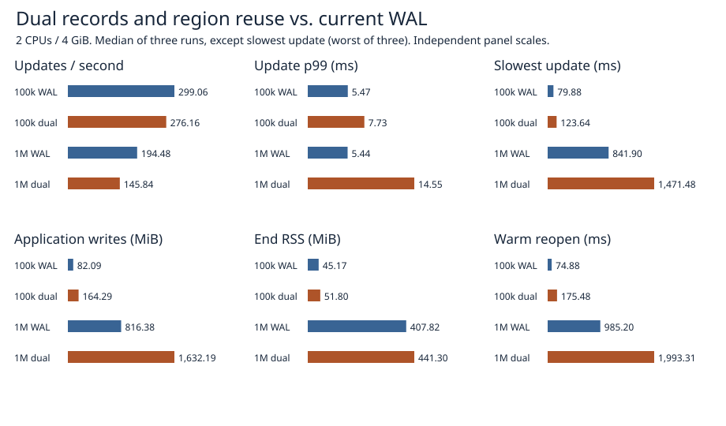

# Dual records and region reuse at 100k and 1M rows

This is a Linux-only test store, not a SilverHamu format or deployable durability option. The control is the current SilverHamu WAL. Each path performs real synchronization. This compares complete single-writer paths; the prototype has neither the production MVCC implementation nor its general-purpose limits.



| Rows | Path | Updates/s | p99 (ms) | Worst (ms) | Writes (MiB) | End RSS (MiB) | Reopen (ms) |
|---:|:---|---:|---:|---:|---:|---:|---:|
| 100,000 | wal | 299.06 | 5.47 | 79.88 | 82.09 | 45.17 | 74.88 |
| 100,000 | dual | 276.16 | 7.73 | 123.64 | 164.29 | 51.80 | 175.48 |
| 1,000,000 | wal | 194.48 | 5.44 | 841.90 | 816.38 | 407.82 | 985.20 |
| 1,000,000 | dual | 145.84 | 14.55 | 1,471.48 | 1,632.19 | 441.30 | 1,993.31 |

Throughput and p99 are medians of three per-run observations; max is the **slowest request in all three runs**. Every request includes a checkpoint if one was due. Only three of 1,024 requests switch generations: p99 alone misses the main cost. [All trial statistics](trials.csv) include checkpoint time, pinning, warm reopen, RSS, high-water mark, and logical versus allocated file size.

## What was measured

- Dedicated fresh Docker volume per trial, Linux, two CPUs and 4 GiB with no swap. Alternating WAL/dual, dual/WAL, WAL/dual. One serial writer; no grouping, queueing or intentional wait. A request is a multi-key transaction, not a single row. Values are 256 bytes; keys alternate between 8 and 32 bytes. Each transaction updates an existing key, adds a key, usually removes the preceding new key, and periodically deletes an existing key.
- Seed and pin an old reader **before** the timer. Run the same 1,024 requests with three full checkpoints (before zero-based requests 256, 512 and 768), leaving 256 updates to replay on open. Check the entire sorted latest and old datasets against expected keys, values and counts, close and reopen, then verify the entire latest dataset again. Setup, snapshot acquisition, verification and warm reopen are separate from throughput. No cold-cache or service latency claim.
- Both paths execute one synchronization per transaction plus two per checkpoint on this workload. Submitted bytes cover the timed phase: prototype counts bytes passed to successful writes; control counts encoded frames plus checkpoint file bytes and header rewrite, and cross-checks WAL length. These are not physical-device writes. RSS is sampled after the timed loop with the old reader still held; the lifetime high-water mark also includes setup. Logical sparse-file length, filesystem allocated blocks and submitted bytes measure different things.

## Prototype and failure boundary

Two banks reuse fixed offsets. The inactive bank receives a sorted, chunked full checkpoint; its data is synced before its two generation selectors are written and synced. Ordinary updates write two framed copies, sync once, then publish in memory. Old-generation bytes are ignored instead of zeroing the bank. Checkpoint chunks and log frames carry generation, position, sequence and predecessor checks; a selector binds the checkpoint count and terminal checksum. Recovery validates before attempting repair and synchronizes repaired data before allowing new writes. A final recovery sync covers a previous repair visible in cache whose sync was interrupted.

Reads are bounded by slot, not file length. Slots are 1 MiB including a 96-byte envelope; individual frames are limited to 4,096 operations. Eight MiB is the format scratch admission threshold, **not** an allocator measurement or a process RSS cap. The current data and explicit old snapshot are separate from scratch. Snapshot acquisition clones the key index and shares values; ordinary commits copy only the changed data. This differs from a production MVCC reader.

The model assumes at most one detectably damaged copy per record. Two eligible, conflicting copies fail closed. If **both** copies of an acknowledged tail disappear, the reader may see an older, valid end: the regression suite preserves this counterexample. CRCs do not authenticate data, and a child-process kill does not simulate power loss or controller failure. No change to production/defaults, API or existing file formats follows from these results.

## Verification and earlier failures

The targeted suite passed 12 tests; the default Linux release library suite passed 97 with 22 ignored (including opt-in benchmarks/helpers). Checks cover capacity and generation bounds, old readers, mixed-length and empty data, repeated reuse, atomic multi-key replay, partial and reordered writes, missing and misplaced blocks, repair failures and retry, and process termination around append, generation publication and repair. The separate benchmark invocation runs the ignored timing entry point. [Safety output](safety.log) and [full library results](library.log).

Two observations changed the experiment:

1. The first pilot could not read the process I/O counter; it produced no performance result. Application-level byte accounting replaced that counter. Its failed raw result is preserved.
2. Before the final large runs, placing a checksum-valid block from another slot in one copy caused recovery to stop despite a healthy peer. [Failing regression](misplacement-negative.log). Recovery now checks each copy against expected identity before selection. The new regression checks checkpoint, log and selector misplacement, full contents and idempotent repair. Earlier timings are archived separately and excluded from the comparison.

## Reproduce from the repository root

```sh
docker build -f benchmarks/scaled-gate/Dockerfile -t catdb-scaled-gate .
docker run --rm --network none --cpus 2 --memory 4g --memory-swap 4g catdb-scaled-gate cargo test --locked --release --lib -- --test-threads=1
python benchmarks/scaled-gate/run.py --stage pilot --out results/pilot-final
python benchmarks/scaled-gate/run.py --stage 100k --out results/100k-final
python benchmarks/scaled-gate/run.py --stage 1m --out results/1m-final
python benchmarks/scaled-gate/report.py results report
```

Proceed in order and stop if any verification fails. Output directories must be new. The report uses only the two final main cohorts. [Raw results](raw/) contain each request, timings, environment/source hashes, container status, and preliminary attempts.
