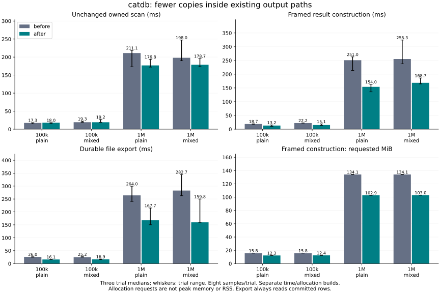
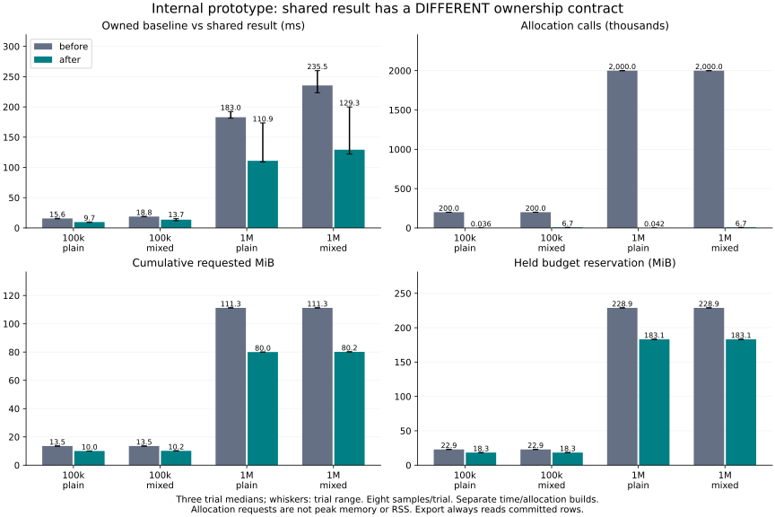

# Removing full-scan key/value allocations

Baseline: `6fbe8ff`. The public owned Rust `scan()` remains unchanged. This follow-up adopts an internal shared result for the existing C ABI full scan and immutable-file export. It also measures that result representation separately; it is **not a new public zero-copy API**.

## Decisions and results

- **Framed output construction:** at 1M rows / plain, **250.972 → 154.015 ms**, with **2,000,022.000 → 43.000 allocation requests** and **134.147 → 102.888 MiB requested. This constructs exactly the existing C ABI row frame. The benchmark invokes equivalent internal framing code, not the DLL entry point; caller-buffer copying, handle lookup and cross-language overhead are excluded on both sides. Actual C ABI bytes/statuses are checked separately.
- **Durable export:** **264.044 → 167.661 ms**, **1,999,359.000 → 26.000 allocations**, **126.516 → 64.008 MiB requested. The real `export_values()` writes, flushes and synchronizes each new immutable file. It no longer copies keys or materializes per-row owned payloads/reference slices. Storage and synchronization variability remain part of this result.
- **Owned Rust scan control:** **211.146 → 176.821 ms** at 1M / plain. Its implementation and return type were not changed. Differences here reflect the paired binaries/system conditions; they are not a demonstrated owned-API optimization. All observed increases and maxima remain in the table.
- **Internal shared-result prototype:** **182.980 → 110.948 ms** versus the owned baseline. The output has a different ownership contract and is shown in a separate figure. Consumers that require `Vec<(Vec<u8>, Vec<u8>)>` would still have to allocate/copy; that conversion is not timed here.

All 48 runs completed ordered-content, old-snapshot and reopen checks. Each operation has eight samples per run and three trials per version/size/shape. Bars are medians of trial medians; whiskers are their range. We report observed maxima, not p99 from eight samples. [All numerical results](table.md), [per-trial summaries](summary.json) and all 48 raw `.csv.gz` files retain every observation.

The unchanged owned control at 100k / plain worsened from **17.274 to 18.024 ms**, with observed maximum **18.812 to 23.646 ms**. Its mixed maximum also increased **25.927 to 32.669 ms**. At 1M the unchanged control improved, so not all measured time differences can be causally assigned to copy removal; allocation-count changes provide more direct evidence of eliminated work. No claim of universally improved latency is made.

## What is removed, and what remains

Keys are copied into one growing contiguous byte vector. Each row stores offsets and an `Arc` to its selected value. Committed values reuse their existing shared allocation. Staged values are copied to an owned `Arc` so the result remains valid after subsequent transaction edits, rollback or destruction. These staged copies occur while the database state mutex is held, whereas the owned scan copies their payloads after unlocking. **Large staged values can therefore lengthen that critical section**; these single-reader timing results do not establish improved concurrent latency for that case. Export uses a read-only transaction with no staged values. Iteration preserves the same ordered merge, snapshot selection and range dependency as the owned path. No borrowed reference into a mutable database or transaction escapes the lock.

The C ABI still constructs its contiguous frame and copies that frame into the caller's buffer. It removes the intermediate independently owned key/value vectors; it does **not** eliminate all data copies. Buffer negotiation, wire layout, range checks and response-size limits remain unchanged. Export requests no keys and passes the shared rows directly to the existing immutable-file writer. There is no storage-format change.

`SharedScan` remains crate-private. It owns keys, value references and a buffer permit, with the permit dropped last. Values remain charged to this permit even if history reclamation later releases its retained-data charge. Sharing is not treated as free memory. This intentionally double-counts shared payloads while both holders live, avoiding a lifetime gap in accounting. Staged values, metadata, and transient vector growth are covered before allocation.

For N output rows and K key bytes, the reservation is **160N + 3K + value bytes** when keys are requested, or **160N + value bytes** for export. Explicit doubling bounds old plus new vector allocations by three times the populated bytes/elements. Row descriptors are 32 bytes on this platform; the metadata allowance also covers staged Arc headers. Layout assumptions and boundary reservations are tested. The buffer reservation may be more conservative for long keys than the old path. It is not a process RSS limit, and allocator rounding is not a measured peak.

## Measurement details and limitations

- Same 100k / 1M synthetic data as the preceding experiment: 8-byte big-endian keys and 8-byte values; durable seed batches of 4,096. Readers are pinned before 1,000 committed updates/deletes. Both versions use the same seed and mutation schedule.
- `plain` is a read-only transaction. `mixed` stages 10,000 deterministic inserts/updates/deletes (10% / 1% of initial rows) and returns N+1 rows. Exports always read the **latest committed** database (N-334 records), excluding staged writes, even in the mixed cohort; they do not export the reader's old snapshot. Every exported value is checked against that committed oracle.
- Each run measures owned, framed, shared and export in that fixed order, eight times each. Before/after order reverses in trial two. Time cohorts precede allocation cohorts. Four binaries are frozen beforehand. No builds or other tests ran concurrently with performance trials; cache, CPU affinity and host background work were not controlled.
- Time builds compile allocation recording out. Separate System-forwarding allocator builds count calling-thread allocation/reallocation requests, summing the full new size of reallocations. **Cumulative requests are not live/peak memory or RSS.** Instrumented times are archived but not used for speed claims. Instrumentation overhead was not estimated.
- Timers exclude data seeding, correctness comparisons and returned-result destruction. Framing includes destruction of its intermediate scan, while shared-result destruction is outside its timer. These are operation-specific construction costs, not end-to-end consume/free or concurrent-service throughput.
- Current/peak buffer reservations are recorded. Held budgets for owned/framed/shared results include their respective permits; framing keeps the conservative source reservation until its result drops, matching the production call's lifetime. Export has released its permit by return, so its current reading is zero and shown as `released`, not zero resource use. Peak is the database's lifetime high-water mark, including preceding operations; it must not be attributed solely to export.
- The original baseline engine is unchanged. Only benchmark code and an adapter implementing its owned/framed preparation were added. Candidate uses the internal shared path. [Environment, exact/local and LF-normalized source hashes, executable hashes](environment.json) identify both builds. All data uses disposable C: directories; no PALV or user-library data was opened.

## Verification

Four new Rust tests check ordered mixed changes and range boundaries, empty and growth-boundary budgets just below/at/above the reservation, preserved staged data after rejection, large values/keys, shared results surviving transaction changes/owner destruction, concurrent updates while paused after unlocking, export contents and existing-destination refusal. All reservations return to zero after result release; values remain accessible after their transaction/database owner is dropped.

Full Rust suites: **137 passed / 11 ignored** with `service`, **148 passed / 13 ignored** with `service,fixed-log`. Ignored entries include explicit benchmarks and subprocess helpers exercised by recovery parents. **35 discovered C ABI tests** and **18 service protocol tests** passed. The additional C ABI test checks exact bytes after mixed changes, empty/large values, 1,024-byte keys and output capacity below/at/above the requirement, including an untouched insufficient buffer. Normal all-target Clippy passes. Existing recovery/failed-save/old-generation/competition tests remain in the suites. Process-crash checks are not evidence of every physical power-loss scenario.

## Reproduce

See [reproduction commands](../../../benchmarks/scan-copy/README.md). Results do not establish speedups for arbitrary values, concurrent loads, cold reads or other machines. The unchanged owned API remains available; the shared prototype is not exposed as a new Rust/C ABI return contract.
