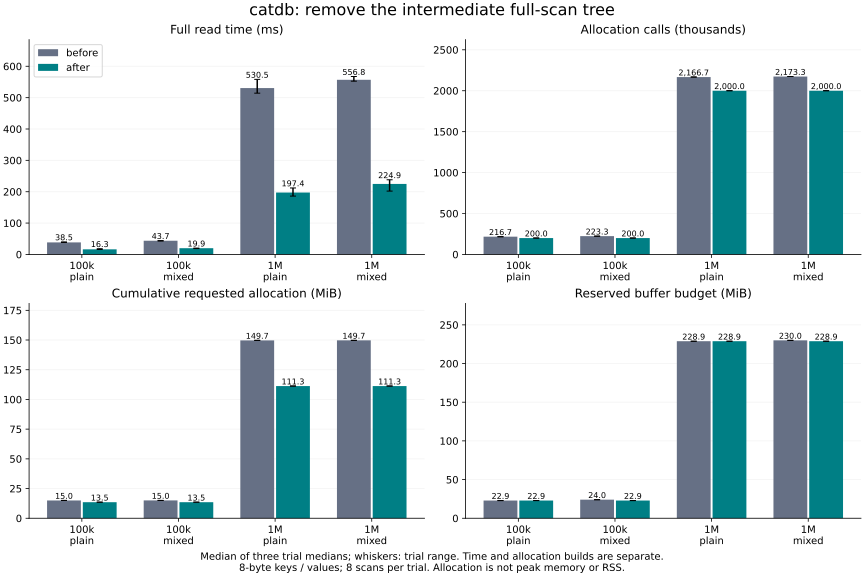

# Full scans without an intermediate tree

Baseline: `d50fe50`. **Adopted:** merge the existing ordered stored-row and staged-write iterators directly into an ordered vector of shared/borrowed values. Copy payloads after releasing the database mutex. Public APIs, range dependencies, commit validation and persistence formats are unchanged.

## Results

At 1M rows, median full-read time changed **530.497 → 197.401 ms** without staged changes and **556.839 → 224.911 ms** with 10,000 staged edits. These are medians of three trial medians, eight scans per trial, with counter-disabled release builds.

Allocation counting is separate. At 1M / plain, cumulative requested allocation changed **149.680 → 111.259 MiB** and calls **2,166,665.000 → 2,000,021.000**. These are allocation requests, including full reallocation sizes, **not peak memory, live memory, or process RSS**. The unchanged conservative per-output-row reservation means that lower actual allocations need not lower the budget: plain scans still reserve 240 bytes per row for these 8-byte keys/values. Mixed scans no longer reserve output space for shadowed stored values or deleted rows.

| Rows / shape | Version | Read median ms | All-scan maximum ms | Allocation calls | Requested MiB | Reserved MiB |
|---|---|---:|---:|---:|---:|---:|
| 100,000 / plain | before | 38.468 | 42.015 | 216,667 | 14.97 | 22.89 |
| 100,000 / plain | after | 16.290 | 20.210 | 200,018 | 13.53 | 22.89 |
| 100,000 / mixed | before | 43.691 | 46.911 | 223,335 | 15.02 | 24.01 |
| 100,000 / mixed | after | 19.915 | 21.904 | 200,020 | 13.53 | 22.89 |
| 1,000,000 / plain | before | 530.497 | 649.190 | 2,166,665 | 149.68 | 228.88 |
| 1,000,000 / plain | after | 197.401 | 237.070 | 2,000,021 | 111.26 | 228.88 |
| 1,000,000 / mixed | before | 556.839 | 682.087 | 2,173,333 | 149.73 | 230.00 |
| 1,000,000 / mixed | after | 224.911 | 256.271 | 2,000,023 | 111.26 | 228.88 |

Time columns use only the counter-disabled cohort. Maxima include all 24 scans per condition; they are observed maxima, not a guaranteed bound or a statistically robust p99. All three trial medians and raw maxima, including unfavorable observations, are in [summary.json](summary.json). Allocation columns are medians of per-trial medians from instrumented runs. All 48 raw CSV files are retained as `.csv.gz` alongside this report; no sample was discarded. The figure's whiskers show the minimum/maximum of three trial medians.

## Workload and limits

- 100,000 / 1,000,000 synthetic records, 8-byte big-endian keys and 8-byte values, seeded in durable batches of 4,096 before timing. Same workstation as the prior experiment; [environment and source/binary hashes](environment.json).
- Both readers start before 1,000 committed overwrites/deletes, so old versions remain pinned throughout. `plain` uses a read-only transaction; `mixed` stages 10,000 deterministic insert/overwrite/delete operations (10% / 1% of initial counts), yielding N+1 visible rows. Both implementations use exactly the same workload.
- Three before/after trials per condition; order reverses in trial two. Timing runs precede allocation runs. Four binaries were frozen before measurement. No concurrent build or test workload was run during timed trials; CPU affinity, host background activity and cache state were not controlled.
- Each timed scan retains its output budget permit through full-result comparison and releases it after dropping the result. Comparisons, destruction, data preparation, old-version checks and reopening are outside the scan timer. Thus this is **full result construction latency**, not end-to-end consume/free latency or service throughput. Public owned `scan()` output still has its existing lifetime semantics; this does not add process-wide accounting for arbitrary caller-owned copies.
- Each run checks all ordered values, all original old-snapshot values, latest committed contents via paging, and all reopened committed contents. Staged edits are rolled back after checking. Actual simultaneous update during unlocked copying is covered by a barrier test, not by these throughput measurements.
- Each run records budget current/peak; every measured output is dropped and the reservation returns to zero. Peak is the database lifetime high-water mark, which can also include setup; current is the held scan reservation. Limits are 512 MiB for retained and buffer budgets. Neither is a hard process-RSS cap.
- Allocation counting is test-only and thread-local, using the existing System-forwarding allocator. `CATDB_ELISION_ALLOC` is unset at compile time for time builds and set for allocation builds. Allocation-build timings remain in raw files but do not support speed claims or an observer-overhead estimate.

## Safety and resource accounting

The two ordered streams are merged once. A staged key supersedes the stored key, including staged deletion; stored values are selected at the transaction's pinned generation. The range dependency is still registered before scanning. Shared values remain alive after unlocking while payloads are copied.

The existing 160-byte intermediate and 64-byte output allowance per selected row is retained, plus key/value lengths. Vector growth starts at one slot and doubles explicitly: for the tested 64-bit layout, the old and new source arrays during growth need at most three 48-byte slots per selected row, within the 160-byte allowance. The final 48-byte output tuple fits the additional 64 bytes. Layout assumptions are tested. Allocator rounding and unrelated engine memory are not an RSS guarantee. Budget is reserved before key copying/vector growth; on rejection temporary memory and reservations are released and staged writes remain intact. Skipping shadowed/deleted values intentionally allows some requests that the old intermediate tree rejected under tight budgets.

Four added tests cover mixed mutation and range boundaries, empty/power-of-two growth and budgets just below/at/above the limit, large shadowed values under a tight available budget, and concurrent update while full-scan copying is paused outside the mutex. They also check old values and range-conflict rejection.

Full Rust suite: **133 passed / 10 ignored** with `service`, **144 passed / 12 ignored** with `service,fixed-log`. Ignored entries include explicit benchmarks and subprocess helpers exercised by parent recovery tests. **30 C ABI** and **18 service protocol** tests pass. Existing suites retain conflict, checkpoint, failed persistence and process-exit recovery coverage. Service all-target Clippy passes; adding `fixed-log` to all-target Clippy exposes an existing `type_complexity` warning in the unchanged `src/fixed_log.rs:242` test hook. Process-exit tests do not prove survival of actual power failure or dishonest hardware synchronization.

## Reproduction

See [build/run/report instructions](../../../benchmarks/scan-merge/README.md). Source archives here are LF-normalized; metadata retains both exact local compiled-file hashes and normalized hashes. The baseline archive has only the identical test-only benchmark module added. No engine behavior was backported to the baseline.
