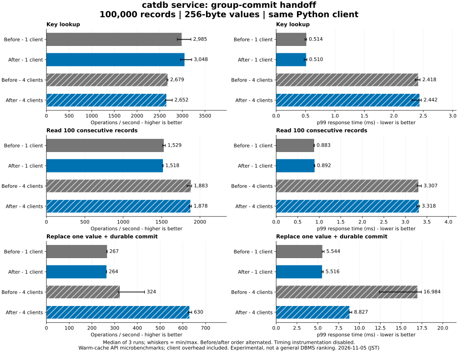

# Service group-commit follow-up — 2026-11-05 (JST)

**Experimental.** This is a paired API microbenchmark on the same workstation,
not a general DBMS ranking or a power-loss certification.

## Result

With four clients, median throughput increased from **324.1 to 629.9
operations/s (1.94x)** and median run p99 decreased from
**16.984 to 8.827 ms (48.0% lower)**.
Single-client update throughput was 266.6
versus 264.1 operations/s; its p99 was
5.544 versus 5.516 ms.
The full table and chart retain all read conditions and all repeat variability.

Bars are medians of three runs, whiskers min/max. p99 is calculated per run over
8,000 complete operations, then the three p99 values are summarized; samples
are not pooled. `max_ms` and all original samples remain in results and raw files.

| Workload | Clients | Variant | ops/s | p50 ms | p95 ms | p99 ms |
|---|---:|---|---:|---:|---:|---:|
| Key lookup | 1 | Before | 2,984.7 | 0.324 | 0.443 | 0.514 |
| Key lookup | 1 | After | 3,047.7 | 0.319 | 0.428 | 0.510 |
| Key lookup | 4 | Before | 2,679.2 | 1.466 | 2.089 | 2.418 |
| Key lookup | 4 | After | 2,651.5 | 1.468 | 2.145 | 2.442 |
| Read 100 consecutive records | 1 | Before | 1,528.7 | 0.643 | 0.792 | 0.883 |
| Read 100 consecutive records | 1 | After | 1,517.6 | 0.646 | 0.801 | 0.892 |
| Read 100 consecutive records | 4 | Before | 1,883.5 | 2.085 | 2.887 | 3.307 |
| Read 100 consecutive records | 4 | After | 1,878.2 | 2.101 | 2.888 | 3.318 |
| Replace one value + durable commit | 1 | Before | 266.6 | 3.845 | 4.485 | 5.544 |
| Replace one value + durable commit | 1 | After | 264.1 | 3.866 | 4.517 | 5.516 |
| Replace one value + durable commit | 4 | Before | 324.1 | 12.411 | 14.130 | 16.984 |
| Replace one value + durable commit | 4 | After | 629.9 | 6.246 | 7.000 | 8.827 |

## Cause and change

The old service enabled batching, but did not enable the existing handoff
coordinator. Arrivals could drain the queue into tiny groups while the preceding
group was still synchronizing. Those small groups then queued for the writer
lock and each required another synchronization.

The `service` Cargo feature now depends on `group-handoff`. One coordinator
collects the next group after the preceding group finishes, allowing requests
arriving during synchronization to stay together. The 32-request / 4 MiB bounds,
conflict validation, log records, sync-before-publication and success-after-sync
semantics are preserved. The existing 200 us budget subtracts time already spent
queued. No async acknowledgement, new storage format, or external source-code
copy is introduced. Embedded builds without `service` retain their defaults.

## Timing decomposition and observer overhead

The separate observer experiment alternates four variants three times with
8,000 updates at four clients. The diagnostics include response serialization
and client-side recording costs. Main chart runs have instrumentation disabled.
Numbers below are medians of three per-run measurements, not evidence that
small differences are statistically significant.

| Variant | ops/s | p99 ms | commits per sync |
|---|---:|---:|---:|
| baseline | 321.0 | 16.826 | not instrumented |
| baseline-diag | 337.1 | 16.580 | 1.044 |
| handoff | 620.8 | 9.035 | not instrumented |
| handoff-diag | 617.6 | 9.116 | 2.000 |

| Commit stage | Before, mean ms | After, mean ms |
|---|---:|---:|
| before_submit | 0.0009 | 0.0009 |
| batch_queue | 0.2473 | 2.7153 |
| batch_to_writer | 0.0001 | 0.0001 |
| writer_wait | 8.0600 | 0.0001 |
| validate_encode | 0.0081 | 0.0116 |
| write | 0.0121 | 0.0152 |
| sync | 3.0881 | 3.1563 |
| publish | 0.0057 | 0.0088 |
| release_notify | 0.0245 | 0.0363 |
| client_extra | 0.1695 | 0.2101 |

For baseline, enabling diagnostics changed median throughput by +5.0% and p99 by -1.5%.

For handoff, enabling diagnostics changed median throughput by -0.5% and p99 by +0.9%.

Instrumentation can alter arrival timing and group formation. An apparent
throughput gain with diagnostics is not evidence of negative overhead or zero
observer effect; the uninstrumented paired runs support the headline result.

`batch_queue` includes the coordinator handoff wait. `writer_wait` measures the
writer lock after group selection. Stage means, not stage p99s, explain the
commit path. `client_extra` includes network, parsing and scheduling and cannot
isolate network cost. Full-operation latency also includes begin and put.
See [all diagnostic distributions](observer/diagnosis.json),
[observer runs](observer/results.json), and the [trace definitions](../../../benchmarks/service-update/README.md).

## Conditions and verification

- Same original Python 3.12 client and operations: 100,000 records, 8-byte keys,
  256-byte values, 8,000 attempts, 1/4 clients, warm-up excluded. Closed-loop
  threads, disjoint update keys, warm cache. No scheduled concurrent checkpoint.
- Windows / Docker Desktop Linux (WSL2), Ryzen 9 5950X and approximately 128 GiB
  RAM. Each client/server has a 2-CPU quota and 4 GiB limit; no pinned affinity.
  Fresh named volumes on the same host. Shared workstation, not dedicated hardware.
- Baseline runtime sources: `1c22601` (identical engine to original comparison
  `60a67085f3f90cf8518106146d0c5a09e902ccbd`). Candidate uses this change's
  `service` feature at `a5dec6e`; see [build provenance](provenance.json).
  Immutable image IDs and source hashes are recorded in
  [environment.json](environment.json). Hashes describe the checkout at run start,
  not the historical baseline sources; variant images identify the actual binaries.
- Before/after order alternates, each six-case order is shuffled identically for
  the pair. All **288,000 operations**, **48 full-content checks**, including six
  restarts, passed. The separate observer run adds **96,000 operations** and
  **36 full-content checks**, including twelve restarts. No operation failed or
  was retried. Cross-variant all-value hashes match at every corresponding stage.
- Existing conflict, old-generation, count/byte limit, lone-request, sync failure
  and subprocess crash tests remain enabled. A deterministic test holds sync,
  checks that no uncommitted value or success is visible, then checks four
  commits in two syncs and exact values after reopen. Process crashes do not
  prove protection against power loss or storage firmware failures.

The [implementation CI](https://github.com/dhq-boiler/SilverHamu/actions/runs/41882479578)
passed on Windows and Linux, including protocol, C ABI and Clippy checks; the
container job also passed. Locally, the Linux Rust suite, 13 real-process service
tests, 30 C ABI checks and the concurrent diagnostic-timestamp test passed.
The deterministic sync gate covers the added handoff behavior; existing tests
remain the oracle for conflict and recovery semantics.

## What open-source implementations contributed

Concepts were compared; third-party implementation code was not copied.
References were checked on 2026-11-05.

- [PostgreSQL 18 WAL configuration](https://www.postgresql.org/docs/18/wal-configuration.html)
  explains grouping arrivals during a preceding flush even without an added
  commit delay. [XLogFlush](https://github.com/postgres/postgres/blob/REL_18_STABLE/src/backend/access/transam/xlog.c)
  waits for WAL ownership and rechecks whether another process already flushed
  the needed position. This supports measuring group formation before increasing
  fixed waits; it is not a claim that SilverHamu now implements PostgreSQL's WAL.
- [InnoDB 8.4 log writer/flusher source](https://github.com/mysql/mysql-server/blob/8.4/storage/innobase/log/log0write.cc)
  separates writing, durable flush progress and notification. SilverHamu retains its
  existing coordinator because a separate background flusher would add another
  lifecycle and failure path; that larger change is not justified by this result.
- [SQLite WAL](https://www.sqlite.org/wal.html) permits readers alongside a writer,
  but only one writer at a time. It remains a useful durability and read-isolation
  reference, rather than a template for multiple concurrent writer admission.

## Limits and next question

The old PostgreSQL and Oracle results are historical context, not rerun in this
paired experiment. The improvement does not establish that SilverHamu overtook them.
The original [all-product figures](../2026-11-05/README.md) remain unchanged and
show the old SilverHamu implementation. Storage synchronization still dominates the
remaining update time; this change does not make each sync faster. Higher client
counts, hot-key conflicts, production checkpoint load, other devices and an
independent client implementation require separate evaluation. Do not extrapolate
these Python-client numbers to an engine-only throughput ceiling.

[Reproduction commands](../../../benchmarks/service-update/README.md) ·
[Main raw results](results.json) · [Numerical summary](summary.csv)
