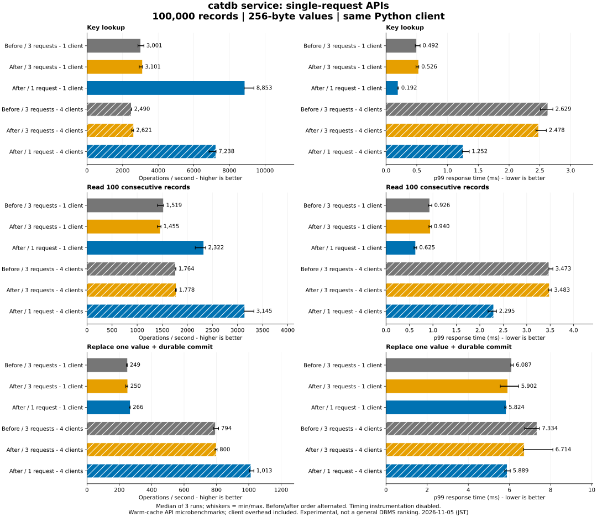

# Single-request service APIs and lightweight ping

Experimental warm-cache Python API measurements, 100,000 records / 256-byte
values. The regular append WAL, group-commit policy and durable acknowledgement
ordering are unchanged. Earlier product and fixed-log results are retained.

The same operation generator compares the old server, the new server's original
API, and the new server's one-request API. New calls perform the existing internal
transaction and validation path. Ping reads the version instead of computing
full database statistics. Neither change removes a durability barrier.

| Workload | Clients | Variant | ops/s | p50 ms | p95 ms | p99 ms |
|---|---:|---|---:|---:|---:|---:|
| Key lookup | 1 | Before / 3 requests | 3,000.9 | 0.322 | 0.420 | 0.492 |
| Key lookup | 1 | After / 3 requests | 3,101.4 | 0.308 | 0.428 | 0.526 |
| Key lookup | 1 | After / 1 request | 8,852.6 | 0.107 | 0.151 | 0.192 |
| Key lookup | 4 | Before / 3 requests | 2,490.4 | 1.567 | 2.271 | 2.629 |
| Key lookup | 4 | After / 3 requests | 2,620.6 | 1.495 | 2.148 | 2.478 |
| Key lookup | 4 | After / 1 request | 7,238.1 | 0.512 | 0.989 | 1.252 |
| Read 100 consecutive records | 1 | Before / 3 requests | 1,518.7 | 0.642 | 0.812 | 0.926 |
| Read 100 consecutive records | 1 | After / 3 requests | 1,454.6 | 0.675 | 0.831 | 0.940 |
| Read 100 consecutive records | 1 | After / 1 request | 2,321.7 | 0.419 | 0.537 | 0.625 |
| Read 100 consecutive records | 4 | Before / 3 requests | 1,763.9 | 2.223 | 3.084 | 3.473 |
| Read 100 consecutive records | 4 | After / 3 requests | 1,777.9 | 2.207 | 3.040 | 3.483 |
| Read 100 consecutive records | 4 | After / 1 request | 3,144.8 | 1.234 | 1.904 | 2.295 |
| Replace one value + durable commit | 1 | Before / 3 requests | 249.0 | 4.142 | 4.754 | 6.087 |
| Replace one value + durable commit | 1 | After / 3 requests | 250.0 | 4.115 | 4.771 | 5.902 |
| Replace one value + durable commit | 1 | After / 1 request | 265.6 | 3.885 | 4.475 | 5.824 |
| Replace one value + durable commit | 4 | Before / 3 requests | 794.1 | 5.015 | 6.020 | 7.334 |
| Replace one value + durable commit | 4 | After / 3 requests | 799.5 | 4.980 | 5.944 | 6.714 |
| Replace one value + durable commit | 4 | After / 1 request | 1,013.4 | 4.003 | 4.775 | 5.889 |

## Changes relative to the original server

| Operation | Clients | Throughput change | p99 change |
|---|---:|---:|---:|
| get | 1 | +195.0% | -61.1% |
| get | 4 | +190.6% | -52.4% |
| range100 | 1 | +52.9% | -32.5% |
| range100 | 4 | +78.3% | -33.9% |
| update | 1 | +6.7% | -4.3% |
| update | 4 | +27.6% | -19.7% |

Three repeats alternate variant order; error bars are min/max, not confidence
intervals. The legacy series exposes regressions or noise in unchanged operations.
One-request scans have a fresh snapshot each request; this workload performs only
one 100-row scan per transaction in every variant. Stable multi-page reads still
use the original transaction API. No request deduplication or automatic retry is
added. A missing commit response can still mean a committed transaction.

## Safety and compatibility

- 432,000 timed operations, 72 full-content checks and nine service restarts:
  values and paired hashes agree; all raw latency samples are retained.
- Protocol tests cover empty/missing values, CRUD, paging, active-transaction
  rejection without discarding changes, bounds, old snapshots, conflicts and
  four concurrent single-request writers followed by process termination.
- The service dispatch test holds synchronization, checks no early success or
  new-value visibility, then confirms the old reader remains stable. Subprocess
  tests terminate the single-request path immediately before/after sync and
  check previously acknowledged values and complete recovered updates.
- Existing engine tests cover persistence failure, partial WAL, conflict detection,
  resource budgets and recovery through the same commit implementation. Windows,
  Linux, fixed-log compatibility, C ABI and container tests passed in
  [implementation CI](https://github.com/dhq-boiler/catdb/actions/runs/41928761537).
- Actual power loss and faulty storage were not simulated. This is not a new
  durability certification or an across-product performance ranking.

## Reproduction and limitations

[Commands and adapter details](../../../benchmarks/single-request/README.md),
[raw results](results.json), [configuration and image IDs](environment.json),
[numeric table](table.md), [source/test provenance](provenance.json), and [service API contract](../../service.md).

The original client generator is unchanged. The single adapter removes network
begin/rollback calls and sends one mutation at commit; its conversion and local
staging remain in operation timing. Full-content checks use the old API for all
variants. Containers have the same 2-CPU / 4-GiB limits on a shared workstation.
No other host build or benchmark was run concurrently. CPU quotas, Python thread
scheduling/GIL and Docker networking affect these results. These are closed-loop
operations, disjoint update keys, warm cache and no scheduled checkpoints. The
results do not cover overload, mixed workloads, cold startup, long-lived readers
or larger-than-memory data. PostgreSQL and Oracle were not rerun.

## Auxiliary ping cost

Same 100,000 records, one ping per timed operation, 1,000 requests per case;
three repeats per mode and client count. Unlike the old ping, the new ping never
counts records or retained versions. This is an isolated workload, not background
healthchecks mixed with application traffic.

| Mode | Clients | Pings/s | p99 ms |
|---|---:|---:|---:|
| before | 1 | 371.1 | 4.648 |
| after | 1 | 8888.2 | 0.200 |
| before | 4 | 411.6 | 15.646 |
| after | 4 | 7629.0 | 1.061 |

[Ping raw results](ping/results.json): 12,000 requests, 24 full-content checks
and six restarts passed. Main-operation figures do not include these samples.
