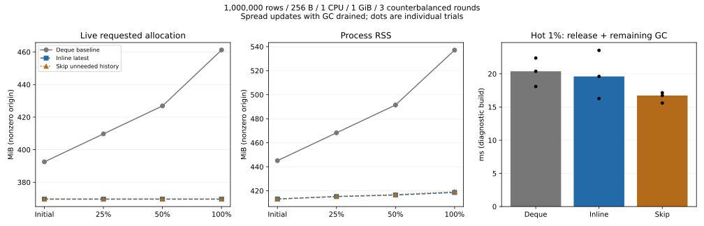
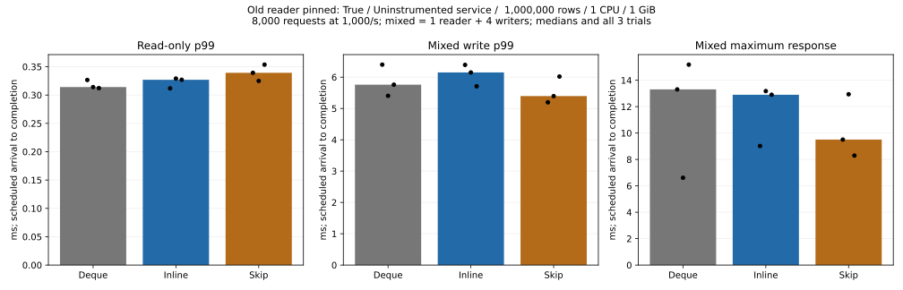
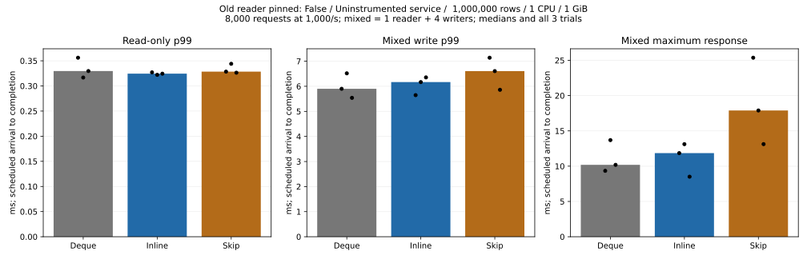

# Skip history creation when no transaction can read the old version

2026-11-06. Experimental `skip-unneeded-history` (implies `inline-latest`),
based on `f59bfda`. The default implementation remains the deque baseline.

## Results and adoption decision

The candidate demonstrably skips history creation when eligible, but remains
**opt-in**. The default deque path is unchanged. This test does not establish
a latency benefit in the eligible service cohort: its write-p99 median worsened
from 6.168 to 6.606 ms versus inline latest, and the median of trial maxima
worsened from 11.847 to 17.894 ms. There is no additional retained-memory saving.
These results do not justify default adoption; the cause of the timing change
is not uniquely identified. No sustainable-throughput ceiling was measured.

| Median of 3 trials | Deque | Inline latest | Skip history |
|:--|--:|--:|--:|
| Full-spread live requested MiB | 461.228 | 369.663 | 369.663 |
| Full-spread RSS MiB | 537.121 | 418.629 | 419.262 |
| Hot release + remaining GC ms | 20.384 | 19.602 | 16.733 |
| Spread reopen at 1 GiB, ms | 2566.004 | 2523.362 | 2495.102 |
| Pinned service write p99 ms | 5.759 | 6.150 | 5.395 |
| Unpinned service write p99 ms | 5.901 | 6.168 | 6.606 |
| Unpinned read-only p99 ms | 0.330 | 0.324 | 0.328 |
| Unpinned median trial maximum ms | 10.188 | 11.847 | 17.894 |

The spread workload skipped **128,117 histories** at the full-coverage
snapshot (individual trials: 128117, 128110, 128200). Exactly 128 of each
1,000-row batch can use the bounded retirement list; the small excess over
128,000 comes from preceding embedded latency windows. The held-old-reader
hot workload skipped **zero** histories before release, as required.



Compared with inline latest, post-GC memory stays at essentially the same level.
The intended saving is temporary work, not another major reduction in retained
heap. Hot-history GC call timings vary across trials and are not evidence that
the skip branch accelerated that ineligible phase. These timings sum release
and remaining GC calls, excluding the diagnostic scan between them.

Fully aged spread WAL reopens at 512 MiB succeeded **0/3, 3/3,
3/3** respectively. Failures are recorded OOM kills. All successful
reopens verify all keys and values; explicit checkpoints remain a separate stage.
See per-phase OOM outcomes and open times in [summary](summary.json).

### Service with the old reader held (control)



The eligibility condition is false during these requests. Differences here
cannot be assigned to avoided history allocation. Pin bookkeeping also changes
in the candidate, and storage/CPU/client timing varies; no causal decomposition
of these differences is claimed.

### Service without a long-held reader (supplement)



This cohort permits history skipping; short readers and pending writers can
still force fallback. The service fast-path hit rate is deliberately not
instrumented. Throughput is approximately the offered 1,000 requests/s, not an
engine-capacity measurement. Individual p99 and maxima are in the
[service table](service-table.md); bars are medians and dots show all trials.

**288,000 requests**, **0 queue refusals**,
**0 errors**; **249 full-content checks**
passed across the main memory/service trials. The 100k-row smoke trial is
recorded separately and excluded from these totals. The old-reader control
checks every changed key against the old snapshot as well as full current data;
the unpinned variant retains full current/restart checks but does not claim an
old-snapshot check during its timing window.

This bounded experiment is complete; default adoption and platform/product
rollout are separate work. No additional long exploration is scheduled here.
The key methodological finding is to check **whether an optimization can
actually activate in the benchmark** before interpreting timing differences.

## Mechanism and safety boundary

Only after successful log synchronization, under the state lock, consumed
accepted writers unregister their snapshots. Group commits unregister all
accepted writers before publication; other transactions, including readers that
started during synchronization, remain registered. The consumed transaction
remembers that it unregistered, so its destructor cannot remove another reader
at the same generation.

An existing latest value is replaced directly only if **no registered
transaction remains** and the key has **no history buffer**. This is deliberately
conservative: a reader on an unrelated key still prevents the optimization.
Existing histories, rejected group requests and bound exhaustion fall back to
normal append-and-GC. Tombstones and conflict validation remain intact.

Old values are detached into a retirement list bounded to **128 versions and
1 MiB per publication** (one oversized first value may progress, as in existing
GC). They are freed after releasing the **state lock**, before releasing their
logical memory charge. The writer-serialization lock remains held until the
commit path returns; this prototype does not claim to remove every writer wait.
Original worst-case admission checks are preserved, so this does not admit a
write that previously lacked retained-memory budget. Replay has no readers and
uses the same replacement logic. WAL bytes, the C ABI and service protocol do
not change. Optional HistoryMetrics diagnostics add the eligibility counter;
code constructing that diagnostic Rust struct must account for the new field.

## Benchmark design

Three variants, rebuilt from the same source tree:

| Label | Cargo features beyond common service/diagnostic features |
|:--|:--|
| before / Deque | none |
| after / Inline | `inline-latest` |
| skip / Skip | `skip-unneeded-history` |

Linux/glibc Docker Desktop; 1-CPU quota (not an isolated core), 1 GiB, swap disabled; 1M ordered 8-byte keys
and 256-byte values; retained budget 640 MiB. Seed creation uses 2 CPUs / 4 GiB
outside measured phases. Each variant has three repetitions, ordered
before/after/skip, after/skip/before, skip/before/after.

1. **Memory diagnostics:** spread updates at 25/50/100% and a separate hot-1%
   workload holding an old snapshot over sixteen updates. Existing batch size
   is 1,000, so the retirement bound limits the eligible spread-update subset.
   Count live requested bytes, heap history, RSS, skipped-history versions,
   explicit GC calls, and 512-MiB reopens before/after checkpointing.
2. **Original service control:** keeps an extra old reader pinned for the entire
   timed workload. This necessarily disables the new replacement path during
   those requests. It tests the fallback workload, not the optimization's speed.
3. **Supplemental unpinned service:** the same workload without that long-lived
   verification reader. Short per-operation readers and pending writers still
   protect their snapshots. Full verification after each phase and restart is
   retained; old-generation safety is also tested in control and Rust tests.

Both service cohorts have diagnostic counters **disabled**, 8,000 requests per
read-only/mixed phase, a scheduled 1,000 requests/s, bounded client queues,
4 read connections for read-only and 1 reader + 4 writers for 80/20 mixed work.
Latencies include scheduled-arrival and queue time. This offered load is not a
measurement of maximum throughput. A common 100-ms OS observer remains on;
no claim of negligible observation overhead is made. The service eligibility
hit rate is not instrumented; the unpinned cohort permits the fast path but
does not assert that every commit takes it. Compare variants within
each cohort; do not attribute differences between cohorts solely to the feature.

The memory probe's embedded timing remains in raw records but is not used for
service latency conclusions. `skipped_history_versions` is a cumulative eligibility
counter, **not** the number of allocator calls. It resets on open; replay can
increment it. A diagnostic `malloc_trim(0)` observation is separate from normal
operation and is never enabled as a production policy.

## Reproduction

```sh
python benchmarks/resource-envelope/skip_history_run.py --out artifacts/skip-history/raw
python benchmarks/resource-envelope/skip_history_report.py --input artifacts/skip-history
```

The output must be new. The runner builds six images, tests service/FFI, runs a
100k-row smoke test, then 18 main memory cases and 18 service cases sequentially.
Unique disposable containers, volumes and networks are cleaned up. Raw data
may be gzip-compressed; the report accepts both. Per-run command lines, source
hashes, limits and image IDs are in [raw](raw/); [schedule](raw/schedule.json)
identifies outer repetitions (child runner repetition numbers restart at 1).

Build the optional service with
`cargo build --release --features service,skip-unneeded-history`.
Default builds and the production Dockerfile remain unchanged.

## Validation and limitations

Windows Rust tests: candidate **150 passed / 11 ignored**, baseline **144 passed /
11 ignored**; Clippy passed for both.
Linux candidate service protocol: **23 passed**; C ABI: **35 passed**.
Client schedule tests: **6 passed**, including unpinned verification and corruption
rejection. Added engine tests cover readers starting during sync, same-generation
registration lifetimes in group commit, retained existing histories, 128/129
retirements, the 1-MiB exact/excess boundary, oversized first values and accounting
until actual release. Existing tests cover CRUD/reinsert, old generations,
point/range conflicts, capacity refusal, failed persistence, checkpoint and
child-process crashes. CI adds Windows/Linux diagnostic and fixed-log variants.

The memory budget is logical accounting, not an exact RSS limit. RSS includes
allocator retention; cgroup usage includes file cache and the observer. Actual
power-loss durability, Windows/mobile allocator performance, sustained CPU-bound
updates and service latency after whole-keyspace aging are not established here.
