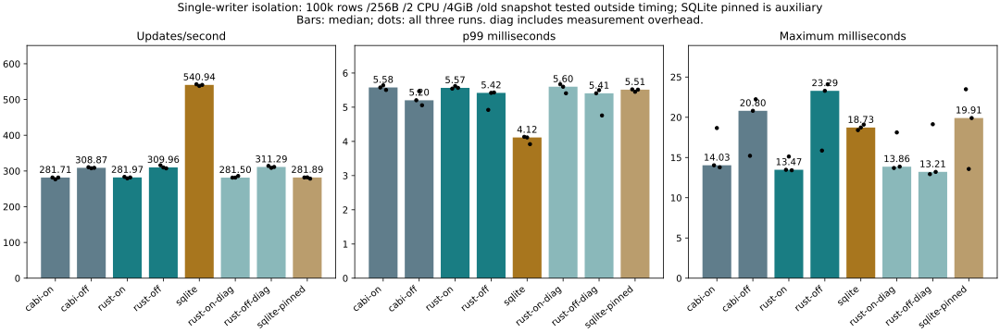
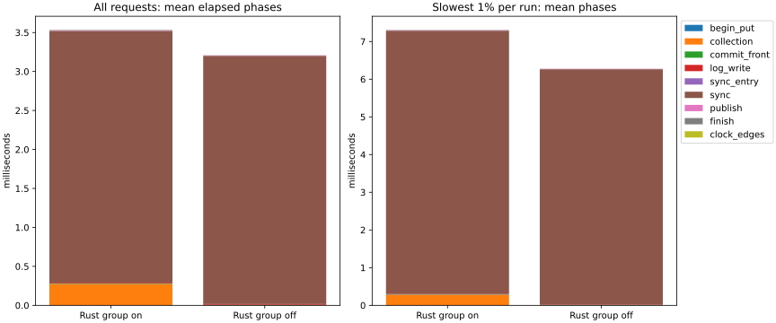

# Single-writer investigation — 2026-11-07

**Finding: durable log synchronization remains dominant; Python is not the large
gap. No engine or default setting was changed.** Current C ABI and direct Rust
throughput are close. Omitting group collection improves throughput about 10%,
but does not close the SQLite gap or consistently improve the maximum latency.

## Primary and observer results

100k rows /256B /one writer /2 CPU /4GiB; 8000 deterministic updates per case,
three repeats with reversed/rotated order and fresh Docker volumes. Primary timing
has no old reader; snapshot safety runs separately after timing. diag denotes
instrumented Rust builds, not a faster production mode. sqlite-pinned is auxiliary.
Throughput and p99 are medians; the maximum column is the worst of all three runs.

| Condition | Updates/s | p99 ms | Worst maximum ms |
|---|---:|---:|---:|
| cabi-on | 281.708 | 5.577 | 18.663 |
| cabi-off | 308.873 | 5.203 | 22.234 |
| rust-on | 281.966 | 5.565 | 15.122 |
| rust-off | 309.956 | 5.419 | 24.102 |
| sqlite | 540.943 | 4.116 | 19.087 |
| rust-on-diag | 281.496 | 5.599 | 18.115 |
| rust-off-diag | 311.289 | 5.407 | 19.132 |
| sqlite-pinned | 281.886 | 5.513 | 23.482 |

C ABI group on/off: 281.708 → 308.873 updates/s (+9.6%); Rust: 281.966 →309.956
(+9.9%). SQLite without an old reader reaches 540.943/s. C ABI/Rust differences
are much smaller than that gap; this does not measure exact language-boundary cost
by subtracting independent noisy runs. Unlike the earlier threaded product harness,
these primary loops execute directly in one thread with a precomputed identical
schedule. Do not pool these samples with the earlier report.

Removing group collection does not establish a maximum-latency improvement:
worst C ABI maximum rises 18.663 →22.234ms; Rust 15.122 →24.102ms. This is not proof
that the unchanged sync path causally regressed. All outliers remain visible.
Existing group-commit configuration can select the direct path, but concurrent
writers were not benchmarked here and no global default was changed.

## Same-request elapsed phases

| Mean elapsed phase, ms | Group on | Group off |
|---|---:|---:|
| begin_put | 0.000846 | 0.001205 |
| collection | 0.273127 | 0.000000 |
| commit_front | 0.007182 | 0.005224 |
| log_write | 0.010220 | 0.010125 |
| sync_entry | 0.000041 | 0.000032 |
| sync | 3.229993 | 3.184550 |
| publish | 0.004564 | 0.004818 |
| finish | 0.006171 | 0.002317 |
| clock_edges | 0.000063 | 0.000056 |

Group-on mean sync is 3.230ms (91.4% of sampled request elapsed time); group-off
sync is 3.185ms (99.3%). Collection accounts for 0.273ms with grouping. Actual
log write calls average about 0.010ms; begin/put and remaining non-sync work are
small. For the actual slowest 1% of requests per run, sync occupies 95.7% /99.5%
of the corresponding mean duration. These are matched request phases, not sums
of independently selected p99 values.

The sync interval includes time in sync_all, including OS blocking and scheduling.
It is not a measurement of physical disk service time or proof of its exact cause.
The commit_front interval includes coordination, locks, conflict validation,
encoding and reservation; finish includes post-publication destruction/return.

Rust diagnostic median throughput is 281.496/s with grouping and 311.289/s without,
versus 281.966/s and 309.956/s without instrumentation. p99 is 5.599/5.407ms versus
5.565/5.419ms. There is no consistent slowdown at this run resolution; that does
not mean measurement is free. Diagnostic group-on worst maximum 18.115ms exceeds
the plain group's 15.122ms. Primary conclusions use uninstrumented results.

## New lead: WAL lifecycle sensitivity

SQLite with the initial snapshot pinned for the timed loop falls from 540.943/s
to 281.886/s; p99 rises 4.116 →5.513ms. All three pinned trials are 278.6–282.2/s.
This is a sensitivity experiment, not an equally configured product-ranking row.
No SQLite engine-internal or syscall trace was collected.

SQLite documents that long readers can stop checkpoint progress and prevent WAL
rewind/reuse until the necessary readers finish. FULL still requests WAL sync on
every commit. See [SQLite WAL documentation](https://www.sqlite.org/wal.html).
That mechanism is a plausible explanation for the sensitivity, **not a proven
attribution**: checkpoint attempts, file growth, cache/locking and storage behavior
can all contribute. catdb's current Linux path appends its log; its production
space-reservation default is Windows-only. These facts suggest comparing durable
reuse versus extension directly, before changing persistence format or resuming
long OS-event searches. Prior fixed-log experiments needed an additional durable
end-record update; this result does not justify dropping that recovery safeguard.

## Integrity, boundaries and source

All 192,000 timed commits completed. Each of 24 runs verifies every initial value,
the full retained old snapshot after an additional committed update, the latest
values and ordinary close/reopen:96 full-content passes. Primary old-snapshot
checks occur after timing; the SQLite auxiliary holds its snapshot throughout.
All C ABI/SQLite hashes agree by repetition; Rust checks every key/value against
the same plan. Empty initial and missing-key cases are checked as well.

All 12 Rust runs record exactly 8000 sync attempts per timed cohort (96,000 total).
C ABI and SQLite syscall counts were not instrumented and are null, never zero.
The real sync remains in both catdb commit paths. Existing Rust library safety
tests passed 67, with 10 explicit performance tests ignored, including pre-sync
publication and persistence-failure behavior. Clippy passed with/without diagnostic
features. Three phase-validator tests reject impossible durations or ordering.
All 48,000 diagnostic records pass ordering and exact telescoping-sum checks.
This is not a new power-cut certification; the timing fixtures use ordinary reopen.

The same release source/default inline-latest build is used for direct Rust and
C ABI. Rust 1.89, locked dependencies; service feature links the same group code,
but no TCP service runs. Optional single-client-commit, wire-buffer, inline-key and
fixed-log are off. SQLite 3.40.1 uses WAL/FULL and automatic checkpointing, with
the existing 64MiB cache target. Fresh named volumes, no network, no Windows bind
mounted DB files. Workstation activity is not fully isolated.

The first smoke used a pinned snapshot for every case and was not treated as
publishable performance evidence. Formatting during that smoke caused a source
hash mismatch; checks were not relaxed. Sources were fixed, reader placement
corrected to match the primary workload, then an eight-condition smoke passed
before the main runs. All main conditions passed without retries or replacements.

## Reproduce

[Commands, phase definitions and scope](../../../benchmarks/solo-update/README.md).
[Environment and normalized source hashes](environment.json), [all trial summaries](summary.json)
and [all trial rows](table.md). Compressed trial JSON retains numeric latencies,
bounded diagnostic timestamps, synthetic content hashes and validation outcomes;
the three plan files contain only synthetic numeric keys/stamps. Full operational
logs remain local. Published images/metadata contain no generated credentials.

This investigation changes only benchmark code/documentation; it does not enable
new production behavior, alter the WAL, or weaken durability.
