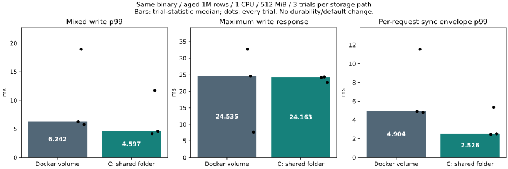

# Docker volume versus Windows shared storage (2026-11-06)

## Scope and decision

This compares **storage paths**, not physical disks or different database engines.
The same diagnostic executable/image runs on Linux under Docker Desktop/WSL2.
Only the DB mount changes: Docker named volume (**ext4**) versus a fresh C: folder
exposed through **9p/DrvFs**. The actual mount records, options, and DB image IDs
are retained for each trial. The engine and durability defaults are **unchanged**.

Both small-data pilots passed sync/readback, cross-process exclusive ownership,
old values, all-content verification, resource refusal/recovery, and forced-stop
reopening. Each runnable path then completed three main trials in alternating
order: volume/bind, bind/volume, volume/bind. Failed or adverse observations are
not replaced by medians. No kernel tracing was enabled during this comparison.

The shared path had lower write p99 in all three paired trials here; its median
was **26.4% lower** (6.242 to 4.597 ms). The median synchronization-envelope p99
was **48.5% lower** (4.904 to 2.526 ms). This is evidence of a storage-path effect
in this environment, not an engine optimization or a physical-device diagnosis.
However, median reopen readiness became **2.616 to 7.043 seconds (2.69x)**.
The third shared trial also had a worse maximum than its volume pair
(**22.671 versus 7.623 ms**). Do not choose a path from p99 alone.

All three shared trials' worst requests occurred at the start of mixed traffic;
their same-request sync envelopes were **21.596–23.237 ms**. Nevertheless, the
second shared trial's remaining-seven-second write p99 was still **11.689 ms**,
so excluding startup would not eliminate all variability. The second volume
trial also had adverse write p99 (**18.923 ms**), included below. This supports
comparing storage and startup behavior; it does not establish a stable tail bound.

## Main results

| Statistic | Docker volume | C: shared folder |
|---|---:|---:|
| Median trial write p99 | 6.242 ms | 4.597 ms |
| Worst write response across all trials | 32.687 ms | 24.335 ms |
| Median trial synchronization-envelope p99 | 4.904 ms | 2.526 ms |
| Median trial mixed read p99 | 0.380 ms | 0.349 ms |
| Median sampled mixed RSS peak | 420.16 MiB | 420.20 MiB |



| Trial | Write p99 ms | Write max ms | Sync envelope p99 ms | Mixed read p99 ms | Requests/s | Rejected | RSS MiB | CPU % | Throttled ms | Reopen ms | Syncs |
|---|---:|---:|---:|---:|---:|---:|---:|---:|---:|---:|---:|
| main-1-volume | 6.242 | 32.687 | 4.904 | 0.335 | 1000.01 | 0 | 420.16 | 10.43 | 0.000 | 2415.2 | 1595 |
| main-1-bind | 4.166 | 24.163 | 2.465 | 0.340 | 1000.04 | 0 | 420.22 | 10.68 | 0.000 | 7044.1 | 1597 |
| main-2-bind | 11.736 | 24.335 | 5.354 | 0.349 | 1000.04 | 0 | 420.20 | 10.84 | 0.000 | 6942.1 | 1582 |
| main-2-volume | 18.923 | 24.535 | 11.531 | 0.380 | 1000.03 | 0 | 420.16 | 10.56 | 0.000 | 2624.9 | 1579 |
| main-3-volume | 5.778 | 7.623 | 4.776 | 0.411 | 1000.04 | 0 | 419.98 | 11.84 | 0.000 | 2616.4 | 1600 |
| main-3-bind | 4.597 | 22.671 | 2.526 | 0.400 | 1000.04 | 0 | 420.07 | 10.72 | 0.000 | 7042.6 | 1597 |

| Trial | First-second write p99 ms | Remaining-seven-second write p99 ms | Worst request pre-call ms | Same worst request sync envelope ms |
|---|---:|---:|---:|---:|
| main-1-volume | 5.936 | 6.242 | 0.117 | 32.103 |
| main-1-bind | 18.605 | 3.627 | 0.132 | 23.109 |
| main-2-bind | 17.501 | 11.689 | 0.154 | 23.237 |
| main-2-volume | 23.855 | 5.665 | 0.106 | 11.843 |
| main-3-volume | 4.341 | 5.910 | 0.100 | 4.464 |
| main-3-bind | 16.233 | 4.184 | 0.126 | 21.596 |


The figure's middle bars are the **median of trial maxima**; the summary table
above reports the **worst across all trials**. Individual dots expose the spread.
Synchronization-envelope timing is request-local instrumentation around the
existing sync step. It includes scheduling/wrapper effects and can be shared by
grouped requests; it is not an independent physical-device latency measurement.
Raw request diagnostics also retain queue, batching, writer-lock, publication,
and reply phases. Aggregate CPU-throttled time must not be added to request time.

## Conditions and fairness

- Aged **1,000,000 rows**, **256-byte values**, identical seed-WAL hash across all
  main trials; each row updated once before the service opens, without checkpoint.
- Service limit **1 CPU / 512 MiB**, swap disabled; old read transaction held
  throughout each workload; one read worker and four update workers in mixed mode.
- **8,000 read-only requests**, then **8,000 mixed requests** per main trial.
  Mixed traffic offers 800 reads/s and 200 updates/s, total 1,000 requests/s,
  with bounded 64-entry per-kind queues. Throughput is offered-rate-limited, not
  a saturation maximum. Rejections and operation errors are retained.
- Same immutable image `sha256:cc279d6e087d3520f6b0754e66d579f3738e96d32b843761efdbc4c8467c91f9` with default inline-latest and
  `service,lock-timing,benchmark-metrics`. Both paths enable the same diagnostics
  and common 3-second readiness gate. This is not a production-build overhead test.
- DB files live on the compared mount; tokens, expected values, request records,
  stdout and resource samples live on a **separate named control volume in both**.
  Thus host-share telemetry writes are not silently added only to the bind case.
- Resource sampling remains charged to the service cgroup in both paths. Outside
  clients, host caches, Windows I/O and virtualization are not included in RSS.
  The 512-MiB service limit does not establish operation on a 512-MiB whole machine.
- Seeding/copying warms caches and occurs outside measurement; this is not a cold
  cache or isolated-device benchmark. Host activity is not fully controlled.
  Do not pool these runs with the earlier observer experiment, whose telemetry
  was stored alongside DB data.

## Safety and limits

Main runs contain **96,000 scheduled requests**, **30 full-content comparisons**,
six seed verifications, old-generation checks for every successful mixed update,
and six staged-budget refusal/recovery probes. The DB child is force-killed and
all values are verified after reopening in every trial. Pilot fixtures contain
1,000 rows and 200 requests per workload; they are excluded from main performance
statistics. Full counts and individual response/error records remain in raw data.

Before each workload suite, an exclusive new sentinel is written, fsynced, closed
and read back; a second server process must fail with the database ownership-lock
error while the first server remains open. Mount topology and available space
are recorded. New bind roots must not already exist; tests verify rejection
preserves a sentinel in an existing directory. No existing library was touched.
Only synthetic DBs were written under the explicitly new working folder.

These checks establish observable process-level behavior, **not equivalent
physical power-loss protection**. A successful Linux fsync on a Windows-shared
path passes through different host/filesystem layers. Faster acknowledgement
alone does not prove that both routes reach the same physical persistence point.
No sync was bypassed; the engine still acknowledges only after its sync succeeds.
Prior engine/API recovery and conflict tests remain applicable because the engine
binary did not change; the CI matrix also runs them on the new harness commit.

The work makes no automatic storage recommendation and changes no default.
A storage-path effect can motivate further host-side durability investigation;
it is not evidence that removing synchronization would be safe.

See [validation details](validation.md) and the retained raw results.

## Reproduction

The base repository commit was `998b888e9d89b8a9eb929e3dc1119181c922f2ac`.
Only the benchmark harness changed; binary/toolchain provenance remains in the
[preceding build record](../aged-sync-2026-11-06/build-record/binaries.sha256).
See [source hashes](raw/sources.json), [image identity](raw/image.json),
[exact commands and ordering](raw/schedule.json), and [summary](summary.json).

```powershell
python benchmarks/storage-path/test_paths.py
python benchmarks/resource-envelope/test_client.py
python benchmarks/storage-path/run.py --out artifacts/storage-path-NEW --bind-root C:/Git/NewDBMS/artifacts/storage-path-data-NEW
python benchmarks/storage-path/report.py artifacts/storage-path-NEW
# Re-analyze retained raw data without running workloads:
python benchmarks/storage-path/report.py docs/benchmarks/storage-path-2026-11-06
```

`catdb-aged-sync:profile` is the local immutable image from the preceding
experiment; build instructions are in its report. Both output roots must be new.
Owned Docker containers/volumes are removed by the harness. Bind DB files are
retained under the explicit working root for inspection; they are not source
files and are not committed. The published raw evidence uses deterministic gzip
for large request/resource streams. The report accepts compressed or plain data.
