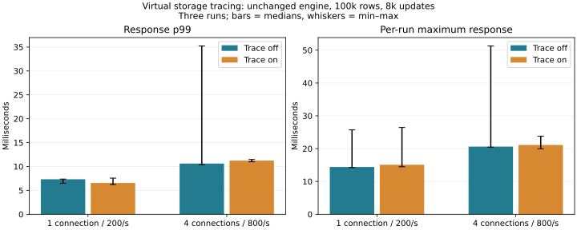
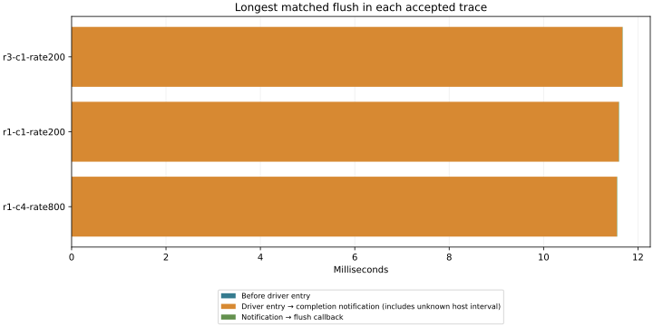

# Virtual storage completion stages — 2026-11-06

**This is an observer study, not a DB speedup.** The production engine, durability settings and defaults remain unchanged. The driver-side request can be followed across submission and completion; the host-internal interval remains opaque.

## Method and observer cost

100,000 synthetic records × 256 bytes, 1 connection at 200 offered requests/s and 4 at 800/s; 8,000 updates per case, three off/on repetitions with alternating order. Both variants use the same profile-enabled image. Fixed arrival rates measure response latency, not peak throughput. All 96,000 main updates committed, with no rejections or operation errors. Full-content checks follow each condition and restart. Preliminary 1,000-update cases are retained separately.

| Connections | Tracing | Median run p99 ms | Maximum across runs ms | Median updates/s |
|---:|---|---:|---:|---:|
| 1 | off | 7.334 | 25.709 | 200.0 |
| 1 | on | 6.556 | 26.447 | 200.0 |
| 4 | off | 10.615 | 51.264 | 799.6 |
| 4 | on | 11.240 | 23.778 | 799.6 |

## Same-request decomposition

The running WSL kernel BTF supplies the request size (240 bytes here); SCSI command pointers are converted using the [kernel PDU layout](https://raw.githubusercontent.com/torvalds/linux/v6.18/include/linux/blk-mq.h) and [SCSI conversion](https://raw.githubusercontent.com/torvalds/linux/v6.18/include/scsi/scsi_cmnd.h), then anonymized. Request dispatch serials distinguish reuse. The [Hyper-V storage driver](https://raw.githubusercontent.com/torvalds/linux/v6.18/drivers/scsi/storvsc_drv.c) is observed at queuecommand entry/return and scsi_done within channel callback context. This avoids nearest-time ownership assumptions.

Driver entry precedes the actual transport send; scsi_done follows receive processing. The middle span therefore includes preparation, transport, host/storage work, virtual CPU/interrupt delivery and receive work. It must not be relabeled physical disk time. A channel callback can service multiple completions; it is not a one-request ID.

| Accepted case | Matched flushes | Longest total ms | Before driver ms | Driver → notification ms | After notification ms |
|---|---:|---:|---:|---:|---:|
| candidate-profile-trace-r1-c4-rate800-normal | 4390 | 11.561 | 0.001 | 11.551 | 0.009 |
| candidate-profile-trace-r1-c1-rate200-normal | 15996 | 11.599 | 0.001 | 11.588 | 0.010 |
| candidate-profile-trace-r3-c1-rate200-normal | 15950 | 11.677 | 0.001 | 11.668 | 0.008 |

Accepted captures: 3/6. Invalid captures: candidate-profile-trace-r2-c4-rate800-normal: missing or missed probes; candidate-profile-trace-r2-c1-rate200-normal: missing or missed probes; candidate-profile-trace-r3-c4-rate800-normal: missing or missed probes. Invalid raw data are retained and excluded from causal interpretation; their client timing remains in the observer-cost comparison.

Each row splits the same longest flush, so its components can be compared directly. Different rows and the response maxima refer to different requests. Channel-entry timestamps, submission-return status and parent journal identities remain in the raw analysis. Submission return can occur after completion on a fast path and is not blindly subtracted as an earlier timestamp.

In this run, 36,336 flushes were matched in three accepted captures. The longest was 11.677 ms: 0.001 ms before driver entry, 11.668 ms until completion notification, and 0.008 ms afterward. Three of six traces had missed dynamic-probe instances (including completion/channel probes); complete three-repetition causal validation was not achieved. No extended or selective rerun was performed. The observer needs a more reliable event path before further fine-grained causal claims.

## Limits, safety and reproduction

No host ETW/physical-device correlation was recorded. The study cannot distinguish host queueing, physical storage latency and virtual interrupt/vCPU delivery inside the middle interval. Earlier 129-ms and 1.47-s events are not retrospectively explained. No application optimization or weaker synchronization is justified by this result alone. Variation and any negative observer effect are preserved.

Fifteen owned dynamic probes, a private trace instance, a 16 MiB/CPU ring (512 MiB capacity here), and a 180-second deadline bound capture. Missing probes, ring loss, unmatched stages and invalid ordering reject attribution. Pointer conversion uses validated BTF, not a guessed layout; raw pointers are anonymized before publication. Export-failure cleanup is tested, although forced process/VM termination can bypass cleanup.

Tests cover request reuse, retries, failure status, missing/duplicate events, CPU context isolation, shared receive callbacks, completion-before-return and malformed/ambiguous BTF. Existing Rust/service/C ABI tests retain snapshot, conflict and process-crash checks. They do not establish physical power-loss durability. Tests, builds and chart rendering ran after timing; small host source/document edits and reads occurred during measurement, and unrelated host/device activity was not fully controlled.

See [reproduction](../../../benchmarks/storage-stage/README.md), [validation](validation.txt), [results](results.json), [stage summary](storage-summary.json), [exact matched requests](storage-analysis.json.gz), [provenance](provenance.json) and [pilot](pilot/results.json).
