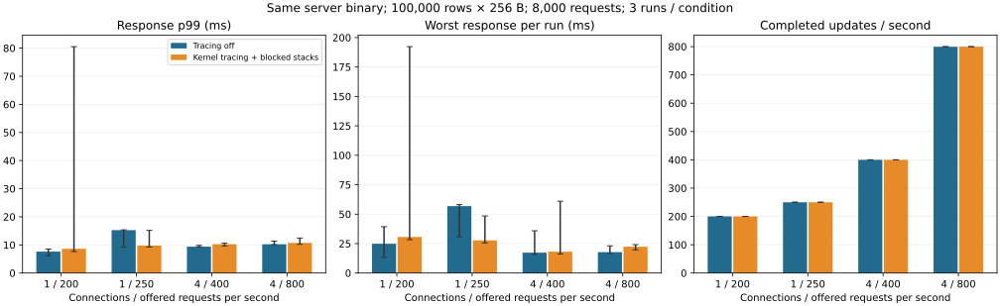
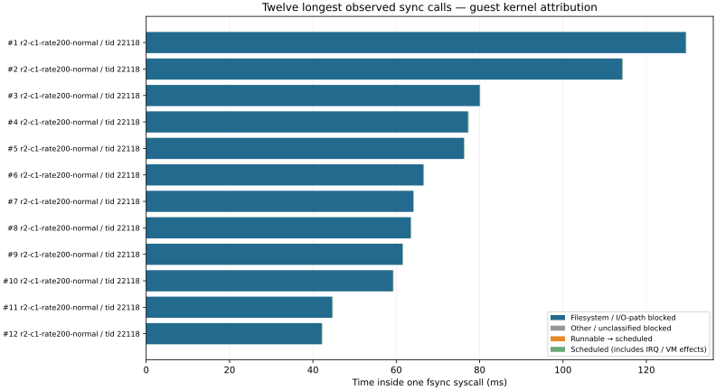

# Log-sync I/O-path versus runnable delay

The server, synchronization primitive and commit policy are unchanged. This is an observer-effect comparison and a kernel attribution study, **not a demonstrated reduction in maximum latency**. No earlier 1.47-second event is assigned a cause retrospectively.

## Conditions

100,000 synthetic records, 256-byte values, 8,000 offered updates per case; 1 connection at 200/250 requests/s and 4 at 400/800 requests/s; three runs per condition, tracing off/on order reversed on alternate repetitions. Both variants use the same `catdb-tail-profile:local` image and existing bounded application diagnostics. The only comparison variable is kernel tracing. Both keep 2-CPU / 4-GiB server and client limits, the 64-outstanding client budget and up-to-8 distinct-key batches. No artificial sync delay is injected in the main cohort. This measures warm-cache updates on the same Docker Desktop Linux guest, not native Windows storage.

Bars are medians of three runs, whiskers are min/max. Response includes scheduled arrival, client queueing, TCP and server work; rejected requests are excluded from latency percentiles and reported separately. All results, including unfavorable changes, are retained.

| Connections / offered rate | p99 off / on (median ms) | Largest response off / on (ms) | Completed/s off / on (median) | Rejections off / on |
|---|---:|---:|---:|---:|
| 1 / 200 | 7.629 / 8.625 | 39.354 / 192.286 | 200.003 / 200.007 | 0 / 0 |
| 1 / 250 | 15.266 / 9.762 | 58.075 / 48.441 | 250.000 / 250.004 | 0 / 0 |
| 4 / 400 | 9.381 / 10.260 | 35.915 / 61.006 | 399.894 / 399.960 | 0 / 0 |
| 4 / 800 | 10.235 / 10.715 | 23.111 / 24.117 | 799.467 / 799.736 | 0 / 0 |

## What the trace establishes

66,567 fsync calls matched the benchmark's synchronization counters exactly, with no missing wakeup/return pairs and zero reported per-CPU overrun, commit-overrun or dropped events. All twelve trace instances were stopped and removed. Text timestamps have microsecond precision; nanosecond fields represent that resolution, not nanosecond accuracy.

The longest captured syscall took **129.578 ms**: filesystem/I/O-path blocked **129.481 ms**, other/unclassified blocked **0.000 ms**, runnable-to-scheduled **0.014 ms**, scheduled **0.083 ms** (`candidate-profile-trace-r2-c1-rate200-normal`, guest TID 22118). These components belong to the same syscall; they are not independently selected maxima.

In that longest call, the journal-commit wait was 129.306 ms and the writeback wait 0.175 ms. Across all 66,567 observed calls, the largest total runnable delay within one sync was 0.287 ms. See [the exact finding and stacks](findings.json). These values characterize this cohort, not an upper bound for future scheduling delays.

A blocked interval is classified as filesystem/I/O-path only when its recorded stack contains `io_schedule`, `jbd2_log_wait_commit`, or the observed writeback wait helpers. A D-state alone is insufficient: the pilot also recorded D-state memory-map locks. Wakeup-to-switch-in and runnable preemption intervals are counted separately. A missing wakeup invalidates the attribution.

The I/O-path category is **not physical disk service time**. Journal commit waits include work and scheduling of journal/writeback workers; the trace does not separate their runnable delays, host Windows scheduling, virtualization or device firmware. Guest block issue/complete events are retained as context only: shared journal traffic, flushes and partial completions cannot be assigned to this WAL by temporal overlap alone. Scheduled time includes interrupts and possible host-vCPU descheduling.

Tracefs uses `mono`; the client uses the same guest monotonic clock. Only fsync entries inside the offered workload window are selected; returns and scheduler transitions are followed to completion. Kernel TIDs pair syscall/scheduler events directly. Exact sync-count agreement checks coverage, but this does not establish a one-to-one identity between a group sync and an individual network update.

## Decision and limits

No durability-relaxing change, priority boost, filesystem option or new batching delay was adopted. The captured stacks expose filesystem/journal waits, not a demonstrated application-lock fix. Prior append `fdatasync` and preallocation trials already failed to remove the sync floor; repeating them without a new hypothesis would not justify a default change. See the [earlier synchronization study](../log-sync-2026-11-05/README.md). Maximum-wait reduction remains unachieved.

The final collector adds a bounded 16-MiB-per-CPU ring (512 MiB on this 32-CPU guest), blocked-stack recording, global fsync/block tracepoints and target-name-filtered scheduler events. It polls its stop file every 100 ms. Trace dumping/compression happens after the workload. This costs memory and execution time even if a particular latency percentile improves by chance. Three repetitions on one shared workstation do not isolate every source of host variance.

## Safety and reproducibility

192,000 requests: 192,000 committed, 0 client admission rejections, zero operation failures. 36 full-content checks passed, including six service restarts. Timed cohorts did not overlap builds, test suites or chart rendering. Small host-side source/document edits and occasional reads of completed data occurred; other host activity was not fully controlled. Production files and PALV libraries were not used.

The production engine and service source were not modified. Existing safety tests and new attribution tests are recorded in [validation.txt](validation.txt); process-crash coverage does not prove real power-loss durability.

Use [the harness](../../../benchmarks/sync-os/README.md), [all numerical results](results.json), [environment](environment.json), [source/image provenance](provenance.json), [exact syscall partitions](kernel-analysis.json.gz), and each `candidate-profile-trace-*` directory for raw kernel traces and loss counters. The failed first pilot (collector name reuse and initially missing handler-thread filter) was corrected before the successful pilot and is excluded from the main results.

## Initial bounded-buffer attempt — retained, not silently discarded

The first complete 24-case cohort used 4 MiB per CPU. All workload checks passed, but five of twelve traced cases reported overwritten events (all single-connection cases). Their syscall attribution was rejected. The full cohort is retained in [initial-attempt/results.json](initial-attempt/results.json), with [invalid-case names](initial-attempt/loss-invalid-cases.json) and raw traces/loss counters. Its unfavorable latency results remain available; they are not pooled with the final 16-MiB-per-CPU comparison. Seven complete initial traces remain valid evidence, including a 70.099-ms sync with 70.043-ms I/O-path blocking and only 0.011-ms runnable delay. This is a different cohort from the figures above.

A single bounded retry repeated both off/on variants at the larger capacity. The export-failure path was also hardened between cohorts: injected trace-export failure now still disables events and removes the owned instance. This changes observer cleanup, not the DB or its successful commit path. Both measured-source archives preserve their respective collector versions.

The collector uses a unique trace instance, leaves global tracing settings untouched, and disables events/removes the instance after capture. Linux documents the [trace clocks, buffers and instances](https://docs.kernel.org/trace/ftrace.html) and [event filters and triggers](https://docs.kernel.org/trace/events.html).
