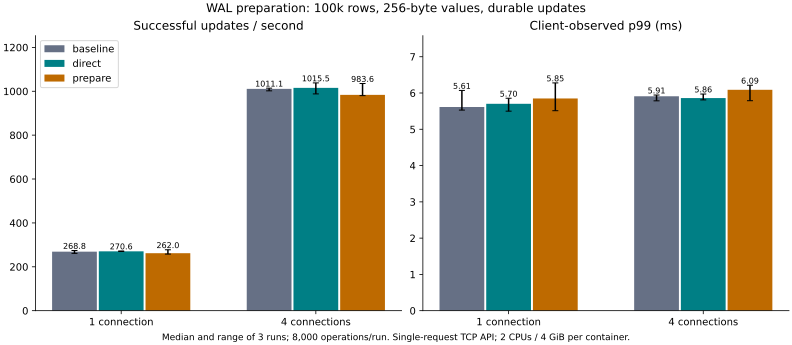
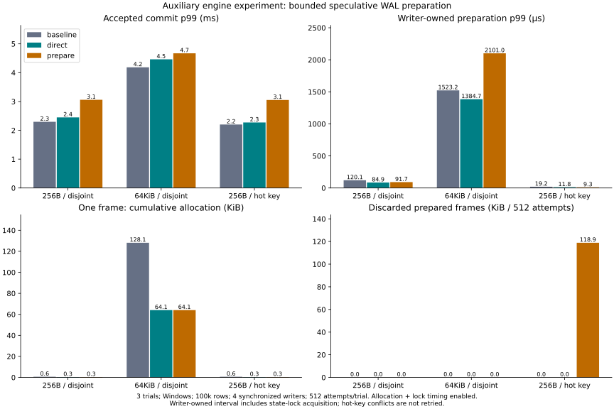

# WAL copy elimination and speculative preparation

**Decision: retain the existing default.** Both candidates remain opt-in experiments. Neither demonstrated a consistent end-to-end latency/throughput improvement in this workload. The direct encoder reduces allocation work, but that alone is not evidence of a faster commit. No durability or conflict checks were removed.

## Three variants

1. **baseline:** original server at `f6b1fa8`, builds a body vector then copies it into a framed WAL record while holding the writer/state locks.
2. **direct (`wal-direct`):** calculate frame capacity and append directly into one vector; no intermediate body copy. Final sequence assignment and checksum remain in the commit path.
3. **prepare (`wal-prepare`, implies `wal-direct`):** reserve buffer budget and encode sequence-independent bytes before entering the group queue or acquiring the single-writer lock. Once accepted, assign the real sequence and compute the body checksum. Preparation is discarded on conflict; successful responses still follow durable synchronization and publication.

The checksum covers the sequence number, so this prototype **does not precompute the final body checksum**. It does not write speculative frames to disk, publish provisional values or skip same-group earlier-update validation. The serialized bytes match the original encoder, including the existing prefix, checksum and seal. `wal-direct` and `wal-prepare` are disabled by default; the default encoder/commit ordering remain the original approach, with common frame acquisition factored into a helper.

## Main service comparison

100,000 synthetic records, 256-byte values, 1 / 4 connections, 8,000 durable single-record replacements per case, three trials per variant. The existing single-request `put_commit` client and operation generator are reused. Client/server each use 2 CPUs and 4 GiB in Docker, warm reusable connections, distinct writer keys and no scheduled checkpoint. The timing includes TCP, JSON/hex conversion and client Python scheduling. Allocation and lock instrumentation are disabled in these server binaries.

| Connections | Variant | Median successful updates/s | Median trial p99 ms |
|---:|---|---:|---:|
| 1 | baseline | 268.8 | 5.615 |
| 1 | direct | 270.6 | 5.703 |
| 1 | prepare | 262.0 | 5.850 |
| 4 | baseline | 1011.1 | 5.910 |
| 4 | direct | 1015.5 | 5.861 |
| 4 | prepare | 983.6 | 6.089 |

At four connections, direct changes throughput by about **+0.4%** and p99 by **-0.8%**, while preparation changes them by about **-2.7% / +3.0%**. Direct's single-connection p99 also worsens. Three noisy trials do not establish a statistically reliable speedup. Observed worst maxima are retained: four-client direct reached **26.283 ms** versus baseline **13.680 ms**, while the single-client baseline had an **85.026 ms** outlier. None of these observations is a worst-case guarantee.

All **144,000 service updates** succeeded without retry. Nine fresh service instances each passed initial, post-case and reopened full-content checks: **36 checks of all 100,000 records**. Trial two reverses variant order; case order is shuffled identically across variants. The [service environment](service-environment.json), [all run results](service-results.json), compressed individual latencies and [complete table](table.md) preserve every trial. No peer DBMS was rerun, so this does not update the product ranking.

## Auxiliary engine comparison

Separate instrumented Windows release binaries run the same current source in legacy/direct/prepared modes, with 100,000 initial 256-byte rows and four barrier-synchronized writers. Each trial has 512 attempts (128 per thread). Conditions are disjoint 256-byte values, disjoint 64-KiB values, and one hot key with 256-byte values. Each has three trials per variant. This is an engine diagnostic, not the Docker service benchmark.

The direct encoder reduces the isolated one-frame allocation count **5 → 1**. With a 3-byte test key, cumulative requested bytes are **648 → 312** at 256 bytes and **131,208 → 65,592** at 64 KiB. These counts include reallocations and are **not peak memory or RSS**. The separate full-frame encoding probe always uses the real sequence and checksum; it checks every frame against the original encoder. Full commit-thread allocation totals, including scheduling/group-leader work, are also retained in [summary.json](summary.json).

Despite fewer allocations, accepted-commit p99 in the 64-KiB cohort changed **4.185 → 4.462 → 4.670 ms** for baseline/direct/prepare; successful throughput changed **1627.9 → 1530.3 → 1587.3 updates/s**. In the small disjoint case, p99 was **2.295 → 2.448 → 3.058 ms**. These adverse results are part of the decision not to change the default.

The hot-key barrier intentionally makes all four transactions observe the same starting version: each trial accepts 128 and rejects 384 without retry. Preparation constructs 512 frames and discards **384 frames / 121,728 bytes**, or 75% of that prepared frame volume. Rejected attempts remain in the raw data and all-attempt p99; the figure uses accepted-commit p99. Lower rejection latency must not be confused with successful-write throughput.

The reported **writer-owned preparation interval** is existing trace point 3→4: after acquiring the writer mutex through validation, retained/buffer checks, frame finishing and log-space reservation. It includes state-mutex acquisition time; it is **not a pure state-lock hold timer** or an isolated serializer timer. Preparation did not consistently reduce it: the large-value interval rose from 1523.2 to 2101.0 µs at p99. This experiment does not identify the causal share of scheduling, allocation, log-space reservation or batching changes. Speculative work changes arrival timing, but its contribution to the regressions was not isolated.

Instrumentation is enabled only in the auxiliary binaries: thread-local allocation counting and lock trace timestamps. Commit timers include explicit speculative preparation, and then the real commit (whose preparation call is idempotent). Other database work on background threads is not counted by the committing-thread allocator. Total-throughput timing includes thread creation/staging/barrier waits; commit samples exclude staging and the barrier. Preparation times and discarded bytes are separately recorded. The instrumentation overhead was not independently quantified, so auxiliary timings must not be compared numerically with the uninstrumented service results.

Every auxiliary trial verifies the pinned old snapshot, the entire latest database against successful sequence-numbered updates, buffer release, and the entire reopened database. All 27 trials pass. Reservation peak includes setup and verification and is a lifetime high-water mark, not an isolated measure of speculative memory. No build or other test ran concurrently with either performance cohort. CPU affinity and host background activity were not controlled.

## Bounds and safety

Preparation is owned by the consumed transaction. The existing active-transaction limit bounds the number of such preparations, and the shared `BUFFER` budget is reserved before allocation. The group queue still has its existing 32-request / 4-MiB body bounds; **preparing callers outside the queue are bounded by active transactions and budget, not by the queue's 32 slots**. A full queue keeps the existing single-commit fallback, reusing the prepared frame. The conservative reservation is four times the transaction body plus frame overhead and 64 bytes per write. It is not reduced to measured allocations. This extra per-write allowance also applies to speculative single commits, so near-limit rejection can happen earlier than in the legacy path.

Dropped preparation frees its frame before releasing the buffer permit. Conflict checks still include write/read dependencies, ranges and earlier accepted writes in the same group. Preparation never assigns the final sequence, changes logical state, or issues a durable acknowledgment. Existing APIs and file formats remain compatible. Since preparation happens earlier, it can spend CPU on a transaction that will fail and can encounter resource exhaustion before later commit validation; it is an opt-in experiment, not a promise of identical error precedence under multiple simultaneous failure conditions.

Added tests cover byte-for-byte original encoding across mixed values/deletes, long keys and sequence boundaries; budget immediately below/at/above the preparation charge; repeat preparation and cancellation/drop releasing resources; preparation while the writer mutex is held without early visibility; conflict disposal and reopen; and same-group write/read/range rejection. Existing saved-write failures, partial logs, old generations, checkpoint and subprocess termination before/after sync tests run with the new variants.

Rust suite results: `service` **138 passed / 11 ignored**; `service,wal-direct` **138 / 11**; `service,wal-prepare` **142 / 11**; `service,fixed-log,wal-prepare` **153 / 13**; `service,commit-window,wal-prepare` **149 / 12**. Ignored cases include explicit benchmarks and crash helpers exercised by parent tests. With preparation enabled, **35 C ABI** and **18 service protocol** tests also pass. Clippy with `service,wal-prepare,lock-timing --all-targets` passes. Process termination tests are not proof of physical power-loss safety for every device.

## Reproduction and provenance

[Commands](../../../benchmarks/wal-preparation/README.md), [source/binary hashes](environment.json), [full table](table.md), and [auxiliary summaries](summary.json). Source archives here are LF-normalized; hashes also retain local compiled-file byte hashes. Main service baseline uses the archived parent commit; auxiliary legacy uses the candidate source's preserved legacy encoder and shared test harness. Actual server/client image IDs are retained. Both candidates stay opt-in, and this experiment is closed without extending the search merely to obtain a positive result.
