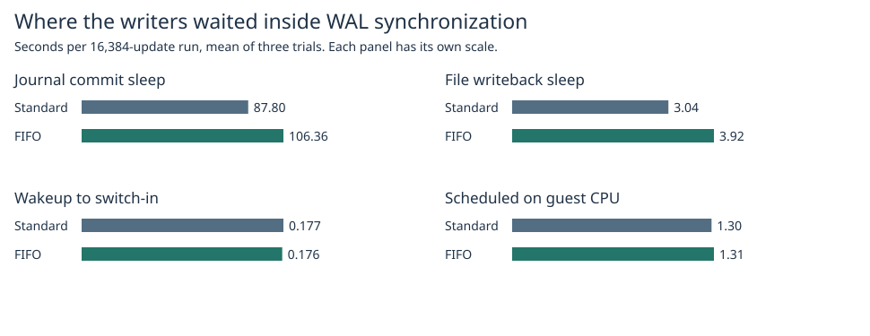
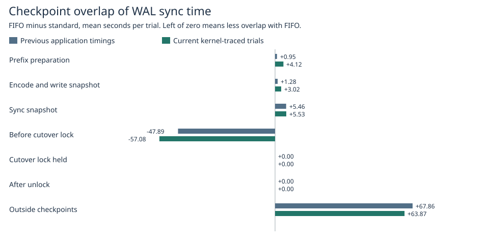
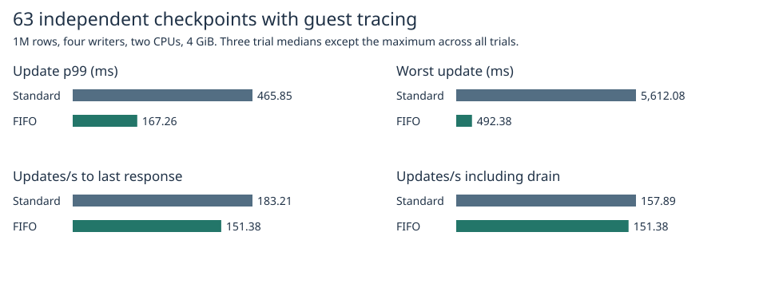

# Guest-kernel waits inside WAL sync

The previous equal-count experiment measured **+27.664 s** for FIFO minus standard in total application WAL sync per run. In this new six-run kernel capture, the difference was **+19.462 s**. Sleep in the ext4 journal-commit wait path accounted for **+18.558 s**, file writeback sleep **+0.885 s**, and wakeup-to-running delay **-0.001 s**. These are arithmetic-mean differences for 16,384 separately acknowledged updates. Journal-commit sleep contributed about 95.4% of the net increase in this capture. FIFO took longer in two of the three pairs and was faster in the third. The kernel events locate where elapsed time accumulated; they do not identify a physical drive, a FIFO-specific disk instruction, or the reason the shared journal completed later.

| Inside each application's WAL sync interval, mean seconds per run | Standard | FIFO | Difference |
|---|---:|---:|---:|
| Scheduled on a guest CPU | 1.2953 | 1.3109 | +0.0156 |
| Sleep: file writeback stack | 3.0394 | 3.9248 | +0.8854 |
| Sleep: journal commit stack | 87.8009 | 106.3584 | +18.5575 |
| Sleep: other io_schedule stack | 0.0001 | 0.0013 | +0.0011 |
| Sleep: no recognized I/O stack | 0.0000 | 0.0000 | +0.0000 |
| Runnable after wakeup | 0.1769 | 0.1758 | -0.0010 |
| Runnable after preemption | 0.0000 | 0.0000 | +0.0000 |
| Application time outside syscall markers | 0.0802 | 0.0835 | +0.0033 |
| Total | 92.3928 | 111.8547 | +19.4619 |

## Coincidence with checkpoint work

Each nanosecond belongs to one phase and one OS category. The phase differences below are FIFO minus standard, in seconds per run. The journal column is a subset of the new total. The earlier app-only traces allow a retrospective phase split, but provide no retrospective kernel stacks.

| Phase | Previous total difference | New standard | New FIFO | New difference | Of new difference: journal sleep |
|---|---:|---:|---:|---:|---:|
| Prefix preparation | +0.950 | 11.839 | 15.961 | +4.122 | +3.953 |
| Snapshot encode/write | +1.278 | 10.237 | 13.253 | +3.016 | +2.864 |
| Snapshot sync | +5.464 | 9.793 | 15.322 | +5.529 | +5.146 |
| After snapshot sync to final lock | -47.886 | 58.602 | 1.523 | -57.079 | -54.483 |
| Final writer-lock hold | +0.000 | 0.000 | 0.000 | +0.000 | +0.000 |
| Unlock to checkpoint return | +0.000 | 0.000 | 0.000 | +0.000 | +0.000 |
| Outside these intervals | +67.858 | 1.922 | 65.796 | +63.874 | +61.078 |

Prefix preparation, snapshot encoding/writing, and the snapshot sync overlapped a combined 12.67 s more writer sync time with FIFO. Time outside checkpoints rose by 63.87 s, while overlap with the interval from snapshot sync to final lock acquisition fell by 57.08 s. This interval includes preparation and waiting to obtain the writer lock. With the standard lock, other writers can continue syncing throughout this interval. A shift between this phase and time outside checkpoints does not show that the checkpoint itself issued the writer's I/O. WAL calls beginning during snapshot sync averaged 48.13 ms (standard) and 59.25 ms (FIFO), versus 6.00 ms and 6.21 ms outside checkpoint activity. Only about 192 and 246 of 16,384 calls per run began in snapshot sync. These start-phase means describe whole calls and differ from the exact interval intersections above. [Phase by scheduler state](cross.csv), [counts and durations grouped by the phase at syscall-wrapper entry](start-phases.csv), [previous application timings](previous-phase.csv).

## Application performance

| Metric under kernel observation | Standard | FIFO |
|---|---:|---:|
| Updates/s through last response | 183.21 | 151.38 |
| Updates/s including final drain | 157.89 | 151.38 |
| Update p99 (ms) | 465.85 | 167.26 |
| Worst update across trials (ms) | 5,612.08 | 492.38 |
| Logical KiB per update | 1,073.20 | 1,073.55 |

Each pair used 1M rows, 256-byte values, four independent writers, 2 CPUs, 4 GiB, no swap, prefix preparation and exactly 63 complete publications. Trial order alternated. All runs verified the pinned old snapshot, latest complete contents and the reopened generation. [Per-trial results](trials.csv), [image identities and sanitized events](raw/).

| Trial pair | Standard sync seconds | FIFO sync seconds | Difference | Difference in journal sleep | Difference in wakeup delay |
|---|---:|---:|---:|---:|---:|
| 1 | 68.450 | 104.388 | +35.938 | +34.180 | +0.0083 |
| 2 | 86.669 | 127.303 | +40.634 | +39.661 | +0.0071 |
| 3 | 122.060 | 103.873 | -18.187 | -18.169 | -0.0184 |

## Observer validation and limits

A separate collector used a private, bounded tracefs instance in the Docker Linux VM with a random name and filters for the four writer threads. Only the collector had SYS_ADMIN to mount tracefs. It used a read-only container, no network and no host PID namespace. Buffer capacity was 8 MiB per guest CPU with a 480 s collection deadline. No global tracing settings were changed. Switch-out stacks were requested for uninterruptible sleep. A journal sleep requires a jbd2 commit-wait stack, file writeback requires a matching writeback wait function, and the generic I/O bucket requires io_schedule. An unrecognized sleep remains unclassified. Direct physical I/O duration was not measured.

The analyzer pairs every application call with one successful fsync from the same uniquely named writer and kernel TID, in order, with independently bracketed CLOCK_MONOTONIC anchors at both ends of the run. Guest events have microsecond timestamps in this capture. A 2 µs edge tolerance applies only to rounding, and amounts outside the syscall remain explicit. All 98,304 full-run WAL calls matched; no clock-edge clipping was needed. The guest TID and container TID are recorded separately. Each partition must sum exactly to its application interval. Wakeup while still scheduled can occur before the switch-out; it adds no runnable time. Missing wakeup on a subsequent switch-in invalidates the capture. Zero per-CPU overruns and dropped events and cleanup of every instance are required. Switch-out stack collection itself can perturb the observed sleeps and scheduling. Scheduled time can include interrupts, tracer work or a guest vCPU that was descheduled by the host.

The preliminary 10k-row workload used 512 updates, 15 complete publications, two matched pairs per lock with trace order reversed. Plain runs retained the same application probes. Changes from plain to traced medians:

| Pilot median change | Standard | FIFO |
|---|---:|---:|
| Throughput through response | +0.4% | -3.0% |
| Throughput through drain | +0.6% | -3.0% |
| p99 | -84.7% | -5.6% |
| Per-trial maximum | +62.0% | -6.9% |

Tail latencies varied substantially in the short controls. Full-length performance values above include the observer; the pilot is not a calibration to subtract from them. The earlier +27.66 s is an independent, untraced observation. [Pilot trials](pilot-report/trials.csv), [pilot overhead](pilot-overhead.csv), [parser checks](checks.txt).

## Reproduction

Build the Rust test image and a Python observer image (the collector uses only Python's standard library and mount). Run from the repository root on a Linux Docker engine exposing sched_switch, sched_wakeup, sys_enter_fsync, sys_exit_fsync and switch stack triggers.

~~~sh
docker build -f benchmarks/scaled-gate/Dockerfile.fifo -t catdb-sync-partition .
docker build -f benchmarks/Dockerfile --build-arg EXTRA_FEATURES=,fifo-writer -t catdb-fifo-products .
python benchmarks/wal-sync-waits/test_partition.py
python benchmarks/wal-sync-waits/run.py --pilot pilot-source
python benchmarks/wal-sync-waits/partition.py pilot-source pilot-report
python benchmarks/wal-sync-waits/run.py full-source
python benchmarks/wal-sync-waits/partition.py full-source report
python benchmarks/wal-sync-waits/report.py report pilot-report docs/benchmarks/equal-publications-2026-11-07/raw
~~~

For publication, export.py sanitizes the guest event stream before analysis. It strips unrelated task names/IDs and file descriptors while preserving target identities, event order, monotonic times, sleep states and kernel wait symbols. The published raw/ and pilot/ directories can be passed directly to partition.py. Its matches/ output provides one row per request, including both thread IDs, absolute clock correspondence via the logged anchors, timing components and duration in each checkpoint phase. Builds and test logs: [library suite](suite.txt), [release library](release.txt). [Measured Rust source](https://github.com/dhq-boiler/catdb/tree/f86573b29683a844cdda1f4688f7cb22f7e4f0e4).
