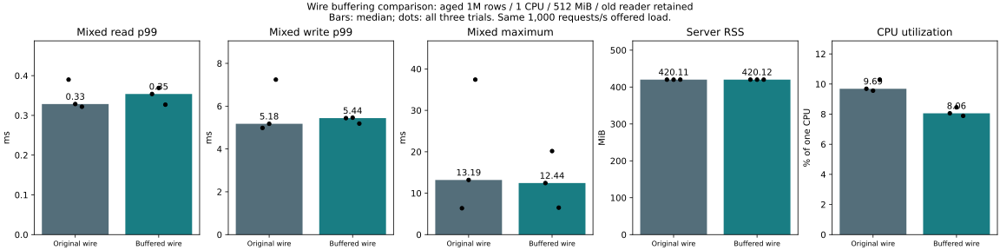

# Wire-compatible buffering experiment — 2026-11-07

**Decision: keep optional.** CPU usage fell in all three pairs, but neither mixed
read/write p99 nor ramp capacity improved consistently. No engine, log format,
durability rule or default feature was changed. Enable `--features service,wire-buffer`
explicitly; omit `wire-buffer` to return to original framing.

## What changed

Each connection reuses at most 4096 bytes of receive capacity and 4096 bytes of
send capacity. Larger buffers are discarded after success or error. Responses
serialize their four-byte length prefix and existing JSON body into one frame,
then use the same bounded partial-write/deadline loop. JSON content, authentication,
ordering, rollback on disconnect and sync-before-success semantics are unchanged.
At 256 connections the retained payload capacity bound is 2MiB; it is separate
from engine logical accounting and included in process RSS. Temporary larger
frames and JSON objects still allocate memory.

## Main comparison

Linux containers on Docker Desktop, Rust 1.89, locked dependencies, named Docker
volume, one CPU quota, 512MiB memory with swap disabled. Same aged synthetic 1M
rows with 256B values; every key had been updated once before reopening. Default
inline-latest is enabled; inline-key and timing/allocation diagnostics are off.
A pinned old reader spans each workload. Each of six trials offers 8000 read-only
requests and then 8000 mixed requests (four writers) at 1000 arrivals/s, with a
finite client queue. Order: baseline/candidate, candidate/baseline, baseline/candidate.
The workload's deliberately small 4096-byte staged-write budget is unchanged.
The 640MiB logical retained budget is not a physical memory guarantee.

All 96,000 main requests succeeded, with zero queue refusals or OOM kills.
Thirty full-content checks, six identical seed checks, 9600 updated-key old-reader
checks, six resource-budget recovery probes and six forced-stop/reopen checks passed.
Latency includes producer and client queue waiting. Fixed-rate throughput near
1000/s is not maximum capacity. CPU is measured from server cgroup usage over the
workload interval, expressed as percent of one CPU, excluding the load generator.

Median CPU fell 9.686% → 8.056% (-16.8% relative); RSS 420.109 → 420.121MiB.
Read p99 rose 0.329 → 0.354ms; write p99 rose 5.178 → 5.442ms. Worst observed mixed
response across all trials was 37.422 → 20.166ms, but the first two candidate
trials had worse maxima than their paired baselines. Three trials do not establish
an improvement in rare tails. Median reopen readiness was 2516.164 → 2516.469ms.

| Trial | Mixed read p99 ms | Write p99 ms | Mixed max ms | Requests/s | Queue refusals | RSS MiB | Cgroup MiB | CPU % | Reopen ms |
|---|---:|---:|---:|---:|---:|---:|---:|---:|---:|
| main-1-baseline | 0.390 | 4.983 | 6.368 | 1000.042 | 0.000 | 420.109 | 430.199 | 9.686 | 2515.479 |
| main-1-buffered | 0.354 | 5.442 | 12.445 | 999.929 | 0.000 | 420.105 | 430.059 | 8.056 | 2617.559 |
| main-2-buffered | 0.369 | 5.462 | 20.166 | 1000.036 | 0.000 | 420.129 | 430.598 | 8.453 | 2516.469 |
| main-2-baseline | 0.329 | 5.178 | 13.194 | 1000.032 | 0.000 | 420.016 | 430.426 | 9.560 | 2516.164 |
| main-3-baseline | 0.322 | 7.240 | 37.422 | 1000.008 | 0.000 | 420.121 | 429.734 | 10.293 | 2616.981 |
| main-3-buffered | 0.327 | 5.186 | 6.505 | 1000.041 | 0.000 | 420.121 | 429.754 | 7.886 | 2516.363 |

## Separate diagnostics

A warmed deterministic in-memory transport processed 10,000 get_latest-like
request parses and preconstructed 256B-value response serializations using the
same framing implementation. Allocation calls fell **9 → 5 per request** and
requested allocation bytes **2431 → 663**. Read trait calls stayed **2 → 2**;
write trait calls fell **2 → 1**. These are `std::io::Read/Write` invocations with
a full-transfer sink, **not kernel syscall counts or TCP packet counts**. JSON
object construction, actual network behavior and DB work are outside this probe.
The allocation-instrumented executable was never used for latency measurements.
[Diagnostic totals](diagnostic.json).

## Read-only ramp

One supplementary exploratory run per variant, same dataset/limits/old reader.
Stages offer 1000/2000/4000/8000 requests/s for ten seconds each. Stop on any
refusal/error or p99 strictly above twice the preceding stage; keep the failed
stage. Both passed 4000/s, then stopped at 8000/s with roughly 23% client queue
refusals. Both producers maintained the scheduled span, but this does not prove
the DB itself saturated: client workers, Python scheduling, network and server
all contribute. Queue p99 dominates the final stage; individual percentile
columns must not be added together. No standalone DB capacity claim is made.
All eight full-content checks and both forced-stop/reopen sequences passed.

| Variant | Offered/s | Completed/s | p99 ms | Maximum ms | Queue refusals | Producer p99 ms | Client queue p99 ms | Call p99 ms |
|---|---:|---:|---:|---:|---:|---:|---:|---:|
| baseline | 1000.000 | 1000.036 | 0.372 | 2.074 | 0.000 | 0.116 | 0.068 | 0.227 |
| baseline | 2000.000 | 1999.989 | 0.324 | 0.640 | 0.000 | 0.092 | 0.059 | 0.216 |
| baseline | 4000.000 | 3999.859 | 0.321 | 0.669 | 0.000 | 0.094 | 0.060 | 0.210 |
| baseline | 8000.000 | 6174.392 | 13.148 | 14.906 | 18201.000 | 0.723 | 12.071 | 1.504 |
| buffered | 1000.000 | 1000.041 | 0.330 | 1.632 | 0.000 | 0.088 | 0.065 | 0.204 |
| buffered | 2000.000 | 2000.017 | 0.295 | 0.868 | 0.000 | 0.063 | 0.057 | 0.200 |
| buffered | 4000.000 | 3999.888 | 0.408 | 4.017 | 0.000 | 0.122 | 0.069 | 0.236 |
| buffered | 8000.000 | 6138.915 | 12.571 | 14.184 | 18556.000 | 0.705 | 11.517 | 1.486 |

## Safety and compatibility

- Candidate Rust suite: 145 passed, 11 deliberately ignored performance tests;
  includes conflicts, retained snapshots, injected failures and crash recovery.
- Existing service protocol suite: 23 passed; two additional live TCP cases
  passed for fragmented authentication/coalesced requests and large-to-small
  values followed by reopening. Existing authentication and disconnect tests remain.
- New framing tests cover exact bytes/order, partial reads/writes, interruption,
  response/request limits, 4096-byte reuse boundaries, malformed/truncated JSON,
  stop/deadline, zero writes and recovery after errors. Two ramp decision tests passed.
- C ABI checks: 35 passed; baseline library: 63 passed. Clippy with warnings
  denied passed for both baseline and candidate.
- CI adds the optional feature on Windows and Linux and retains C ABI checks.
  Physical power loss is not simulated by process termination.

## Reproduction and evidence

[Harness and scope](../../../benchmarks/wire-buffer/README.md). Build both images
from this source with `benchmarks/wire-buffer/Dockerfile`, tagging
`catdb-wire:baseline` and `catdb-wire:buffered`; only the latter adds
`--build-arg EXTRA_FEATURES=,wire-buffer`. The Dockerfile uses the existing
`catdb-comparison:local` harness base. Run
`python benchmarks/wire-buffer/run.py --out artifacts/wire-new/raw` then
`python benchmarks/wire-buffer/report.py artifacts/wire-new`.
For diagnostics run each image's `wire-probe`. For ramps use
`benchmarks/resource-envelope/run.py --read-ramp` with the same row/resource/seed/
reader options as run.py. The optional ramp hook was added after the six main
trials; the ordinary runner branch is unchanged.

[Summary](summary.json), [ramp aggregates](ramp.json), [diagnostics](diagnostic.json)
and compressed numeric per-request files preserve all successful and rejected
outcomes. Published records contain only numeric timing/sequence fields and
operation/outcome enums; full local environment and operational logs are omitted.
Baseline image: `sha256:63a0ed10e0d38a8ed12f1f884f49a6a5820f206ef85eb33e694faf40ae7a74da`.
Candidate image: `sha256:c940278bff4dd6e7d84ed676af86f7fb7954ea740830d3bff0c2d469787cbc97`.
Post-measurement formatting and an empty-struct baseline wrapper adjustment do
not alter the wire algorithms. An initial source-edit attempt failed on local
text encoding and rustfmt first required installation; neither produced a
performance sample. All performance trials and unfavorable outcomes are retained.
