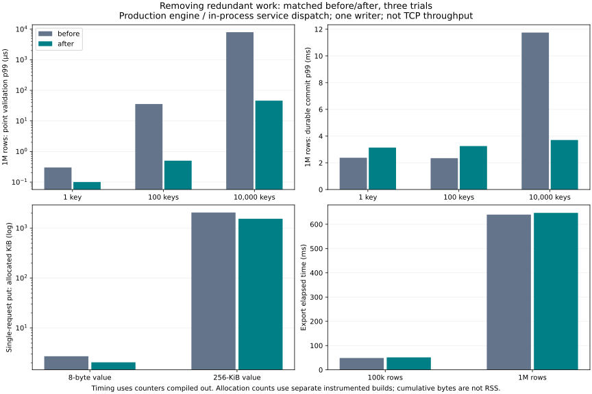

# Removing unnecessary work — first production batch

Baseline: `8b39b88`. The [cross-path audit](audit.md) found avoidable request copies, committed-row searches and unused dependency recording, plus larger candidates deferred for separate decisions. This batch changes three localized paths; it does not change public APIs, storage formats or synchronization guarantees.

## Changes and decisions

1. **Single-request JSON clone removed.** `dispatch` resolves the operation once and passes its name separately to the shared `dispatch_operation` body. The original request stays borrowed and unmodified; existing validation, response bounds and durable commit are reused. Retained: a 256-KiB `put_commit` saves **524,947 allocated bytes and nine allocation calls per operation** in the separate allocation run. This includes the former 512-KiB hex-string copy. Median trial p99 for the in-process durable request changed 8.570 → 4.334 ms, but the paired build includes the point guard too, so the entire latency delta is not attributed solely to JSON copying.
2. **Unchanged-generation point lookups removed.** Read/write dependencies skip committed-row lookup only when the committed sequence equals the transaction snapshot. Same-group earlier keys are still inspected, with the same conflict precedence. Retained: at 1M rows / 10k read dependencies plus one staged write, validation p99 fell **7.962 ms → 45.9 µs**, and durable commit p99 **11.750 → 3.706 ms**. The dependency sets are still traversed; this is not constant-time validation in their size. Advancing generations still use the original committed-row checks.
3. **Export uses the existing read-only transaction mode.** It retains snapshot pinning and output buffering but no longer stores an unused range dependency. Retained as a semantics/resource simplification, **not as a measured export speedup**: exactly one allocation and 194 requested bytes were removed for these bounds. Export elapsed time changed 48.605 → 51.166 ms at 100k and 639.843 → 646.950 ms at 1M. The gain is tiny relative to the full scan/copy/write. A regression test demonstrates valid export even with a dependency budget too small for the former unused record; buffer limits still apply.

Small operations do not uniformly improve: at 1M rows, commit p99 with 1 / 100 read dependencies changed **2.379 → 3.142 ms / 2.345 → 3.252 ms**, despite cheaper validation. Synchronization and system variability can dominate, but no causal breakdown establishes the source of these regressions here. They are not discarded or hidden. With only 64 samples, this commit p99 estimator is the maximum of each trial. The after 1-key trial maxima were 3.142, 2.314, 4.086 ms versus 3.017, 2.379, 2.249 ms before. No general service-throughput or worst-case latency improvement is claimed.



## Verification

- Added request-immutability and validation checks for empty/missing/invalid inputs, exact 256-KiB and over-limit values, scans, deletion and active-transaction rejection.
- Added point-dependency checks for both read and write conflicts, including same-group earlier keys and later committed update/deletion.
- Added export content/version/destination-protection checks with a one-byte dependency budget.
- Full Rust tests: **129 passed / 9 ignored** with `service`; **140 passed / 11 ignored** with `service,fixed-log`. Ignored entries include explicit benchmarks and subprocess helpers invoked by recovery parents. Existing tests retain same-group conflicts, old snapshots, resource rejection, partial writes, sync failure, process exit before/after sync, checkpoint and reopen checks.
- **30 C ABI** and **18 service protocol** tests passed, including acknowledged updates surviving process termination. Clippy and formatting checks passed. Process-exit checks are not proof against actual power loss.
- All **36 measured runs** succeeded: 24 engine runs checked every original current/reopened row, every exported snapshot value and old-snapshot absence of the newly written marker; 12 dispatch runs checked values and reopened contents. The engine workload does not rewrite original rows; broader old-value mutation semantics are covered by the safety suites.

## Measurement method

Both baseline and candidate use identical test-only benchmark modules. The normal release binaries compile allocation recording out using an absent `CATDB_ELISION_ALLOC` compile-time environment variable. Separate binaries built with that variable set count allocations on the calling thread; copies of all four executables are frozen before running. Time claims use the counter-disabled runs only. The test allocator otherwise forwards to `System`. This is not a live/peak/RSS meter: allocation bytes sum requested allocation sizes and full new sizes for reallocations, excluding deallocation and allocations on other threads.

There are three before/after trials in each condition, reversing order in the second trial. Time cohorts run before allocation cohorts; allocation-instrumented times are archived but are not used as speed results or a controlled observer-overhead estimate. No concurrent builds or agent tests ran during performance trials. The workstation/CPU/compiler, source hashes and executable hashes are in [environment.json](environment.json). Source hashes include LF-normalized hashes so Git's Windows newline normalization is verifiable.

**Engine:** 100k / 1M synthetic big-endian u64 keys and 8-byte values, seeded through durable batches of 4,096 records. For 1 / 100 / 10,000 read dependencies plus one staged outlying-key write, the benchmark takes 192 isolated `validate_commit` samples with the state mutex already held and 64 real durable commits. Dependencies are prepared outside the commit timer. Generation is unchanged at each validation; this deliberately qualifies for the shortcut. Group commit is disabled in timing, and same-group safety is tested separately. A pinned old read snapshot remains alive. Export saves all original rows in key order once per run, verifies the entire immutable file, then verifies the reopened transaction store. Larger buffer/retained budgets are specified for the full export.

**Service dispatch:** in-process calls to the real dispatch path with preconstructed JSON, a single key, 8-byte / 256-KiB values, 64 durable puts and 192 latest reads per size. Timers exclude TCP, framing, JSON parsing, response transport and request construction. Returned values and reopened contents are checked outside the timer. This isolates internal work and is not comparable to the earlier four-client network benchmark.

p99 uses nearest rank (`ceil(.99*n)-1`). Thus 64 samples produce a maximum, and 192 produce the second-largest sample. Chart/table values are medians of the three trial p99s, not pooled percentiles. Export has one timed operation per trial and is reported as median elapsed time, not a tail distribution. Fine timings are quantized at approximately 100 ns; no precise multiplier is inferred near that floor. Disk cache/CPU isolation were not controlled. All raw samples, including unfavorable runs and instrumented times, are included.

## Results

| Dataset | Operation | Dependencies / value bytes | Before p99 µs | After p99 µs | Before alloc calls | After alloc calls | Before allocated bytes | After allocated bytes |
|---|---|---:|---:|---:|---:|---:|---:|---:|
| 100000 | validate | 1 | 0.700 | 0.100 | 0.000 | 0.000 | 0.000 | 0.000 |
| 100000 | validate | 100 | 32.400 | 0.400 | 0.000 | 0.000 | 0.000 | 0.000 |
| 100000 | validate | 10000 | 4901.000 | 35.500 | 0.000 | 0.000 | 0.000 | 0.000 |
| 100000 | commit | 1 | 3601.500 | 2241.100 | 7.000 | 7.000 | 217.000 | 217.000 |
| 100000 | commit | 100 | 3653.300 | 2566.300 | 7.000 | 7.000 | 217.000 | 217.000 |
| 100000 | commit | 10000 | 6280.900 | 3360.900 | 7.000 | 7.000 | 217.000 | 217.000 |
| 100000 | export | 0 | 48604.900 | 51166.400 | 216673.000 | 216672.000 | 17303336.000 | 17303142.000 |
| 1000000 | validate | 1 | 0.300 | 0.100 | 0.000 | 0.000 | 0.000 | 0.000 |
| 1000000 | validate | 100 | 35.600 | 0.500 | 0.000 | 0.000 | 0.000 | 0.000 |
| 1000000 | validate | 10000 | 7962.200 | 45.900 | 0.000 | 0.000 | 0.000 | 0.000 |
| 1000000 | commit | 1 | 2379.300 | 3141.600 | 7.000 | 7.000 | 217.000 | 217.000 |
| 1000000 | commit | 100 | 2344.800 | 3251.500 | 7.000 | 7.000 | 217.000 | 217.000 |
| 1000000 | commit | 10000 | 11749.500 | 3705.600 | 7.000 | 7.000 | 217.000 | 217.000 |
| 1000000 | export | 0 | 639843.100 | 646949.900 | 2166671.000 | 2166670.000 | 172959242.000 | 172959048.000 |
| service | put_commit | 8 | 3005.900 | 2223.200 | 29.000 | 20.000 | 2763.000 | 2088.000 |
| service | put_commit | 262144 | 8569.600 | 4334.200 | 45.000 | 36.000 | 2099881.000 | 1574934.000 |
| service | get_latest | 8 | 1.800 | 1.400 | 14.000 | 7.000 | 1341.000 | 687.000 |
| service | get_latest | 262144 | 1201.300 | 1187.000 | 14.000 | 7.000 | 1312021.000 | 1311367.000 |

Timing columns: median of three trial p99s, except export (one operation per trial; median elapsed time). Allocation columns: median of the per-trial median operation count/bytes, from separate instrumented builds. Values are cumulative allocated/requested bytes, not live or peak memory.


[Full per-trial summary, including maxima](summary.json). The 36 compressed CSV files in this directory retain individual timings and allocation counts. All three changes were present in the candidate; isolated code paths and allocation differences give useful attribution, but this was not a full factorial experiment.

## Reproduce

From this commit's checkout, with Rust, Python and matplotlib:

```sh
cargo test --locked --features service -- --test-threads=1
cargo test --locked --features service,fixed-log -- --test-threads=1
python benchmarks/work-elision/build.py artifacts/work-elision-build-new
python benchmarks/work-elision/run.py artifacts/work-elision-build-new/binaries.json artifacts/work-elision-runs-new
python benchmarks/work-elision/report.py artifacts/work-elision-runs-new artifacts/work-elision-report-new
```

Use new output directories. The builder extracts the pinned baseline, adds only the shared measurement modules, and freezes time/allocation executables. The experiment leaves synthetic stores/snapshots for inspection; only measurements are published. No user libraries or PALV deployment were changed.

The audit records the next candidates: eliminating full-scan intermediate trees, repeated retained-growth computations and repeated staging lookups, and reconsidering explicit statistics scans. Those need their own invariants and measurements; this first batch does not imply they have been implemented. Previous reclamation regressions and retained durability checks remain relevant.
