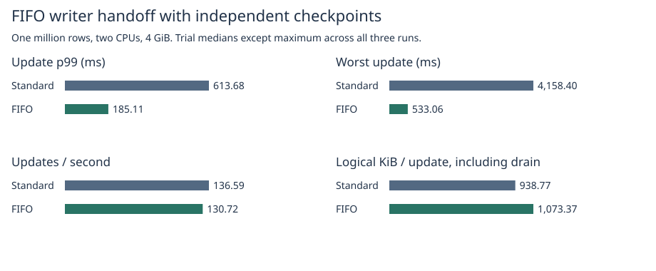
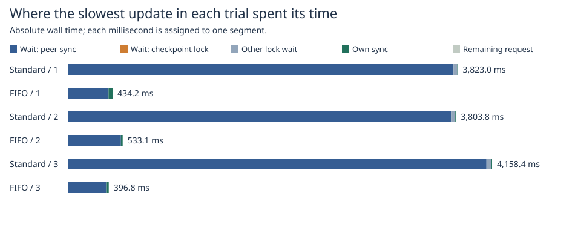
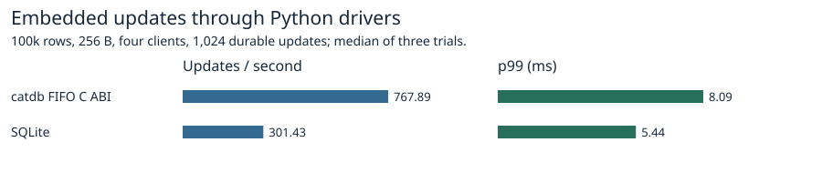
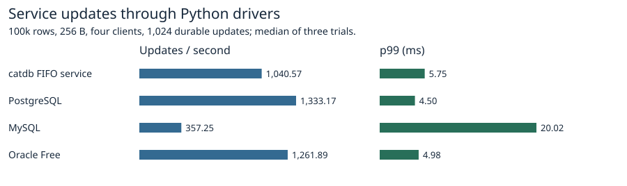

# FIFO handoff for the production writer lock

With prefix preparation and independent checkpoint scheduling enabled in both arms, the worst request across three trials changed from **4,158.40 to 533.06 ms**. Median update p99 changed by **-69.8%**, throughput by **-4.3%**. The longest request became shorter in 3/3 pairs, p99 became shorter in 3/3, and throughput increased in 1/3. The [previous 5,455.66 ms outlier](../independent-2026-11-07/README.md) was measured in a separate campaign. This comparison uses freshly run standard-lock controls. FIFO reduced both latency measures in every pair. It did not preserve median update throughput in this workload. Across the three trials, 232 standard-lock requests accumulated over one second of writer-lock wait versus zero FIFO requests. The default remains the standard mutex.

## Four continuous writers and an independent checkpoint thread

| Metric | Standard mutex | FIFO |
|---|---:|---:|
| Update p99, ms | 613.68 | 185.11 |
| Worst update, ms | 4,158.40 | 533.06 |
| Updates/s | 136.59 | 130.72 |
| Updates/s including final drain | 136.59 | 130.72 |
| Logical writes, MiB | 15,020.30 | 17,173.92 |
| Logical KiB/update | 938.77 | 1,073.37 |
| MiB per completed publication | 272.91 | 272.44 |
| Actual publications per trial | 51–55 | 63 |
| Coalesced of 63 triggers per trial | 8–12 | 0 |
| Requests with writer waits over one second, per trial | 70–84 | 0 |

All 16,384 requests run through the production WAL. Test-only markers timed the same phases on both sides. The two release test binaries share sources, compiler and container image; one enables the `fifo-writer` Cargo feature. Both enable the same 2,048-chunk checkpoint prefix, seed one million rows with 256-byte values, use two CPUs, 4 GiB and no swap, hold an old snapshot and drive four writers continuously. Each request time starts before transaction preparation and includes retries. Clock intervals are wall time. Medians are taken across three runs except the maximum across all trials. CSV policy labels off/on mean standard/FIFO; prefix is on in every run. [All trial statistics](trials.csv), [raw logs and image identity](raw/).

The worker receives one signal per 256 commits, through commit 16,128. A slow worker combines pending signals. Every trial handled the last signal. Per-publication writes and actual publication counts are shown separately because a throughput change under this scheduler combines handoff effects and the work performed by checkpoints. Total writes include committed WAL frames, replacement snapshots with copied tails, header rewrites and completed maintenance after the last response. They are logical writes; equal input and trigger counts do not imply equal numbers of rewrites.

## Attribution of the slowest updates

| Trial | Lock | Total ms | Retries | Writer wait ms | Wait overlapping other WAL syncs, ms | Other sync intervals | Wait overlapping final publication lock, ms | Own WAL sync ms |
|---:|---|---:|---:|---:|---:|---:|---:|---:|
| 1 | Standard | 3,822.96 | 0 | 3,817.27 | 3,779.84 | 612 | 0.00 | 5.57 |
| 1 | FIFO | 434.24 | 0 | 394.39 | 394.08 | 3 | 0.00 | 39.75 |
| 2 | FIFO | 533.06 | 0 | 515.77 | 515.49 | 3 | 0.00 | 17.15 |
| 2 | Standard | 3,803.80 | 0 | 3,797.35 | 3,756.06 | 589 | 0.00 | 6.11 |
| 3 | Standard | 4,158.40 | 1 | 4,151.69 | 4,103.42 | 691 | 0.00 | 6.60 |
| 3 | FIFO | 396.80 | 0 | 371.02 | 370.63 | 3 | 0.00 | 25.39 |

The longest standard-lock request overlapped **691 other sync intervals** while waiting to acquire the writer lock. The longest FIFO request overlapped **3** across 1 attempts. Its longest individual overlap was 500.87 ms. Overlap columns are subsets of lock wait, not extra time. A sync interval can include scheduler delays. The request trace starts its wait before queue registration; it does not separately resolve time spent acquiring the queue's internal mutex. [Per-trial maximum and p99 requests](request-phases.csv), [publication counts and hold times](checkpoints.csv).

## Semantics, safety and reproduction

Enable the experimental policy with `cargo build --release --features fifo-writer --lib` or add `fifo-writer` alongside `service` for the server. Without the feature the engine uses its existing standard mutex. The FIFO orders contenders by **registration at the database writer lock**. Single commits, group leaders (one turn per group), snapshot capture and final checkpoint cutover share the lock. A contended acquisition appends a waiter to the queue. Release signals its head, and a newcomer cannot claim an available lock while a waiter is queued. The uncontended path needs no waiter allocation. A panic in user work poisons the writer lock and wakes the queue through successive releases.

The controlled cross-path test queues a single commit, a prefix publication and a group commit in that order, verifies the generation during cutover and checks old and reopened values. Other tests cover no barging, panic with multiple waiters, point and range conflicts, persistence failure and child exits around WAL sync and checkpoint publication. Each timed run checks the full old view, latest values against commit order and full contents/generation after reopen. [FIFO release suite](raw/fifo-suite.txt), [default release suite](raw/default-suite.txt), [service, timing and fixed-log feature coverage](raw/features.txt).

~~~sh
docker build -f benchmarks/scaled-gate/Dockerfile.fifo -t catdb-writer-fifo .
python benchmarks/scaled-gate/run_independent.py --fifo --pilot pilot
python benchmarks/scaled-gate/run_independent.py --fifo raw
python benchmarks/scaled-gate/report_independent.py raw report
~~~

The reporter accepts original or published compressed logs. [Timed implementation revision](https://github.com/dhq-boiler/catdb/tree/706b0765d0b974ea39464b2f9d7b55255827c2f9).

## Fresh product benchmark

100k rows, 256-byte values, four clients, 1,024 synchronous single-key updates, three trials per engine. The catdb C ABI and server binaries **include the FIFO feature**. This separate workload has different checkpoint conditions from the million-row stress test. The runner checked the full digest after restart. [Medians](products.csv), [versions, settings and raw latencies](raw/products/).

~~~sh
docker build -f benchmarks/Dockerfile --build-arg EXTRA_FEATURES=,fifo-writer -t catdb-fifo-products .
python benchmarks/run.py --image catdb-fifo-products --single-request --four-updates --rows 100000 --ops 1024 --reps 3 --out products
python benchmarks/scaled-gate/report_prewrite_products.py --fifo products report
~~~
