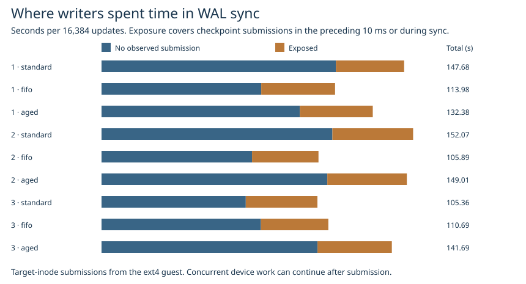

# Did checkpoint writeback explain the 150 to 112 updates/s regression?

Writer-lock legend: **Aged writer priority (16 ms)** (長時間待機優先). Trial data uses `aged`.

In the slow third pair, the aged writer priority policy **reduced** the number of WAL syncs preceded by checkpoint submissions. Of the extra 36.327 s inside WAL sync, 35.023 s (96.4%) accumulated across calls with zero observed target-file submissions in the preceding 10 ms and during sync. The change in submission frequency does not explain the throughput loss. Strict FIFO had the most prior exposure of the three policies in every pair and higher throughput than the aged writer priority policy in every pair.

| Third pair, 16,384 durable updates | Current | FIFO | aged writer priority |
|---|---:|---:|---:|
| Acknowledged updates/s | 150.10 | 142.51 | 112.05 |
| Update p99, ms | 475.26 | 69.64 | 134.92 |
| Longest update, ms | 6,678.13 | 309.03 | 369.49 |
| WAL sync time, s | 105.361 | 110.695 | 141.688 |
| Updates with submissions in the preceding 10 ms | 2,033 | 2,271 | 1,100 |
| Mean submitted MiB in that window per update | 0.971 | 1.080 | 0.524 |
| Updates with submissions during sync | 1,640 | 2,050 | 1,660 |
| Updates with neither exposure | 13,066 | 12,488 | 14,317 |
| Mean sync time for those updates, ms | 5.39 | 6.23 | 7.36 |
| Same writer lane as previous lock holder | 14,707 | 0 | 82 |

Acquisition order clearly changed. In the third pair a successful update immediately followed a checkpoint lock holder 58 times with the current lock and 126 times each with FIFO and the age threshold. None of those calls in any trial saw a target-file submission in the preceding 10 ms. Background writeback also occurs between checkpoint lock acquisitions. The during-sync counts alone can rise when sync gets longer.

## What repeated

Fixed prior exposure counts for current / aged writer priority were 511 / 1,586, 706 / 884 and 2,033 / 1,100 across the three pairs. In the first two, the candidate saw *more* prior exposure while total WAL time fell by 15.30 and 3.06 s. Within each of the nine runs, mean sync time was higher for calls with prior submissions. This within-run association does not explain the change between lock policies in the slow pair.

For the third pair, a two-group decomposition separates the changed number of exposed calls from changed mean durations in each group. Weighting the count change by the average of the two runs' group means accounts for −8.122 s. Changes in durations within groups account for +44.449 s, summing to +36.327 s. These are descriptive differences. A submission marker timestamps entry to the guest I/O path. I/O submitted earlier, unrelated activity, outstanding device work and host scheduling remain possible contributors. The nine independent runs did not manipulate any one of those factors.

**Decision.** Retain aged writer priority as an option for bounding long writer waits. The agreed condition for an additional checkpoint scheduling experiment was a reproducible increase in exposure explaining the slowdown. The observed direction reversed across pairs. No engine setting was changed or new performance gain claimed.

## Data and reproduction

This replays all nine continuous runs from the [original workload and integrity checks](../aged-load-2026-11-08/README.md), with 1 million 256-byte rows, four writers, 2 CPUs, 4 GiB, 8 MiB ext4 writeback and 63 publications each. The same trials verified the held snapshot and reopened state. All 147,456 acknowledged updates appear once, and per-run sync totals reproduce the original markers. No new crash behavior is introduced. [All nine comparisons and byte counts](summary.csv).

Each compressed CSV contains request and generation, current and prior lock holder (lanes 0–3 for writers, 4 for checkpoint, −1 for the first acquisition), checkpoint bytes in the two windows, and sync duration. Failed attempts participate in the acquisition sequence. The volume join matches checkpoint inode lifetimes, publication windows and the captured device. Both windows are half-open, using the monotonic clock calibration from the trace. A submission may appear in prior windows of several requests, so their byte counts must not be summed as physical write volume.

Run `python benchmarks/writer-overlap/attribute.py RAW/continuous OUT` against the original application and kernel logs, then `python benchmarks/writer-overlap/exposure_report.py OUT docs/benchmarks/aged-load-2026-11-08/trials.csv`. The second step reproduces the figure from the published compressed tables alone plus the prior trial summary. Run `python benchmarks/writer-overlap/test_windows.py` for window boundary and decomposition checks.
